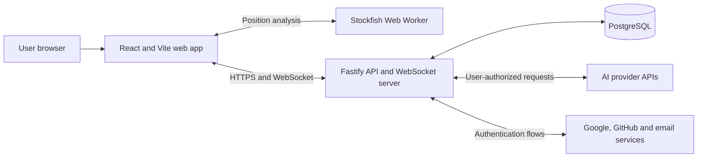

# Architecture

**Status:** Proposed baseline for MVP  
**Last updated:** 2026-09-02

## Architectural drivers

- A server-authoritative chess state prevents clients and models from creating illegal or conflicting moves.
- Four AI providers must behave through one normalized contract while retaining provider-specific capabilities.
- Bring-your-own-key credentials require strict storage, transport, and logging boundaries.
- Human games need realtime updates and reconnection.
- AI games deliberately stop when the controlling browser session is absent, so the MVP does not need a durable background-job platform.
- The stack should remain portable until a hosting platform is selected.

## System context



The web application never calls an AI provider directly. The API normalizes model discovery, capabilities, move requests, usage, errors, and redaction.

## Repository shape

The initial implementation is an npm workspaces monorepo:

```text
apps/
  web/          Pages, UI, client state, WebSocket client, Stockfish worker
  api/          HTTP API, WebSocket server, auth, game orchestration, providers
packages/
  chess/        Domain types and deterministic chess helpers
  contracts/    Runtime schemas and shared transport types
  database/     Drizzle schema, migrations, repositories
  config/       Shared TypeScript, lint, and test configuration
docs/           Product, architecture, roadmap, and ADRs
```

Packages expose intentional public entry points. The web application may import shared contracts and chess presentation helpers but not API repositories, provider clients, or credential code.

## Components

### Web application

Responsibilities:

- render the dark, responsive arena UI;
- collect provider/model/parameter configuration;
- hold session-only provider keys in memory;
- initiate exactly one AI turn at a time;
- maintain HTTP and WebSocket session state;
- run Stockfish analysis in a Web Worker without blocking rendering;
- send display-only evaluation results to the API for saved games;
- localize all user-facing text.

The client is not authoritative for legal moves, game results, authorization, participant identity, or room state.

### Fastify API

Recommended modules:

```text
auth          Better Auth integration and profile lifecycle
users         usernames, avatars, deletion, and history ownership
credentials   session credential handling and encrypted saved credentials
providers     OpenAI, Anthropic, Google, and OpenRouter adapters
games         game commands, reads, lifecycle, replay, and PGN
chess         server-side legality and result evaluation
rooms         invitation codes, membership, reconnection, and abort
realtime      WebSocket authentication, events, and connection registry
analysis      persisted Stockfish samples and post-game aggregates
```

Fastify route schemas validate external input and serialize explicit response shapes. Domain services do not depend on Fastify request objects.

### PostgreSQL and Drizzle

PostgreSQL is the durable system of record. Drizzle ORM defines the schema in TypeScript and Drizzle Kit produces reviewed SQL migrations. Use the latest stable release line; do not base the MVP on Drizzle v1 beta/RC relations APIs.

Core tables are expected to include:

| Table                  | Purpose                                                            |
| ---------------------- | ------------------------------------------------------------------ |
| Better Auth tables     | users, accounts, sessions, verification records                    |
| `profiles`             | unique username, avatar metadata, preferences                      |
| `provider_credentials` | encrypted key material and provider metadata                       |
| `games`                | mode, state, result, FEN, PGN, ownership, privacy, version         |
| `game_participants`    | human, guest, or AI seat configuration                             |
| `moves`                | canonical move, position, commentary, timing, evaluation           |
| `model_invocations`    | attempts, provider/model, parameters, usage, cost estimate, errors |
| `rooms`                | private invitation code, owner, membership, lifecycle              |
| `guest_sessions`       | expiring identity and active-game recovery metadata                |

Stable relational fields stay in typed columns. Bounded provider-specific parameter, usage, and error metadata may use `jsonb`. Provider keys never appear in JSON metadata.

Enforce one active or paused game per user or guest session with a database constraint where practical and an application-level check with a clear conflict response. Concurrent creation requests must not bypass this limit.

### Stockfish worker

Stockfish runs inside a browser Web Worker after every accepted move. Analysis is asynchronous and must not block the next visual update. The web app may persist evaluation score, mate distance, depth, and principal variation for replay.

Stockfish data is display and analysis metadata, not authoritative chess state. It is never included in an LLM prompt. Because client-computed analysis is untrusted, it must not later be reused for ratings, prizes, or security-sensitive decisions.

## Game command model

All game mutations are commands against a game version. The server validates:

1. requester identity and participation;
2. current game state;
3. expected side to move;
4. expected game version;
5. move legality;
6. resulting game state and termination.

The server persists the move and updated game state atomically. Duplicate or stale commands return the current state instead of appending another move.

For conflict handling, establish read authorization first, then check the accepted command ID and expected version before fresh-command lifecycle and current-seat checks. This lets an authorized retry return the current snapshot even when the accepted move changed the turn or completed the game.

Reconstruct the chess engine from the ordered, persisted UCI moves starting at the standard initial position. Current FEN alone cannot restore repetition history. Keep FEN, PGN, result, and termination reason consistent with this history; evaluate the [product's automatic draw policy](product.md#automatic-draw-policy) before allowing another turn.

### Deterministic domain and core contracts

`@neurochess/chess` wraps pinned `chess.js` 1.4.0 behind an opaque synchronous aggregate. `createGame()` creates the standard position in `configuring`; callers explicitly start it. Commands return either a defensive `ChessSnapshot` or a code-based domain failure, without transport identifiers, clocks, I/O, display text, or engine objects. Only active games expose playable moves. The internal lifecycle reducer handles start, pause, resume, abort, and completion. Trusted `resignHuman(losingColor)` and `recordTechnicalLoss(losingColor)` hooks require the caller to verify seat type, authorization, and retry policy.

`restoreGame({ moves, lifecycle })` requires the complete ordered UCI history and explicit lifecycle metadata. It replays the same move/adjudication path, rejects entries after a terminal outcome, and rejects lifecycle metadata that contradicts the replay. Paused, aborted, and non-board completion states are preserved. Session recovery must explicitly supply `paused` for unfinished active games; domain restoration does not infer browser presence. FEN, SAN, legal moves, and identity/commentary-free PGN are derived, never restored from cached strings. PGN's result header and final marker always reflect the domain result. Unfinished games use `*` with a null reason; aborted games use `*` with reason `aborted`.

Repetition uses occurrence counts keyed by the first four fields of the engine's normalized FEN, including legal en passant availability and excluding move counters. Do not substitute `chess.js` 1.4.0's repetition hash: it retains an en passant target when an adjacent pawn is pinned and cannot capture. A regression fixture demonstrates the resulting missed third occurrence. The adapter counts the initial position and every accepted move, rebuilding counts on restoration. The engine's half-move counter supplies the fifty-move threshold; specific predicates are evaluated in the [product-defined order](product.md#automatic-draw-policy), not through generic `isDraw()` or `isGameOver()`.

`@neurochess/contracts` independently defines strict Zod schemas for bootstrap, creation, route parameters, snapshots, move commands, and errors. Creation accepts only `{}`; it grants no sandbox privilege and does not select a public mode. Snapshots add a UUID `gameId` and nonnegative safe-integer `version` to domain data. Move commands contain `gameId`, canonical UCI `move`, `expectedVersion`, and UUID `commandId`. Clients reuse a command ID for retries of the same command. Version is an aggregate revision, not the number of plies: the application layer owns version advancement for persisted state changes, atomic writes, and deduplication. A `GAME_CONFLICT` error carries the current authorized snapshot for stale or duplicate commands; other errors cannot carry snapshots.

The two shared packages remain separate leaves. Their duplicated stable literals, database literals, and snapshot compatibility are checked in the API test suite. Contracts validate wire structure and lifecycle/result combinations, not chess semantics. Arbitrary-FEN fixtures are package-internal, outside production compilation and exports. HTTP orchestration and persistence are consumers of these packages, not dependencies of them.

### Persisted guest commands (PR 2)

Fastify exposes `POST /guest-session`, `POST /sandbox/games`, `GET /games/:gameId`, and `POST /games/:gameId/moves`. Routes validate strict request/response schemas and delegate to injected guest and game services. The game service composes the chess aggregate with database-owned repository interfaces; the database package does not import chess or contracts. The [development guide](development.md#sandbox-api) specifies the wire behavior.

PostgreSQL stores normalized `guest_sessions`, `games`, `game_participants`, and `moves`. The server creates an active standard-position game at revision zero, with a human White seat assigned to the owner and an unassigned human Black seat. An internal `is_sandbox` marker and enabled non-production policy are both required for the owner to control both seats. Ordinary-game ownership is not move authority; the current human seat must be assigned to the requester. No ordinary-game creation or joining route is introduced here.

Write transactions use `READ COMMITTED`, locking the guest row before the game row. A partial unique owner index enforces the active/paused slot; per-game unique ply, command ID, and move-version indexes defend accepted history. A move insert and all resulting position/result fields commit together, advancing the aggregate revision once. No provider call occurs inside these transactions.

Snapshot reads use a read-only `REPEATABLE READ` transaction so history and version come from one database view. The service restores ordered UCI history, checks persisted FEN/PGN and per-move projections, and rejects inconsistencies without repairing data or changing lifecycle. See [ADR-0006](decisions/0006-guest-owned-game-commands.md) for identity, authority, concurrency, and follow-up boundaries.

### AI turns

The browser requests one AI turn at a time. The API:

1. authorizes the requester and reserves the expected turn/version;
2. builds the canonical model context from server state;
3. resolves a session-only key from the request or decrypts an explicitly saved credential;
4. calls the selected provider adapter outside a long-running database transaction;
5. validates and normalizes the response;
6. retries model-invalid output at most twice;
7. commits the legal move only if the game version is still current;
8. returns the new state and normalized telemetry.

The reservation must be idempotent so multiple clicks, retries, or network duplicates cannot cause multiple moves. If the controlling tab disconnects, automatic turn requests stop and the game becomes paused.

### Human turns

Human moves use the same authoritative command path without a provider call. For online games, the accepted state is broadcast to both room participants over WebSocket. Reconnecting clients fetch a full snapshot before processing later events.

### Local development sandbox

Phase 1 provides an explicitly labeled development screen where one guest session controls White and Black in turn. It uses the real API, PostgreSQL persistence, chess rules, and reusable UI components through the shared command service.

- Enable the sandbox explicitly on the server in local development or tests; keep it disabled by default. Production configuration must reject attempts to enable it. Hiding a frontend route is insufficient.
- Mark sandbox games internally when the server creates them. Only their owning guest session receives authority over both seats. Clients cannot grant themselves this capability or apply it to ordinary games, and production game access must not recognize sandbox authority.
- Preserve every lifecycle, turn, legality, version, and atomic persistence check. Both-seat control never permits moving out of turn or changing an accepted position.
- Keep sandbox records in the development/test database. The sandbox creates no room, invitation, join flow, public spectator access, or additional public game mode.
- Start each sandbox game from the standard position. Special FEN positions are allowed only as internal test fixtures, never through a game-creation API.

Apply the [guest identity and ownership rules](#authentication-and-guest-sessions). The Phase 1 target is to restore an unfinished sandbox game as `paused` on refresh/reopening and require explicit resume. PR 2 deliberately provides read-only snapshots that preserve stored lifecycle; recovery and resume are the next slice. Completed or aborted records remain readable by their owning guest during the retained session, with replay and PGN export endpoints still pending. They do not become account history. The production guest retention period remains an open product decision.

## AI provider boundary

Each provider adapter implements equivalent operations conceptually:

```ts
interface AiProviderAdapter {
  listModels(input: ListModelsInput): Promise<ModelDescriptor[]>;
  requestMove(input: MoveRequest): Promise<NormalizedMoveResponse>;
}
```

`ModelDescriptor` includes capability metadata used to build a capability-aware configuration UI. The server filters unsupported parameters rather than sending speculative fields to a provider.

The normalized move response contains:

- required UCI move;
- optional viewer commentary;
- provider request identifier when safe to retain;
- latency;
- normalized token usage when available;
- raw provider usage fields in bounded, non-secret metadata;
- retry and error classification.

Model lists come from the selected provider through the API and may be cached briefly. A model being listed does not guarantee it supports the required chess response contract; adapters must surface capability or runtime errors clearly.

## Error taxonomy

Errors are classified before game policy is applied:

| Class                  | Examples                                      | Game effect                      |
| ---------------------- | --------------------------------------------- | -------------------------------- |
| `model_invalid`        | malformed payload, missing move, illegal move | retry twice, then technical loss |
| `provider_auth`        | rejected API key                              | pause                            |
| `provider_quota`       | quota, balance, or rate limit                 | pause                            |
| `provider_timeout`     | provider request timeout                      | pause                            |
| `provider_unavailable` | network or upstream failure                   | pause                            |
| `game_conflict`        | stale version or duplicate command            | refresh current state            |
| `authorization`        | user is not allowed to act                    | reject without changing game     |

Missing commentary is not an error.

## Authentication and guest sessions

Better Auth manages email/password, Google, GitHub, email verification, password reset, and authenticated sessions in PostgreSQL. Profiles add a unique username and avatar metadata.

Guests explicitly bootstrap an opaque 256-bit token in a host-only Secure, HttpOnly, SameSite=Strict cookie before creating a game. Only its SHA-256 digest is stored with an internal guest UUID. Bootstrap reuses valid identities; other endpoints reject missing or expired identities rather than creating replacements. Valid activity renews the configured inactivity expiry without rotating the token (24 hours by default). Exact-Origin POST enforcement and credentialed CORS complement the cookie policy. See [ADR-0006](decisions/0006-guest-owned-game-commands.md).

Temporary game metadata does not appear in durable history. Access expires now; automated deletion after inactivity and the production retention duration are follow-up work and must be resolved before production guest gameplay.

Guest identity, ownership checks on snapshots/commands/replay/PGN, and the active-or-paused game limit are required from Phase 1. A game ID alone never grants access. Phase 3 extends these foundations to authenticated users and durable private history.

After refresh, an AI game is restored as paused and requires explicit resume. Session-only key loss and mandatory re-entry are required when AI games arrive in Phase 2; an authenticated user's explicitly saved credential may be resolved through the saved-credential path introduced in Phase 3.

## Credential lifecycle

### Session-only credential

1. The browser accepts the key into in-memory state.
2. It sends the key over HTTPS only to provider-related API operations that require it.
3. The API uses it within that request and does not persist or log it.
4. Refreshing or closing the tab removes it; a restored game remains paused until re-entry.

### Saved credential

1. Only an authenticated user may opt in to saving a key.
2. The API encrypts the key with authenticated encryption before database insertion.
3. The database stores ciphertext and required cryptographic metadata, never the plaintext key.
4. The encryption key lives in deployment secret storage, separately from PostgreSQL.
5. Reads return masked metadata only. Decryption occurs only for an authorized provider call.
6. Users can revoke individual saved keys, clear credentials, or delete the account.

All request logging and exception reporting must redact credential fields, authorization headers, cookies, URLs with tokens, and provider secrets.

## Realtime rooms

The Fastify process owns active WebSocket connections. PostgreSQL stores canonical room and game state, allowing a client to reconnect after a connection loss or process restart.

MVP assumptions:

- one API instance is sufficient;
- no Redis dependency;
- invitation codes are random, unguessable, stored safely, and revocable;
- only an authenticated room owner can abort the room;
- an aborted game is retained for registered participants;
- games and rooms are private.

If the API is scaled horizontally, add a shared pub/sub or connection-routing layer through a new ADR.

## Telemetry and cost

Store operational metadata required by the product: provider/model, attempt number, duration, reported tokens, normalized errors, and estimated cost. Never store raw keys. Avoid storing complete raw provider payloads by default; retain the normalized move and user-facing commentary needed for replay.

Cost calculation uses provider-reported token counts and versioned pricing metadata when available. Every cost is labeled as an estimate. Unknown usage or price produces `unavailable`, not zero.

## API shape

The exact paths remain an implementation detail, but the API needs these capability groups:

- auth and profile management;
- provider model discovery and credential management;
- game creation, snapshot, command, pause/resume, abort, replay, deletion, and PGN;
- room creation, invitation resolution, join, reconnect, and abort;
- WebSocket snapshot/event protocol;
- history listing and account/data deletion.

Generate OpenAPI from Fastify route schemas. Version WebSocket event payloads through shared runtime schemas.

## Verification strategy

- Unit tests: chess state transitions, legal move validation, result rules, provider normalization, retry classification, cost calculation, and redaction.
- Integration tests: Fastify routes, Better Auth authorization, Drizzle repositories, migrations, credential encryption, deletion cascades, and idempotent AI turns.
- WebSocket tests: invitation join, move broadcast, disconnect/reconnect snapshot, owner abort, and unauthorized access.
- Provider contract tests: recorded or mocked responses for every adapter; no live paid calls in the default suite.
- End-to-end tests: the three game modes, guest restrictions, history/replay/PGN, responsive layouts, and key lifecycle.

Phase 1 acceptance must additionally verify:

- one guest completes a game through human commands, replays it, and exports PGN without loading a provider adapter; another guest cannot read or mutate any of these resources;
- sandbox creation/control paths are unavailable when disabled, production cannot enable them, and ordinary games never inherit authority over both seats;
- concurrent game creation respects the active/paused limit, completion or abortion releases the slot, and duplicate move submissions append only one move;
- refresh recovers an unfinished game paused, and resume preserves the full move history;
- repeating `g1f3 g8f6 f3g1 f6g8` twice from the initial position ends the game on the eighth half-move, including after database restoration between the cycles;
- internal fixtures verify the 99-to-100 half-move boundary, pawn/capture counter resets, repetition identity, and checkmate priority without exposing arbitrary-FEN creation;
- completed and aborted games reject new moves, and replay/PGN agree with the persisted result and termination reason.

## Deployment constraints

The web app can be hosted as static assets. The API hosting environment must support a long-running Node.js Fastify process and persistent WebSocket connections. PostgreSQL should be managed or backed up appropriately and reached over TLS. Both applications should be containerizable.

The exact providers, production region, email delivery service, object storage for custom avatars, observability service, and backup policy remain open decisions.
