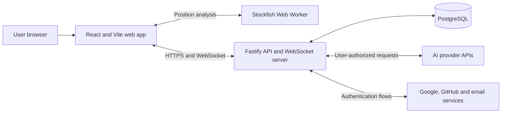

# Architecture

**Status:** Proposed baseline for MVP  
**Last updated:** 2026-09-07

## Architectural drivers

- A server-authoritative chess state prevents clients and models from creating illegal or conflicting moves.
- Four AI providers must behave through one normalized contract while retaining provider-specific capabilities.
- Bring-your-own-key credentials require strict storage, transport, and logging boundaries.
- Human games need realtime updates and reconnection.
- AI games deliberately stop when the controlling browser session is absent, so the MVP does not need a durable background-job platform.
- The stack should remain portable until a hosting platform is selected.

## System context



The web application never calls an AI provider directly. The API normalizes model discovery, capabilities, move requests, usage, errors, and redaction.

## Repository shape

The initial implementation is an npm workspaces monorepo:

```text
apps/
  web/          Pages, UI, client state, WebSocket client, Stockfish worker
  api/          HTTP API, WebSocket server, auth, game orchestration, providers
packages/
  chess/        Domain types and deterministic chess helpers
  contracts/    Runtime schemas and shared transport types
  database/     Drizzle schema, migrations, repositories
  config/       Shared TypeScript, lint, and test configuration
docs/           Product, architecture, roadmap, and ADRs
```

Packages expose intentional public entry points. The web application may import shared contracts and chess presentation helpers but not API repositories, provider clients, or credential code.

## Components

### Web application

Responsibilities:

- render the dark, responsive arena UI;
- collect provider/model/parameter configuration;
- hold session-only provider keys in memory;
- initiate exactly one AI turn at a time;
- maintain HTTP and WebSocket session state;
- run Stockfish analysis in a Web Worker without blocking rendering;
- send display-only evaluation results to the API for saved games;
- localize all user-facing text.

The client is not authoritative for legal moves, game results, authorization, participant identity, or room state.

The [AI setup flow](development.md#ai-setup-ui) keeps each seat's non-secret draft and discovered capabilities separate from its page-memory credential. Provider and key changes cancel obsolete discovery; requests cannot replace a newer seat catalog. Shared schemas validate provider lists, discovery results, and credential-free creation. The accepted handoff starts the shared [playback controller](development.md#ai-playback-ui) with separate AI-seat credentials, the versioned command session, operation gate, and paused recovery. AI-versus-AI is read-only; [AI-versus-human](development.md#ai-versus-human-ui) enables the configured human seat.

### Fastify API

Recommended modules:

```text
auth          Better Auth integration and profile lifecycle
users         usernames, avatars, deletion, and history ownership
credentials   session credential handling and encrypted saved credentials
providers     OpenAI, Anthropic, Google, and OpenRouter adapters
games         game commands, reads, lifecycle, replay, and PGN
chess         server-side legality and result evaluation
rooms         invitation codes, membership, reconnection, and abort
realtime      WebSocket authentication, events, and connection registry
analysis      persisted Stockfish samples and post-game aggregates
```

Fastify route schemas validate external input and serialize explicit response shapes. Domain services do not depend on Fastify request objects.

### PostgreSQL and Drizzle

PostgreSQL is the durable system of record. Drizzle ORM defines the schema in TypeScript and Drizzle Kit produces reviewed SQL migrations. Use the latest stable release line; do not base the MVP on Drizzle v1 beta/RC relations APIs.

Core tables are expected to include:

| Table                  | Purpose                                                            |
| ---------------------- | ------------------------------------------------------------------ |
| Better Auth tables     | users, accounts, sessions, verification records                    |
| `profiles`             | unique username, avatar metadata, preferences                      |
| `provider_credentials` | encrypted key material and provider metadata                       |
| `games`                | mode, state, result, FEN, PGN, ownership, privacy, version         |
| `game_participants`    | human, guest, or AI seat configuration                             |
| `moves`                | canonical move, position, commentary, timing, evaluation           |
| `game_commands`        | accepted command identity, kind, and aggregate revision            |
| `model_invocations`    | attempts, provider/model, parameters, usage, cost estimate, errors |
| `turn_reservations`    | durable command/execution ownership, revision, lease, and outcome  |
| `rooms`                | private invitation code, owner, membership, lifecycle              |
| `guest_sessions`       | expiring identity and active-game recovery metadata                |

Stable relational fields stay in typed columns. Bounded provider-specific parameter, usage, and error metadata may use `jsonb`. Provider keys never appear in JSON metadata.

Enforce one active or paused game per user or guest session with a database constraint where practical and an application-level check with a clear conflict response. Concurrent creation requests must not bypass this limit.

### Stockfish worker

Stockfish runs inside a browser Web Worker after every accepted move. Analysis is asynchronous and must not block the next visual update. The web app may persist evaluation score, mate distance, depth, and principal variation for replay.

Stockfish data is display and analysis metadata, not authoritative chess state. It is never included in an LLM prompt. Because client-computed analysis is untrusted, it must not later be reused for ratings, prizes, or security-sensitive decisions.

## Game command model

All game mutations are commands against a game version. The server validates:

1. requester identity and participation;
2. current game state;
3. expected side to move;
4. expected game version;
5. move legality;
6. resulting game state and termination.

The server persists the move and updated game state atomically. Duplicate or stale commands return the current state instead of appending another move.

For conflict handling, establish read authorization first, then check the accepted command ID and expected version before fresh-command lifecycle and current-seat checks. This lets an authorized retry return the current snapshot even when the accepted move changed the turn or completed the game.

Reconstruct the chess engine from the ordered, persisted UCI moves starting at the standard initial position. Current FEN alone cannot restore repetition history. Keep FEN, PGN, result, and termination reason consistent with this history; evaluate the [product's automatic draw policy](product.md#automatic-draw-policy) before allowing another turn.

### Deterministic domain and core contracts

`@neurochess/chess` wraps pinned `chess.js` 1.4.0 behind an opaque synchronous aggregate. `createGame()` creates the standard position in `configuring`; callers explicitly start it. Commands return either a defensive `ChessSnapshot` or a code-based domain failure, without transport identifiers, clocks, I/O, display text, or engine objects. Only active games expose playable moves. The internal lifecycle reducer handles start, pause, resume, abort, and completion. Trusted `resignHuman(losingColor)` and `recordTechnicalLoss(losingColor)` hooks require the caller to verify seat type, authorization, and retry policy.

`restoreGame({ moves, lifecycle })` requires the complete ordered UCI history and explicit lifecycle metadata. It replays the same internal move/adjudication path without constructing intermediate snapshots; PGN, legal-move lists, and defensive history copies are projected only when a snapshot is requested. It rejects entries after a terminal outcome and lifecycle metadata that contradicts the replay. Paused, aborted, and non-board completion states are preserved. Session recovery restores the persisted lifecycle before submitting an explicit pause command; domain restoration does not infer browser presence. FEN, SAN, legal moves, and identity/commentary-free PGN are derived, never restored from cached strings. PGN's result header and final marker always reflect the domain result. Unfinished games use `*` with a null reason; aborted games use `*` with reason `aborted`.

Repetition uses occurrence counts keyed by the first four fields of the engine's normalized FEN, including legal en passant availability and excluding move counters. Do not substitute `chess.js` 1.4.0's repetition hash: it retains an en passant target when an adjacent pawn is pinned and cannot capture. A regression fixture demonstrates the resulting missed third occurrence. The adapter counts the initial position and every accepted move, rebuilding counts on restoration. The engine's half-move counter supplies the fifty-move threshold; specific predicates are evaluated in the [product-defined order](product.md#automatic-draw-policy), not through generic `isDraw()` or `isGameOver()`.

`@neurochess/contracts` independently defines strict Zod schemas for bootstrap, creation, route parameters, snapshots, move commands, and errors. Sandbox creation accepts only `{}`; its body grants no sandbox privilege. Separate AI creation schemas accept independent White/Black configurations or a human color and one AI configuration, never client-selected authority or positions. Snapshots add a UUID `gameId` and nonnegative safe-integer `version` to domain data. Move commands contain `gameId`, canonical UCI `move`, `expectedVersion`, and UUID `commandId`; AI turn commands omit `move` because the server obtains it from the adapter. Clients reuse a command ID for retries of the same command. Version is an aggregate revision, not the number of plies: the application layer owns version advancement for persisted state changes, atomic writes, and deduplication. A `GAME_CONFLICT` error carries the current authorized snapshot for stale or duplicate commands; other errors cannot carry snapshots.

The two shared packages remain separate leaves. Their duplicated stable literals, database literals, and snapshot compatibility are checked in the API test suite. Contracts validate wire structure and lifecycle/result combinations, not chess semantics. Arbitrary-FEN fixtures are package-internal, outside production compilation and exports. HTTP orchestration and persistence are consumers of these packages, not dependencies of them.

### Persisted guest commands

Fastify exposes guest bootstrap, sandbox and AI creation/discovery, snapshots, human and AI turns, lifecycle commands, replay, and PGN. Routes validate strict request/response schemas and delegate to injected guest and game services. The game service composes the chess aggregate with database-owned repository interfaces; the database package does not import chess or contracts. The development guide specifies the [shared guest/sandbox behavior](development.md#sandbox-api) and [AI wire contract](development.md#guest-ai-game-api).

PostgreSQL stores normalized `guest_sessions`, `games`, `game_participants`, and `moves`. The server creates an active standard-position game at revision zero. Sandbox creation assigns human White to the owner and leaves human Black unassigned. An internal `is_sandbox` marker and enabled non-production policy are both required for the owner to control both seats. AI creation persists independent effective AI configurations and, in AI-versus-human, assigns only the selected human color to the owner. Ordinary-game ownership is not move authority; the current human seat must be assigned to the requester. Human-room creation and joining remain separate flows.

Write transactions use `READ COMMITTED`, locking the guest row before the game row. A partial unique owner index enforces the active/paused slot. Normalized `game_commands` receipts enforce accepted command-ID and revision uniqueness across moves, pause, resume, abort, and human resignation; the forward migration backfills old move receipts. Each successful command commits its receipt, position/result fields, and any move insert together, advancing the aggregate revision once. Lifecycle commands add no move. Completion and abortion release the slot in that transaction. No provider call occurs inside these transactions. See [ADR-0007](decisions/0007-lifecycle-recovery-and-private-replay.md).

Snapshot reads use a read-only `REPEATABLE READ` transaction so history and version come from one database view. The service restores ordered UCI history, checks persisted FEN/PGN and per-move projections, and rejects inconsistencies without repairing data or changing lifecycle. See [ADR-0006](decisions/0006-guest-owned-game-commands.md) for identity, authority, concurrency, and follow-up boundaries.

### Sandbox web client

`apps/web/src/api/client.ts` validates HTTP requests and responses with the existing contracts, uses credentialed/no-store requests, and cancels requests after ten seconds or when their owner disconnects. It retains only safe error codes and validated conflict snapshots; server message fields and exception text never enter the UI. The FEN presentation parser checks display syntax without generating moves or adjudicating games.

The sandbox controller owns networking and complete accepted snapshots. React subscribes through `useSyncExternalStore`; square selection, focus, orientation, and promotion remain separate component state. Only `legalMoves` supplies selectable sources, destinations, and promotion suffixes. A synchronous guard serializes creation, moves, and lifecycle commands before React can render pending feedback. Commands use the actual snapshot revision and a fresh UUID, and responses must belong to the current game/request generation without regressing the accepted revision.

Client flow, replay, and export state use discriminated unions. The store accepts complete typed substates instead of partial field patches, publishing phase, snapshot, and pending-command changes atomically. Changing the accepted game or revision, or clearing access, clears its private replay and export state in the same notification.

- Mounting checks readiness and reads the URL's game or discovers the existing guest's unfinished sandbox. Anonymous discovery returns to entry; only explicit Start bootstraps a guest before creation. Readiness does not imply sandbox availability.
- Creation conflicts recover the authorized game paused. Command conflicts replace the complete snapshot and invalidate stale selection/promotion without automatically repeating a user command.
- Rejected moves synchronize with an authorized GET before permitting another move. A failed synchronization keeps the board inspectable and movement blocked.
- Network, timeout, server, or malformed-response failures retain the original command and fetch the authorized snapshot. An unchanged revision cannot prove that the original request will not commit; new moves remain blocked. Explicit retry reuses the identical UUID, revision, and UCI. A newer revision makes that old command unable to commit, so the returned position can be adopted safely.
- Access failures on loaded games clear the snapshot and require explicit action before another guest bootstrap. No game state is persisted in browser storage.

The web localization layer uses bundled, typed i18next/react-i18next English resources with English fallback. Metadata, configuration errors, the failure screen that an error boundary shows when rendering throws, controls, board descriptions, and one polite atomic live region use the catalog; a caught exception is reported to React but never rendered. There is no language selector or browser-language detection. The [design guide](design-system.md#keyboard-and-chess-interaction) defines grid/dialog semantics and focus behavior; the [browser tests](development.md#browser-tests) exercise the real guest-command flow.

Recovery sends the same versioned pause command as the Pause control. It reconciles active conflict snapshots with at most three automatic attempts, then requires Retry recovery. An uncertain pause keeps its original command for explicit retry. No recovered active snapshot enables play; an already-paused game needs no write, and Resume is always explicit. Snapshot/discovery GETs never change game lifecycle. URL navigation cancels obsolete requests, clears private view state, and resolves the target through guest authorization.

Terminal replay and PGN use the same authorized full-history verification as snapshots. Replay returns the terminal snapshot and initial FEN; a separate client cursor selects the displayed verified FEN/SAN/UCI without modifying the accepted snapshot. Export returns the verified canonical PGN in JSON. Copy and UTF-8 file download use identical text, with a selectable-text clipboard fallback. These endpoints reject unfinished games; access loss clears loaded private data. There are no provider adapters, rooms, or WebSockets in this flow.

### AI turns

The web playback controller separates accepted game state, turn activity, and automatic-progression intent. A synchronous gate prevents duplicate requests before React renders; a single timer schedules the presentation gap only after an accepted active response. Pause and confirmed Stop halt scheduling, invalidate the client request generation, and immediately use the shared lifecycle command path. An accepted server revision prevents the old turn committing. If completion wins the lock, a pause/stop intent follows the authorized conflict snapshot with at most three lifecycle attempts. Terminal outcomes and provider pauses halt scheduling.

AI-turn transport deliberately has no client deadline: one turn may include discovery and three attempts, each subject to the API's provider transport deadlines. Ordinary game requests retain their ten-second timeout. Caller cancellation remains effective through response-body consumption. Failed or conflicting turns never trigger an automatic resend: read-back adopts only the same game's non-regressing accepted snapshot and leaves progression off. An unchanged revision stays uncertain and blocks fresh turns until explicit Pause or Stop advances it. Disconnect/page exit cancels scheduling and request consumption; reopening uses paused recovery.

The browser requests one AI turn at a time. The API:

1. authorizes the requester and reserves the expected turn/version;
2. builds the canonical model context from server state;
3. resolves a session-only key from the request or decrypts an explicitly saved credential;
4. calls the selected provider adapter outside a long-running database transaction;
5. validates and normalizes the response;
6. retries model-invalid output at most twice;
7. commits the legal move only if the game version is still current;
8. returns the new state and retains normalized telemetry in invocation records for subsequent telemetry views.

The reservation must be idempotent so multiple clicks, retries, or network duplicates cannot cause multiple moves. If the controlling tab disconnects, automatic turn requests stop and the game becomes paused.

The persistence contract is [ADR-0009](decisions/0009-ai-turn-persistence.md), extended by [ADR-0010](decisions/0010-ai-paused-stepping-and-retry-accounting.md). Games store their mode; AI participants store independent effective configurations; each invocation copies its configuration and normalized telemetry without credentials. `GameRepository.write` provides reserve, renew, begin/record invocation, invalid-output counting, and atomic turn completion operations. Only a newly granted reservation may execute a provider call. The application must restore and validate the authoritative side and position before using these primitives; they do not perform chess adjudication or provider I/O.

Reservations bind an owning guest, command UUID, server execution UUID, revision, and renewable lease. Accepted receipts and reserved IDs cannot be reused across command kinds. A lifecycle change invalidates in-flight reservations in its existing transaction. Expired ownership cannot be renewed or transferred: an explicit pause recovers an interrupted turn before a fresh step or resume, and late results are rejected. Pause also advances the revision of an already-paused AI game when it has an outstanding reservation. Invocation records preserve attempted work even when its move was never accepted. Reads remain private, read-only, and separate from recovery.

An AI-turn command executes one turn in either `active` or `paused` state. Paused stepping resumes only the transaction-local chess aggregate to build context and apply the legal move, then pauses it again unless the move completes the game. The stored game remains paused during provider I/O, and completion writes one receipt and one revision. Resume and Stop use the existing lifecycle commands; Stop maps to `abort`. Neither control launches a provider call.

The invalid-output budget spans reservations for the current chess turn. Persistence counts recorded `model_invalid` invocations for the current seat since the last accepted move revision; provider errors and unresolved/abandoned attempts do not count. Attempt numbers remain local to each reservation. The service and persistence both enforce the three-invalid limit, and the third invalid outcome and domain technical loss commit atomically. Manual retry submits a fresh AI-turn command from the paused snapshot, preserving the budget and remaining paused unless terminal.

`games/ai-service.ts` composes this path with the shared authorized history restoration and snapshot projection. Creation validates effective configuration against trusted server-supplied model descriptors. The normal server registers provider adapters with request-scoped credentials; integration tests use scripted adapters or mocked provider HTTP. Each HTTP turn reserves and begins its invocation before provider I/O, then validates the normalized response and applies the move through a freshly restored aggregate under the commit lock. Result recording and completion share one transaction. Duplicate, busy, expired, or overtaken requests use the existing authorized conflict envelope and cannot obtain execution rights. Lease renewal runs only while that request is attached; HTTP disconnection signals cancellation and leaves uncertain ownership for explicit recovery. No automatic sequence of turns or background game is started. See the [API composition and recovery contract](development.md#guest-ai-game-api).

### Human turns

For a newly created AI-versus-human game, the accepted setup configuration supplies the human color to the board and playback controller. Only AI seats require page-memory credentials. The controller permits human submission only on the active human turn while progression is enabled and no operation is pending; the API independently enforces the persisted seat assignment. Accepted human commands schedule one AI response, while AI responses wait for the human. Resignation is bound to the configured human color and uses the same lifecycle invalidation and conflict handling as Stop. Recovered games without known seat configuration and re-entered keys remain inspection-only.

Human moves use the same authoritative command path without a provider call. For online games, the accepted state is broadcast to both room participants over WebSocket. Reconnecting clients fetch a full snapshot before processing later events.

### Local development sandbox

Phase 1 provides an explicitly labeled development screen where one guest session controls White and Black in turn. It uses the real API, PostgreSQL persistence, chess rules, and reusable UI components through the shared command service.

- Enable the sandbox explicitly on the server in local development or tests; keep it disabled by default. Production configuration must reject attempts to enable it. Hiding a frontend route is insufficient.
- Mark sandbox games internally when the server creates them. Only their owning guest session receives authority over both seats. Clients cannot grant themselves this capability or apply it to ordinary games, and production game access must not recognize sandbox authority.
- Preserve every lifecycle, turn, legality, version, and atomic persistence check. Both-seat control never permits moving out of turn or changing an accepted position.
- Keep sandbox records in the development/test database. The sandbox creates no room, invitation, join flow, public spectator access, or additional public game mode.
- Start each sandbox game from the standard position. Special FEN positions are allowed only as internal test fixtures, never through a game-creation API.

Apply the [guest identity and ownership rules](#authentication-and-guest-sessions). Unfinished sandbox games recover as paused on refresh/reopening and require explicit resume. Completed or aborted records remain available for private replay and PGN export at their game URL during the retained guest session, including after a new game starts. They do not become account history. The production guest retention period and automated cleanup remain follow-up decisions.

## AI provider boundary

The [shared AI schemas](../packages/contracts/src/ai.ts) define strict runtime contracts independently of server implementation. Each [server-side adapter](../apps/api/src/providers/adapter.ts) implements:

```ts
interface AiProviderAdapter {
  readonly descriptor: ProviderDescriptor;
  listModels(input: ListModelsInput): Promise<ModelDiscoveryResult>;
  requestMove(input: MoveRequest): Promise<NormalizedMoveResponse>;
}
```

`ProviderDescriptor` identifies one of the four MVP providers. `ModelDescriptor` carries the provider, dynamic model ID, display name, and `supportedParameters`. An absent parameter capability means unsupported by the adapter. Temperature and maximum output tokens declare inclusive minimum/maximum values; reasoning effort declares a bounded set of supported values. Availability always comes from live discovery. When discovery omits capabilities, an adapter may supplement returned IDs with conservative compatibility metadata verified against official documentation; it must not use that metadata as a model allowlist or infer support for unknown IDs. See the [OpenAI compatibility policy](development.md#openai-adapter), [Anthropic capability mapping](development.md#anthropic-adapter), [Google model eligibility and capability mapping](development.md#google-adapter), and [OpenRouter routed-model capability mapping](development.md#openrouter-adapter).

`AiConfiguration` contains only provider, model ID, and parameters; credentials are separate request-scoped server inputs. `resolveAiConfiguration` filters unsupported known parameters, preserves explicit zero, and rejects mismatched model identities or supported values outside the declared limits. Callers must reject invalid configuration before invoking a provider.

`buildModelContext` accepts the authoritative chess aggregate after caller authorization, for an active game whose turn matches the model's color. It explicitly projects FEN, complete identity/commentary-free PGN, color, side to move, and the engine's entire legal UCI list. Restored games use the existing full-history restoration path. The builder never accepts provider identities, opponent commentary, analysis, or a client-selected position. Every adapter uses the same `MODEL_RESPONSE_INSTRUCTION`; custom prompts are not configurable.

Discovery and move operations return an `ok`-discriminated success or failure. A successful move value contains canonical UCI and optional viewer commentary (at most 2,000 characters, with empty or missing commentary accepted). `normalizeMoveResponse` validates extracted JSON or structured output and exact membership in the supplied legal set. Syntax validation is not chess authority: the command service must still recheck authorization, version, lifecycle, turn, and legality before applying a returned move.

Both successful and failed move attempts carry latency in milliseconds and normalized token usage. Usage is `null` when unavailable; input, output, and total counts are individually nullable when partially reported. Reported counts are nonnegative safe integers; missing counts are never inferred or replaced with zero. A provider response identifier may be included only when the adapter verifies it is safe to retain. Raw provider usage needs explicit non-secret normalization before entering shared telemetry; no arbitrary raw payload or metadata field is accepted.

Errors expose only the [classification below](#error-taxonomy), with `malformed_output` or `illegal_move` reasons for `model_invalid`. They cannot carry messages, exceptions, request objects, credentials, or raw model output. Localization and retry policy belong to consumers. An adapter executes one attempt and never mutates a game or retries internally. The [scripted mock](development.md#provider-contract-tests) follows this same boundary for automated tests.

The provider registry validates registered adapters and routes discovery and move calls. `GET /ai/providers` lists registered descriptors; `POST /ai/models` queries one provider using a separate session credential. Both require an existing guest; discovery also requires the exact Origin. Successful discovery validates the entire bounded model list, provider identity, unique model IDs, and capability ranges. Responses use only shared schemas; classified discovery errors contain only their kind and do not mutate a game. Unexpected exceptions, malformed results, and credential echoes fail with a fixed safe error before caching or persistence.

Discovery calls are never memoized. Each success returns a server-generated `catalogId` referencing validated metadata, bound to the internal guest ID and provider. The cache retains at most 128 catalogs of 2,000 models each for five minutes. Independent drafts retain separate references, including when two keys expose different models or capability limits for the same provider/model ID. Creation resolves each seat against its exact referenced catalog; references never enter persisted configuration or game responses. An invalid, foreign, expired, evicted, or restarted reference cannot fall back to another catalog or trusted fixture.

A discovery request may include its previous `catalogId` to refresh that draft. Only that reference is invalidated before querying, including on failure; other drafts remain usable. Missing references after expiry, eviction, or restart can rediscover, while a reference belonging to another guest or provider is rejected. New responses receive new references and cannot revive an invalidated one. Creation without references retains the latest-request catalog per guest/provider for existing callers, with trusted fixture metadata available only to server tests. Existing games keep their effective configuration and can execute with a re-entered key after a restart. A listed model does not guarantee it satisfies the chess response contract; adapters must surface capability or runtime errors clearly.

## Error taxonomy

Errors are classified before game policy is applied:

| Class                  | Examples                                      | Game effect                      |
| ---------------------- | --------------------------------------------- | -------------------------------- |
| `model_invalid`        | malformed payload, missing move, illegal move | retry twice, then technical loss |
| `provider_auth`        | rejected API key                              | pause                            |
| `provider_quota`       | quota, balance, or rate limit                 | pause                            |
| `provider_timeout`     | provider request timeout                      | pause                            |
| `provider_unavailable` | network or upstream failure                   | pause                            |
| `game_conflict`        | stale version or duplicate command            | refresh current state            |
| `authorization`        | user is not allowed to act                    | reject without changing game     |

Missing commentary is not an error.

## Authentication and guest sessions

Better Auth manages email/password, Google, GitHub, email verification, password reset, and authenticated sessions in PostgreSQL. Profiles add a unique username and avatar metadata.

Guests explicitly bootstrap an opaque 256-bit token in a host-only Secure, HttpOnly, SameSite=Strict cookie before creating a game. Only its SHA-256 digest is stored with an internal guest UUID. Bootstrap reuses valid identities; other endpoints reject missing or expired identities rather than creating replacements. Valid activity renews the configured inactivity expiry without rotating the token (24 hours by default). Exact-Origin POST enforcement and credentialed CORS complement the cookie policy. See [ADR-0006](decisions/0006-guest-owned-game-commands.md).

Temporary game metadata does not appear in durable history. Access expires now; automated deletion after inactivity and the production retention duration are follow-up work and must be resolved before production guest gameplay.

Guest identity, ownership checks on snapshots/commands/replay/PGN, and the active-or-paused game limit are required from Phase 1. A game ID alone never grants access. Phase 3 extends these foundations to authenticated users and durable private history.

After refresh, an AI game is restored as paused and requires explicit resume. Session-only key loss and mandatory re-entry are required when AI games arrive in Phase 2; an authenticated user's explicitly saved credential may be resolved through the saved-credential path introduced in Phase 3.

## Credential lifecycle

### Session-only credential

1. The browser accepts the key into in-memory state.
2. It sends the key over HTTPS only to provider-related API operations that require it.
3. Discovery and AI-turn requests carry exactly one `{ provider, apiKey }` credential. The API separates it from the credential-free command, verifies the turn's persisted provider before reservation, and passes it only to that request's provider attempts. Creation, lifecycle, snapshots, and replay accept no credential. No default, environment, previously submitted, or other-seat key is used.
4. The API drops its credential references when the request completes or disconnects, including adapter input objects. A disconnected or cancelled operation cannot cache a late discovery result or persist a late move. Adapters must honor cancellation and never retain keys or raw request objects. Provider output is validated and rejected if it echoes the current key, including in otherwise permitted names, commentary, or response identifiers. No credentials enter logs, exceptions, response payloads, catalogs, or database inputs.
5. Refreshing or closing the tab removes it; a restored game remains paused until re-entry.

### Saved credential

1. Only an authenticated user may opt in to saving a key.
2. The API encrypts the key with authenticated encryption before database insertion.
3. The database stores ciphertext and required cryptographic metadata, never the plaintext key.
4. The encryption key lives in deployment secret storage, separately from PostgreSQL.
5. Reads return masked metadata only. Decryption occurs only for an authorized provider call.
6. Users can revoke individual saved keys, clear credentials, or delete the account.

All request logging and exception reporting must redact credential fields, authorization headers, cookies, URLs with tokens, and provider secrets.

## Realtime rooms

The Fastify process owns active WebSocket connections. PostgreSQL stores canonical room and game state, allowing a client to reconnect after a connection loss or process restart.

MVP assumptions:

- one API instance is sufficient;
- no Redis dependency;
- invitation codes are random, unguessable, stored safely, and revocable;
- only an authenticated room owner can abort the room;
- an aborted game is retained for registered participants;
- games and rooms are private.

If the API is scaled horizontally, add a shared pub/sub or connection-routing layer through a new ADR.

## Telemetry and cost

Store operational metadata required by the product: provider/model, attempt number, duration, reported tokens, normalized errors, and estimated cost. Never store raw keys. Avoid storing complete raw provider payloads by default; retain the normalized move and user-facing commentary needed for replay.

Cost calculation uses provider-reported token counts and versioned pricing metadata when available. Every cost is labeled as an estimate. Unknown usage or price produces `unavailable`, not zero.

## API shape

The exact paths remain an implementation detail, but the API needs these capability groups:

- auth and profile management;
- provider model discovery and credential management;
- game creation, snapshot, command, pause/resume, abort, replay, deletion, and PGN;
- room creation, invitation resolution, join, reconnect, and abort;
- WebSocket snapshot/event protocol;
- history listing and account/data deletion.

Generate OpenAPI from Fastify route schemas. Version WebSocket event payloads through shared runtime schemas.

## Verification strategy

- Unit tests: chess state transitions, legal move validation, result rules, provider normalization, retry classification, cost calculation, and redaction.
- Integration tests: Fastify routes, Better Auth authorization, Drizzle repositories, migrations, credential encryption, deletion cascades, and idempotent AI turns.
- WebSocket tests: invitation join, move broadcast, disconnect/reconnect snapshot, owner abort, and unauthorized access.
- Provider contract tests: recorded or mocked responses for every adapter; no live paid calls in the default suite.
- End-to-end tests: the three game modes, guest restrictions, history/replay/PGN, responsive layouts, and key lifecycle.

Phase 1 acceptance must additionally verify:

- one guest completes a game through human commands, replays it, and exports PGN without loading a provider adapter; another guest cannot read or mutate any of these resources;
- sandbox creation/control paths are unavailable when disabled, production cannot enable them, and ordinary games never inherit authority over both seats;
- concurrent game creation respects the active/paused limit, completion or abortion releases the slot, and duplicate move submissions append only one move;
- refresh recovers an unfinished game paused, and resume preserves the full move history;
- repeating `g1f3 g8f6 f3g1 f6g8` twice from the initial position ends the game on the eighth half-move, including after database restoration between the cycles;
- internal fixtures verify the 99-to-100 half-move boundary, pawn/capture counter resets, repetition identity, and checkmate priority without exposing arbitrary-FEN creation;
- completed and aborted games reject new moves, and replay/PGN agree with the persisted result and termination reason.

## Deployment constraints

The web app can be hosted as static assets. The API hosting environment must support a long-running Node.js Fastify process and persistent WebSocket connections. PostgreSQL should be managed or backed up appropriately and reached over TLS. Both applications should be containerizable.

The exact providers, production region, email delivery service, object storage for custom avatars, observability service, and backup policy remain open decisions.
