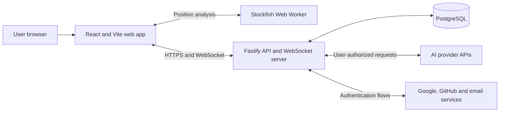

# Architecture

**Status:** Proposed baseline for MVP  
**Last updated:** 2026-10-01

## Architectural drivers

- A server-authoritative chess state prevents clients and models from creating illegal or conflicting moves.
- Four AI providers must behave through one normalized contract while retaining provider-specific capabilities.
- Bring-your-own-key credentials require strict storage, transport, and logging boundaries.
- Human games need realtime updates and reconnection.
- AI games deliberately stop when the controlling browser session is absent, so the MVP does not need a durable background-job platform.
- The stack should remain portable until a hosting platform is selected.

## System context



The web application never calls an AI provider directly. The API normalizes model discovery, capabilities, move requests, usage, errors, and redaction.

## Repository shape

The initial implementation is an npm workspaces monorepo:

```text
apps/
  web/          Pages, UI, client state, WebSocket client, Stockfish worker
  api/          HTTP API, WebSocket server, auth, game orchestration, providers
packages/
  chess/        Domain types and deterministic chess helpers
  contracts/    Runtime schemas and shared transport types
  database/     Drizzle schema, migrations, repositories
  config/       Shared TypeScript, lint, and test configuration
docs/           Product, architecture, roadmap, and ADRs
```

Packages expose intentional public entry points. The web application may import shared contracts and chess presentation helpers but not API repositories, provider clients, or credential code.

## Components

### Web application

Responsibilities:

- render the dark, responsive arena UI;
- collect provider/model/parameter configuration;
- hold session-only provider keys in memory;
- initiate exactly one AI turn at a time;
- maintain HTTP and WebSocket session state;
- run Stockfish analysis in a Web Worker without blocking rendering;
- send display-only evaluation results to the API for saved games;
- localize all user-facing text.

The client is not authoritative for legal moves, game results, authorization, participant identity, or room state.

### Fastify API

Recommended modules:

```text
auth          Better Auth integration and profile lifecycle
users         usernames, avatars, deletion, and history ownership
credentials   session credential handling and encrypted saved credentials
providers     OpenAI, Anthropic, Google, and OpenRouter adapters
games         game commands, reads, lifecycle, replay, and PGN
chess         server-side legality and result evaluation
rooms         invitation codes, membership, reconnection, and abort
realtime      WebSocket authentication, events, and connection registry
analysis      persisted Stockfish samples and post-game aggregates
```

Fastify route schemas validate external input and serialize explicit response shapes. Domain services do not depend on Fastify request objects.

The API's `identity` module defines a credential-free, server-derived `Principal` and its database validity/locking boundary. Guest token verification and cookie renewal stay in `guests`; game authorization consumes the principal rather than the guest authentication service. See [ADR-0013](decisions/0013-server-derived-principals-and-account-lifecycle.md) for the account extension and cleanup rules.

### PostgreSQL and Drizzle

PostgreSQL is the durable system of record. Drizzle ORM defines the schema in TypeScript and Drizzle Kit produces reviewed SQL migrations. Use the latest stable release line; do not base the MVP on Drizzle v1 beta/RC relations APIs.

Core tables are expected to include:

| Table                  | Purpose                                                            |
| ---------------------- | ------------------------------------------------------------------ |
| Better Auth tables     | users, accounts, sessions, verification records                    |
| `profiles`             | unique username, avatar metadata, preferences                      |
| `provider_credentials` | encrypted key material and provider metadata                       |
| `games`                | mode, state, result, FEN, PGN, ownership, privacy, version         |
| `game_participants`    | human, guest, or AI seat configuration                             |
| `moves`                | canonical move, position, commentary, timing, evaluation           |
| `game_commands`        | accepted command identity, kind, and aggregate revision            |
| `model_invocations`    | attempts, provider/model, parameters, usage, cost estimate, errors |
| `rooms`                | private invitation code, owner, membership, lifecycle              |
| `guest_sessions`       | expiring identity and active-game recovery metadata                |

Stable relational fields stay in typed columns. Bounded provider-specific parameter, usage, and error metadata may use `jsonb`. Provider keys never appear in JSON metadata.

Enforce the [public-mode and independent Sandbox limits](product.md#development-sandbox) with a database constraint and an application-level check with a clear conflict response. The partial unique index on `(owner_guest_session_id, is_sandbox)` reserves one active/paused slot per group. Concurrent creation requests must not bypass either limit; see [ADR-0012](decisions/0012-independent-sandbox-game-slot.md).

Account ownership must extend this with normalized account references and an unambiguous owner, retaining guest rows and separate Sandbox slots. Owner-only uniqueness does not cover joining a room as a non-owner: Phase 4 must extend database-enforced unfinished-slot reservations to all human participants before joining is enabled.

### Stockfish worker

Stockfish runs inside a browser Web Worker after every accepted move. Analysis is asynchronous and must not block the next visual update. The web app may persist evaluation score, mate distance, depth, and principal variation for replay.

Stockfish data is display and analysis metadata, not authoritative chess state. It is never included in an LLM prompt. Because client-computed analysis is untrusted, it must not later be reused for ratings, prizes, or security-sensitive decisions.

## Game command model

All game mutations are commands against a game version. The server validates:

1. requester identity and participation;
2. current game state;
3. expected side to move;
4. expected game version;
5. move legality;
6. resulting game state and termination.

The server persists the move and updated game state atomically. Duplicate or stale commands return the current state instead of appending another move.

For conflict handling, establish read authorization first, then check the accepted command ID and expected version before fresh-command lifecycle and current-seat checks. This lets an authorized retry return the current snapshot even when the accepted move changed the turn or completed the game.

Reconstruct the chess engine from the ordered, persisted UCI moves starting at the standard initial position. Current FEN alone cannot restore repetition history. Keep FEN, PGN, result, and termination reason consistent with this history; evaluate the [product's automatic draw policy](product.md#automatic-draw-policy) before allowing another turn.

### Deterministic domain and core contracts

`@neurochess/chess` wraps pinned `chess.js` 1.4.0 behind an opaque synchronous aggregate. `createGame()` creates the standard position in `configuring`; callers explicitly start it. Commands return either a defensive `ChessSnapshot` or a code-based domain failure, without transport identifiers, clocks, I/O, display text, or engine objects. Only active games expose playable moves. The internal lifecycle reducer handles start, pause, resume, abort, and completion. Trusted `resignHuman(losingColor)` and `recordTechnicalLoss(losingColor)` hooks require the caller to verify seat type, authorization, and retry policy.

`restoreGame({ moves, lifecycle })` requires the complete ordered UCI history and explicit lifecycle metadata. It replays the same internal move/adjudication path without constructing intermediate snapshots; PGN, legal-move lists, and defensive history copies are projected only when a snapshot is requested. It rejects entries after a terminal outcome and lifecycle metadata that contradicts the replay. Paused, aborted, and non-board completion states are preserved. Session recovery restores the persisted lifecycle before submitting an explicit pause command; domain restoration does not infer browser presence. FEN, SAN, legal moves, and identity/commentary-free PGN are derived, never restored from cached strings. PGN's result header and final marker always reflect the domain result. Unfinished games use `*` with a null reason; aborted games use `*` with reason `aborted`.

Repetition uses occurrence counts keyed by the first four fields of the engine's normalized FEN, including legal en passant availability and excluding move counters. Do not substitute `chess.js` 1.4.0's repetition hash: it retains an en passant target when an adjacent pawn is pinned and cannot capture. A regression fixture demonstrates the resulting missed third occurrence. The adapter counts the initial position and every accepted move, rebuilding counts on restoration. The engine's half-move counter supplies the fifty-move threshold; specific predicates are evaluated in the [product-defined order](product.md#automatic-draw-policy), not through generic `isDraw()` or `isGameOver()`.

`@neurochess/contracts` independently defines strict Zod schemas for bootstrap, creation, route parameters, snapshots, move commands, and errors. Sandbox HTTP creation accepts only `{}`; it grants no sandbox privilege and does not select a public mode. Snapshots add a UUID `gameId` and nonnegative safe-integer `version` to domain data. Move commands contain `gameId`, canonical UCI `move`, `expectedVersion`, and UUID `commandId`. Clients reuse a command ID for retries of the same command. Version is an aggregate revision, not the number of plies: the application layer owns version advancement for persisted state changes, atomic writes, and deduplication. A `GAME_CONFLICT` error carries the current authorized snapshot for stale or duplicate commands; other errors cannot carry snapshots.

The two shared packages remain separate leaves. Their duplicated stable literals, database literals, and snapshot compatibility are checked in the API test suite. Contracts validate wire structure and lifecycle/result combinations, not chess semantics. Arbitrary-FEN fixtures are package-internal, outside production compilation and exports. HTTP orchestration and persistence are consumers of these packages, not dependencies of them.

### Persisted guest commands

Fastify exposes guest bootstrap, sandbox creation/discovery, snapshots, moves, lifecycle commands, replay, and PGN. Routes validate strict request/response schemas and delegate to injected guest and game services. The game service composes the chess aggregate with database-owned repository interfaces; the database package does not import chess or contracts. The [development guide](development.md#sandbox-api) specifies the wire behavior.

PostgreSQL stores normalized `guest_sessions`, `games`, `game_participants`, and `moves`. The server creates an active standard-position game at revision zero, with a human White seat assigned to the owner and an unassigned human Black seat. An internal `is_sandbox` marker and enabled non-production policy are both required for the owner to control both seats. Ordinary-game ownership is not move authority; the current human seat must be assigned to the requester. No ordinary-game creation or joining route is introduced here.

Write transactions use `READ COMMITTED`, locking the guest row before the game row. A partial unique index on owner and Sandbox marker enforces the active/paused slot within each group. Normalized `game_commands` receipts enforce accepted command-ID and revision uniqueness across moves, pause, resume, abort, and human resignation; the forward migration backfills old move receipts. Each successful command commits its receipt, position/result fields, and any move insert together, advancing the aggregate revision once. Lifecycle commands add no move. Completion and abortion release the slot in that transaction. No provider call occurs inside these transactions. See [ADR-0007](decisions/0007-lifecycle-recovery-and-private-replay.md).

Snapshot reads use a read-only `REPEATABLE READ` transaction so history and version come from one database view. The service restores ordered UCI history, checks persisted FEN/PGN and per-move projections, and rejects inconsistencies without repairing data or changing lifecycle. See [ADR-0006](decisions/0006-guest-owned-game-commands.md) for identity, authority, concurrency, and follow-up boundaries.

### Ordinary AI game configuration

`aiGameConfigurationSchema` describes `ai_vs_ai` and `ai_vs_human` with independent `white` and `black` seats. AI seats contain provider, model ID, and a closed parameter object; human seats contain only their type. Creation assigns the owning guest to the single human seat, if present. Identical providers/models are allowed. Credentials, guest IDs, Sandbox privileges, positions, and prompts are never configuration inputs.

The game service's `createAi`, `details`, and `unfinishedGame` methods create and restore these games through the existing guest locks, scoped unfinished-owner index, and full-history verification. Details combine an unchanged chess snapshot with its private configuration in one read transaction. Every unfinished-game lookup requires an explicit ordinary or Sandbox scope: ordinary creation/discovery excludes Sandbox, and Sandbox creation/discovery excludes ordinary games. Creation conflicts return only the occupied game's snapshot from that scope. Ordinary AI reads are owner-only, and ownership grants no human move or resignation authority over an AI seat. Configuration restoration rejects inconsistent mode, seat, or guest assignment before any command is accepted.

`games.mode` stores the ordinary AI mode. Legacy records retain null mode and their original `is_sandbox` value; null mode grants no additional authority. AI provider and model ID are typed participant columns, with bounded, closed parameter metadata in `jsonb`. Human seats have null AI fields. Parameter schemas supply structural bounds; provider capability validation and filtering belong at the discovery/inference boundary. See the [migration instructions](development.md#migrations) and [roadmap](roadmap.md#phase-2--ai-arena-core).

### AI failure policy and invocation records

AI execution uses the reservations in [ADR-0009](decisions/0009-ai-turn-reservations.md) and the durable failure policy in [ADR-0010](decisions/0010-ai-failure-policy-and-invocations.md). `ai_turns` identifies a logical turn by game and next ply, independent of lifecycle revisions. Its invalid-output budget survives Pause/Resume and explicit crash recovery. Each dispatch gets a numbered `model_invocations` row before calling the injected adapter outside the transaction.

The executor rechecks authority, seat configuration, revision, and reservation at each dispatch/outcome. Known invalid outputs increment the durable count; the third commits the trusted domain technical loss and an internal `technical_loss` command receipt. Provider failures commit an ordinary pause under the AI command ID and return the paused snapshot. They never consume invalid-output budget. Both outcomes, and successful moves, commit their required attempt, counter, and command records atomically. Explicit Resume or Next move and a fresh versioned command authorize another attempt on the same logical turn.

`GameService.invocations` exposes private normalized records in a read-only transaction after the same ownership and full-history checks as game reads. Records include the exact parameters supplied to the adapter, service-measured duration, independently nullable reported usage, safe enumerated failure causes, and accepted commentary. A logical turn links all its attempts to the accepted move; failures without a move remain readable. Invocation reads are separate from chess snapshots, and operational metadata may change without a game revision. Commentary never enters PGN or model context. Raw responses, prompts, exceptions, credentials, and upstream request IDs are not persisted.

Lifecycle commands interrupt unfinished attempt records while invalidating reservations. A late result may update only its own attempt as discarded, never a counter or canonical game outcome. Unresolved dispatches retain unknown duration/usage; recovery neither invents an upstream result nor silently retries it. The public controller reads these records independently of chess revisions for commentary, telemetry, Events, and safe provider-error guidance. Reads refresh during unfinished games and on explicit Refresh details, including terminal games; request lifetime, game ID, and revision fence stale responses. These reads cannot dispatch moves.

Live commentary shows each AI seat's latest accepted move. Replay selects only the chosen ply's accepted commentary, measured latency, and independently reported token counts. Human moves and the initial position have distinct empty states. Operational totals include every recorded attempt, including failures and discarded calls; a missing measurement or missing historical AI-move record makes the affected total unavailable. Events show attempt sequence, invalid-output budget, safe reasons, and the terminal result. Commentary remains plain untrusted text and never enters canonical PGN.

### Sandbox web client

The application shell separates the public AI Arena (`/`) from Sandbox (`/sandbox`). Vite exposes only the explicit `SANDBOX_ENABLED` value from the shared root environment to the web environment validator; it does not expose other server variables. The flag controls navigation, screen mounting, and a build-time import boundary: disabled builds omit the Sandbox client; enabled builds load it lazily on the Sandbox route, keeping navigation and a localized loading notice visible while it downloads. API authorization remains authoritative. Native page links leave the sandbox controller's lifetime; returning uses the existing paused-recovery flow. Each mode controller resolves game parameters on its own route through authorized reads.

`apps/web/src/api/client.ts` validates HTTP requests and responses with the existing contracts, uses credentialed/no-store requests, and cancels requests after ten seconds or when their owner disconnects. It retains only safe error codes and validated conflict snapshots; server message fields and exception text never enter the UI. The FEN presentation parser checks display syntax without generating moves or adjudicating games.

The sandbox controller owns networking and complete accepted snapshots. `game/SandboxScreen.tsx` connects it through `useSandbox`, while `game/presentation.ts` and `game/statusPresentation.ts` project accepted state into board, participant, and status data. The adapters in `game/panels` translate commands into presentation callbacks. `app/AppShell.tsx` owns shared page landmarks; `arena` owns layout and reusable panels. Architecture checks prevent arena, board, and UI production components from importing sandbox state/controllers or the HTTP client. A different mode supplies its own adapter and authorized actions; a presentation callback never grants server authority.

`arena/ArenaDetails.tsx` accepts Moves plus optional commentary, telemetry, Analysis, and Events content. It renders only supplied extensions; Sandbox supplies Moves and its own guidance/recovery actions. Additional detail panels use keyboard-operated tabs that preserve local state. The development-only `/dev/arena` reference adapter exercises the same shell, layout, board, participants, lifecycle controls, and replay with fictional human/AI scenarios. It uses legal fixture history from the chess package without importing Sandbox or HTTP modules. Its lazy entry is excluded from production builds and also requires the Sandbox flag; these fixtures do not implement or authorize any public game mode.

React subscribes through `useSyncExternalStore`; square selection, focus, orientation, and promotion remain separate component state. Presentation projections do not cache private snapshots or merge partial revisions. Only `legalMoves` supplies selectable sources, destinations, and promotion suffixes. A synchronous guard serializes creation, moves, and lifecycle commands before React can render pending feedback. Commands use the actual snapshot revision and a fresh UUID, and responses must belong to the current game/request generation without regressing the accepted revision.

Client flow, replay, and export state use discriminated unions. The store accepts complete typed substates instead of partial field patches, publishing phase, snapshot, and pending-command changes atomically. Changing the accepted game or revision, or clearing access, clears its private replay and export state in the same notification.

- Mounting checks readiness and reads the URL's game or discovers the existing guest's unfinished sandbox. Anonymous discovery returns to entry; only explicit Start bootstraps a guest before creation. Readiness does not imply sandbox availability.
- Creation conflicts recover the authorized game paused. Command conflicts replace the complete snapshot and invalidate stale selection/promotion without automatically repeating a user command.
- Rejected moves synchronize with an authorized GET before permitting another move. A failed synchronization keeps the board inspectable and movement blocked.
- Network, timeout, server, or malformed-response failures retain the original command and fetch the authorized snapshot. An unchanged revision cannot prove that the original request will not commit; new moves remain blocked. Explicit retry reuses the identical UUID, revision, and UCI. A newer revision makes that old command unable to commit, so the returned position can be adopted safely.
- Access failures on loaded games clear the snapshot and require explicit action before another guest bootstrap. No game state is persisted in browser storage.

The web localization layer uses bundled, typed i18next/react-i18next English resources with English fallback. Metadata, configuration errors, the failure screen that an error boundary shows when rendering throws, controls, board descriptions, and one polite atomic live region use the catalog; a caught exception is reported to React but never rendered. There is no language selector or browser-language detection. The [design guide](design-system.md#keyboard-and-chess-interaction) defines grid/dialog semantics and focus behavior; the [browser tests](development.md#browser-tests) exercise the real guest-command flow.

Recovery sends the same versioned pause command as the Pause control. It reconciles active conflict snapshots with at most three automatic attempts, then requires Retry recovery. An uncertain pause keeps its original command for explicit retry. No recovered active snapshot enables play; an already-paused game needs no write, and Resume is always explicit. Snapshot/discovery GETs never change game lifecycle. URL navigation cancels obsolete requests, clears private view state, and resolves the target through guest authorization.

Terminal replay and PGN use the same authorized full-history verification as snapshots. Replay returns the terminal snapshot and initial FEN; a separate client cursor selects the displayed verified FEN/SAN/UCI without modifying the accepted snapshot. Export returns the verified canonical PGN in JSON. Copy and UTF-8 file download use identical text, with a selectable-text clipboard fallback. These endpoints reject unfinished games; access loss clears loaded private data. There are no provider adapters, rooms, or WebSockets in this flow.

### AI turns

The browser requests one AI turn at a time. The API:

1. authorizes the requester and reserves the expected turn/version;
2. builds the canonical model context from server state;
3. resolves a session-only key from the request or decrypts an explicitly saved credential;
4. calls the selected provider adapter outside a long-running database transaction;
5. validates and normalizes the response;
6. retries model-invalid output at most twice;
7. commits the legal move only if the game version is still current;
8. returns the new state and normalized telemetry.

The reservation must be idempotent so multiple clicks, retries, or network duplicates cannot cause multiple moves. If the controlling tab disconnects, automatic turn requests stop and the game becomes paused.

The game service's `aiTurn` accepts a game ID, expected revision, command ID, controller UUID, optional paused-step flag, and request-scoped adapter access. It builds the standard response instruction and chess context from verified server history. A separate `ai_turn_reservations` row fences execution; `game_commands` records only accepted moves/lifecycle changes. Discovery and inference hold no database transaction. After reservation, live discovery validates the current model and resolves effective parameters before an invocation is recorded. Authority, seat/configuration, reservation identity, and revision are rechecked before inference and before acceptance, which uses the same deterministic move and atomic persistence path as human commands.

AI HTTP requests cancel provider work when the response connection closes. Discovery has a 30-second operational deadline; a turn, including discovery and automatic invalid-output retries, has a 180-second deadline. A dispatched turn's cancellation or timeout follows the provider-pause policy, never a chess loss. The AI client allows 35/190 seconds respectively so the API can persist and acknowledge an operational failure, propagates its owner's cancellation, and never retries transport failures automatically. An uncertain response still requires authorized synchronization and explicit recovery; a lost response cannot prove that no move committed. These deadlines are transport safeguards, not chess clocks.

Failed or interrupted executions retain a blocked reservation. A process crash can leave an apparently in-flight reservation; it never expires into automatic redispatch. Explicit owner-authorized Pause advances the revision and invalidates the reservation before Resume and another turn can authorize a new call. Accepted ordinary-game commands clear reservations atomically; reads do not. Expired controller presence also authorizes a server pause, never another provider call. See [ADR-0009](decisions/0009-ai-turn-reservations.md) for receipt identity, cancellation, rollback, crash recovery, and the limits of provider billing guarantees. Failure-policy and public-flow implementation status remains in the [roadmap](roadmap.md#phase-2--ai-arena-core).

### AI controller presence and recovery

The public `match` controller holds complete accepted snapshots, page-memory credentials, and one unresolved inference identity at a time. It never advances the board speculatively. Pause, Stop, and human resignation use a separate lifecycle request lane; accepted controls invalidate pending inference. The speed setting delays the next AI request after the previous complete response. A lost acknowledgement blocks dispatch until synchronization and a versioned pause establish a safe revision. AI seats remain read-only to human commands.

As specified in [ADR-0011](decisions/0011-ai-controller-presence-and-step.md), an authenticated owner claims a database controller lease with a page-memory UUID. Three-second heartbeats renew a 15-second lease; expired or replaced controllers cannot dispatch or accept provider outcomes. Every API instance sweeps expired presence at startup and every two seconds, committing an authoritative pause under the existing lock/receipt machinery. Initial unclaimed games also expire. During total API/database downtime the pause is deferred until service returns, while the persisted expiry still fences acceptance.

Opening an unfinished game at `/?game=<uuid>` performs authorized reads followed by an explicit versioned pause without a controller UUID. This revokes any competing tab and outstanding execution, including a paused step. No GET changes lifecycle. The recovered tab needs missing keys and explicit Resume or Next move before claiming control. Navigation, close, refresh, and bfcache entry stop automatic requests and clear keys; unload delivery is not needed for server enforcement. Provider errors show only localized safe causes and require user-directed continuation.

`step: true` authorizes one AI move while the stored game is paused. The executor resumes only its reconstructed in-memory aggregate to build legal context and apply the deterministic move. It persists the move and final paused or terminal position at one revision, without an intermediate active record or playable paused snapshot. Its reservations, failure budgets, and technical-loss policy are identical to ordinary AI turns.

### Human turns

AI-versus-human setup assigns the guest only to the selected human color and requires a credential only for the opponent. Switching a seat to human cancels its discovery and clears its key and AI selections. The public match controller uses the shared HTTP move command, board, promotion, and private replay path. It waits on human turns and dispatches one AI turn after an accepted human move; AI White opens when the human chooses Black. The initial board orientation follows the human color. A paused step is available only on an AI turn.

Unacknowledged human moves follow the [Sandbox web client's uncertain-command policy](#sandbox-web-client). Recovery fences unresolved work with a versioned pause before explicit continuation. Only the human seat has a confirmed resignation action, including paused and off-turn positions; a conflicting revision requires a new decision instead of automatically resubmitting resignation. No room transport is used for this mode.

Human moves use the same authoritative command path without a provider call. For online games, the accepted state is broadcast to both room participants over WebSocket. Reconnecting clients fetch a full snapshot before processing later events.

### Local development sandbox

Phase 1 provides an explicitly labeled development screen where one guest session controls White and Black in turn. It uses the real API, PostgreSQL persistence, chess rules, and reusable UI components through the shared command service.

- Enable the sandbox explicitly on the server in local development or tests; keep it disabled by default. Production configuration must reject attempts to enable it. Hiding a frontend route is insufficient.
- Mark sandbox games internally when the server creates them. Only their owning guest session receives authority over both seats. Clients cannot grant themselves this capability or apply it to ordinary games, and production game access must not recognize sandbox authority.
- Preserve every lifecycle, turn, legality, version, and atomic persistence check. Both-seat control never permits moving out of turn or changing an accepted position.
- Keep sandbox records in the development/test database. The sandbox creates no room, invitation, join flow, public spectator access, or additional public game mode.
- Start each sandbox game from the standard position. Special FEN positions are allowed only as internal test fixtures, never through a game-creation API.

Apply the [guest identity and ownership rules](#authentication-and-guest-sessions). Unfinished sandbox games recover as paused on refresh/reopening and require explicit resume. Completed or aborted records remain available for private replay and PGN export at their game URL during the retained guest session, including after a new game starts. They do not become account history. The production guest retention period and automated cleanup remain follow-up decisions.

## AI provider boundary

Each provider adapter implements equivalent operations conceptually:

```ts
interface AiProviderAdapter {
  readonly provider: AiProvider;
  listModels(input: ListModelsInput): Promise<ModelDiscoveryResult>;
  requestMove(input: MoveRequest): Promise<NormalizedMoveResponse>;
}
```

`ModelDescriptor` includes capability metadata used to build a capability-aware configuration UI. The server filters unsupported parameters rather than sending speculative fields to a provider.

Shared schemas distinguish supported, unsupported, and unknown move-generation capability; null parameter capability never enables a speculative control. Normalized operations return discriminated success/failure results with enumerated diagnostics, excluding upstream exception text. Usage may be entirely null or contain independently nullable reported counts; absent totals are never synthesized. Adapter inputs carry cancellation and a request-scoped key, which must not be retained on the adapter. The reusable scripted adapter lives only in API test fixtures, with an architecture guard excluding it from production imports.

The normalized move response contains:

- required UCI move;
- optional viewer commentary;
- provider request identifier when safe to retain;
- latency;
- normalized token usage when available;
- retry and error classification.

Model lists come from the selected provider through the API. Discovery is currently uncached and scoped to the supplied request credential; another account's catalog is never reused. Malformed, mismatched-provider, or credential-echoing descriptors become safe provider failures. A missing or explicitly unsupported selected model pauses a turn without inference. Unknown move-generation capability permits a runtime attempt with no optional parameters. For supported models, unknown/unsupported parameter fields are omitted; values outside an advertised range or enumeration pause the game and return `AI_PARAMETERS_INVALID` before inference, without consuming an invalid-output attempt. Seat configuration is immutable, so a changed range that invalidates a selection requires a new configuration/game. Invocation records contain the parameters actually supplied to inference. Discovery failures retain a safe failure attempt with no effective parameters or token usage.

A model being listed does not guarantee it supports the required chess response contract; adapters must surface capability or runtime errors clearly. Registration is explicit through `aiAdapters`; production has no fixture adapter or fallback.

The [OpenAI adapter](development.md#openai-adapter) uses stateless Responses API requests and annotates live model discovery with conservative documented capabilities. The [Anthropic adapter](development.md#anthropic-adapter) uses Messages and paginated discovery with advertised output/effort capabilities. The [Google adapter](development.md#google-adapter) uses GenerateContent and paginated discovery with advertised generation methods, temperature ranges, and output limits. The [OpenRouter adapter](development.md#openrouter-adapter) uses Chat Completions and account-filtered discovery, preserving routed identifiers and advertised capabilities while disabling fallback requests and context compression. An optional pure adapter parameter resolver supplies required wire defaults before invocation persistence; discovered capabilities are passed within the request, never retained on the adapter. These adapters discard raw usage metadata after extracting reported counts and perform no implicit transport retries. The common executor retains all legality, retry-budget, lifecycle, and persistence authority.

## Error taxonomy

Errors are classified before game policy is applied:

| Class                  | Examples                                      | Game effect                      |
| ---------------------- | --------------------------------------------- | -------------------------------- |
| `model_invalid`        | malformed payload, missing move, illegal move | retry twice, then technical loss |
| `provider_auth`        | rejected API key                              | pause                            |
| `provider_quota`       | quota, balance, or rate limit                 | pause                            |
| `provider_timeout`     | provider request timeout                      | pause                            |
| `provider_unavailable` | network or upstream failure                   | pause                            |
| `game_conflict`        | stale version or duplicate command            | refresh current state            |
| `authorization`        | user is not allowed to act                    | reject without changing game     |

Missing commentary is not an error.

## Authentication and guest sessions

The account architecture uses Better Auth for email/password, Google, GitHub, email verification, password reset, and authenticated sessions in PostgreSQL. Profiles add the display/normalized username and avatar metadata defined by the [product policies](product.md#usernames-and-avatars). Implementation milestones are tracked only in the [roadmap](roadmap.md#phase-3--accounts-encrypted-credentials-and-history).

The API's `auth` service uses the stable Better Auth Drizzle adapter from the server-only database package. Generated user/account/session/verification and rate-limit tables share the existing migration history. The Fastify bridge explicitly allows session lookup and sign-out, email lifecycle endpoints when a sender is configured, and Google/GitHub sign-in and callbacks when each provider is configured. Strict shared request schemas reject client identity, profile fields, callback destinations, scopes, direct ID tokens, and linking data. Profile mutation, token/account enumeration, explicit linking, and built-in account deletion remain closed. Implicit account linking is explicitly disabled.

Better Auth owns OAuth authorization URLs, PKCE, signed state cookies, state expiry/consumption, provider exchanges, and session creation. An API plugin records the selected provider in server-controlled OAuth state and checks that binding before code exchange; an optional callback issuer must also match. State uses PostgreSQL and a host-only cookie, with the library's state-cookie check enabled. Only GET callbacks for configured providers are admitted, and they retain the state cookie. Ordinary POSTs still require the exact web Origin. Authorization-code requests accept only a provider selector; the API fixes all onward destinations and maps callback errors to bounded application codes, discarding raw provider descriptions/URLs. Callback responses redirect to a token-free web URL with no-store/no-referrer headers.

OAuth profiles pass runtime validation before identity creation. The [provider-email policy](product.md#google-and-github-sign-in) binds accounts to immutable provider subjects; a unique `(provider_id, account_id)` index prevents duplicate ownership during concurrent sign-ins. The API retains only that binding, the required local email/verification state, and a validated initial HTTPS provider avatar. Names start empty and returning sign-ins never overwrite profile/email fields. Google requests `openid email profile` with online access and no incremental grant expansion; GitHub requests only `user:email`, using public profile fields for its subject/avatar. Access, refresh, and ID tokens, scopes, and token expiry metadata are removed by account-write hooks; provider account cookies and token refresh/read endpoints are disabled. Token encryption remains enabled as defense in depth, but no OAuth token is intentionally retained. Recovery hooks prevent Better Auth from adding a password method to an OAuth-only account; the generic reset acknowledgement remains unchanged.

Better Auth owns password hashing, verification, reset tokens, and session revocation under the [email lifecycle policy](product.md#emailpassword-lifecycle). The API injects an email sender and provides a configurable SMTP adapter. English mail and response copy lives in the API localization catalog. Request-local mail callbacks collect messages and dispatch only after the auth transaction commits successfully, outside database locks and outside the library's callback-error suppression. Registration, verification resend, and reset initiation return the same receipt acknowledgement without awaiting SMTP or exposing recipient-specific failures. Failed deliveries produce only the fixed internal `auth_email_delivery_failed` log event; neither mail nor transport exceptions are passed to telemetry, and observer errors cannot affect responses. Graceful API shutdown drains in-flight deliveries. Dispatch is not a durable queue: abrupt process loss may require explicit resend. This removes SMTP-dependent response status and delay, without claiming constant-time database or password processing. Runtime configuration has no test-mailbox mode; tests inject isolated mailboxes. Production requires SMTP configuration and TLS, while unconfigured development instances keep email routes closed.

Email sign-in and password-reset completion resolve the account through Better Auth, then lock its user row and execute the auth handler on that same transaction's adapter. This serializes password verification/session creation with password replacement/session revocation across API instances: a sign-in checking the old password cannot escape a completed reset. Reset token consumption, password replacement, and session deletion commit together; library server-error responses cause rollback. The database package owns the lock and transaction; the API owns request validation and response handling.

The API constructs email links from validated origins, never request callback URLs or library redirect defaults. Verification links address the API and successful verification redirects only to the token-free `${WEB_ORIGIN}/?auth=email-verified`. Reset links address `${WEB_ORIGIN}/auth/reset-password#token=…`; the future form must immediately remove the fragment from browser history, retain it only in page memory, and submit it in the reset POST body. No auth link or token belongs in logs, analytics, persisted client state, or referrers. Library reset-token redirect routes are closed. Email initiation and completion never inherit another account's cookie or create a session; only explicit sign-in does.

Account session lookup returns only user ID/email/verification state and session expiry, or `null`; tokens, provider accounts, raw names/avatars, IPs, and user agents never enter application JSON. A separate account resolver verifies the signed cookie against PostgreSQL on every call and returns only an account principal. It neither refreshes sessions nor falls back to a guest. Game services still accept only the guest principal until account ownership, identity locking, seats, and unfinished-game constraints are extended together.

Auth configuration requires a secret and explicit API/browser origins. Account cookies are host-only, Secure, HttpOnly, and SameSite=Lax to support top-level OAuth callbacks; cookie session caching is disabled. Sessions last seven days and renew after one day through session lookup. Fastify preserves every Set-Cookie header, requires the exact web Origin for every auth POST, and retains Better Auth CSRF/origin checks. Database-backed limits apply per socket IP and endpoint: registration, verification resend, and reset requests allow three per 60 seconds; email/OAuth sign-in and reset completion allow ten; OAuth callbacks allow 30; other endpoints allow 100. Untrusted forwarding headers cannot choose the IP or auth base URL. Same-site HTTPS origins are required for browser deployment; HTTP localhost is the development exception. Proxy trust must be configured deliberately when deployment is selected.

Auth responses are uncached and use a no-referrer policy. Errors use localized application codes/messages, library console logging and telemetry are disabled, and unknown auth request paths are masked because protocol tokens can appear in path segments. Sign-out verifies that the session is no longer valid before acknowledging success, including when the library catches a database deletion error.

Guests explicitly bootstrap an opaque 256-bit token in a host-only Secure, HttpOnly, SameSite=Strict cookie before creating a game. Only its SHA-256 digest is stored with an internal guest UUID. Bootstrap reuses valid identities; other endpoints reject missing or expired identities rather than creating replacements. Valid activity renews the configured inactivity expiry without rotating the token (24 hours by default). Exact-Origin POST enforcement and credentialed CORS complement the cookie policy. See [ADR-0006](decisions/0006-guest-owned-game-commands.md).

`guests/http.ts` handles cookie authentication/renewal and returns only the principal to game services. The principal has an explicit identity kind; only the guest variant is currently executable. Reads require database validity. Commands lock the identity before the game and reject an expired identity after the lock wait. AI reservation, dispatch/retry, and outcome checks use the same command preparation. Server cleanup also takes the identity lock but may discard an attempt or pause an abandoned game after session expiry; it cannot renew the session or dispatch inference.

When account-capable gameplay is added, resolve a validated account session first on public routes and never combine its authority with a guest cookie. Account-only and expired authenticated operations fail closed. Sandbox remains explicitly guest-only, including shared game-resource routes for Sandbox records; selecting a Sandbox resource must not grant guest fallback on an ordinary account operation. Do not accept identity IDs or kinds in transport bodies. Follow the [guest separation and transition policy](product.md#identity-changes-and-account-linking), including deliberate OAuth linking; configure these policies explicitly rather than inheriting authentication-library defaults.

Temporary game metadata does not appear in durable history. Access expires now; automated deletion after inactivity and the production retention duration are follow-up work and must be resolved before production guest gameplay.

Guest identity, ownership checks on snapshots/commands/replay/PGN, and the active-or-paused game limit are required from Phase 1. A game ID alone never grants access. Phase 3 extends these foundations to authenticated users and durable private history.

After refresh, an AI game is restored as paused and requires explicit resume. Session-only key loss and mandatory re-entry are required when AI games arrive in Phase 2; an authenticated user's explicitly saved credential may be resolved through the saved-credential path introduced in Phase 3.

## Credential lifecycle

### Session-only credential

1. The browser accepts the key into in-memory state.
2. It sends the key over HTTPS only to provider-related API operations that require it.
3. The API uses it within that request and does not persist or log it.
4. Refreshing or closing the tab removes it; a restored game remains paused until re-entry.

The AI client's credential store is a page-owned closure with independent color/provider entries. Replacement, explicit clearing, owner cancellation, and `pagehide` remove entries; even a page restored from the browser's back/forward cache requires re-entry. It exposes no serializable credential state and uses no browser persistence. Configuration and command receipts never contain credentials; the HTTP turn body adds a key only for that operation. Client destinations require HTTPS except for local development on `localhost`. Loading or constructing the client never bootstraps a guest.

The independent setup adapter in `apps/web/src/setup` consumes that client and a page-owned credential store. It reads unfinished-game discovery on mount; only explicit Load models or Start actions may bootstrap a guest. Each seat cancels and discards obsolete discovery on key/provider changes, clears model/parameter selections before refreshing capabilities, and submits only supported, valid parameters. Reusable `arena/setup` controls receive data and callbacks, without importing API clients or mode controllers. Creation hands private game details to the page owner, which retains the credential lifetime; Return to game hands over only the authorized game ID. Setup itself neither dispatches turns nor performs recovery; its page owner handles those operations. An uncertain creation response requires explicit unfinished-game discovery before another creation attempt. The page-owned `match` controller connects this handoff to the public Arena and owns recovery, controller heartbeats, and serialized turns.

### Saved credential

1. Only an authenticated user may opt in to saving a key.
2. The API encrypts the key with authenticated encryption before database insertion.
3. The database stores ciphertext and required cryptographic metadata, never the plaintext key.
4. The encryption key lives in deployment secret storage, separately from PostgreSQL.
5. Reads return masked metadata only. Decryption occurs only for an authorized provider call.
6. Users can revoke individual saved keys, clear credentials, or delete the account.

All request logging and exception reporting must redact credential fields, authorization headers, cookies, URLs with tokens, and provider secrets.

## Realtime rooms

The Fastify process owns active WebSocket connections. PostgreSQL stores canonical room and game state, allowing a client to reconnect after a connection loss or process restart.

MVP assumptions:

- one API instance is sufficient;
- no Redis dependency;
- invitation codes are random, unguessable, stored safely, and revocable;
- only an authenticated room owner can abort the room;
- an aborted game is retained for registered participants;
- games and rooms are private.

If the API is scaled horizontally, add a shared pub/sub or connection-routing layer through a new ADR.

## Telemetry and cost

Store operational metadata required by the product: provider/model, attempt number, duration, reported tokens, normalized errors, and estimated cost. Never store raw keys. Avoid storing complete raw provider payloads by default; retain the normalized move and user-facing commentary needed for replay.

Cost calculation uses provider-reported token counts and versioned pricing metadata when available. Every cost is labeled as an estimate. Unknown usage or price produces `unavailable`, not zero.

## API shape

The exact paths remain an implementation detail, but the API needs these capability groups:

- auth and profile management;
- provider model discovery and credential management;
- game creation, snapshot, command, pause/resume, abort, replay, deletion, and PGN;
- room creation, invitation resolution, join, reconnect, and abort;
- WebSocket snapshot/event protocol;
- history listing and account/data deletion.

Generate OpenAPI from Fastify route schemas. Version WebSocket event payloads through shared runtime schemas.

## Verification strategy

- Unit tests: chess state transitions, legal move validation, result rules, provider normalization, retry classification, cost calculation, and redaction.
- Integration tests: Fastify routes, Better Auth authorization, Drizzle repositories, migrations, credential encryption, deletion cascades, and idempotent AI turns.
- WebSocket tests: invitation join, move broadcast, disconnect/reconnect snapshot, owner abort, and unauthorized access.
- Provider contract tests: recorded or mocked responses for every adapter; no live paid calls in the default suite.
- End-to-end tests: the three game modes, guest restrictions, history/replay/PGN, responsive layouts, and key lifecycle.

Phase 1 acceptance must additionally verify:

- one guest completes a game through human commands, replays it, and exports PGN without loading a provider adapter; another guest cannot read or mutate any of these resources;
- sandbox creation/control paths are unavailable when disabled, production cannot enable them, and ordinary games never inherit authority over both seats;
- concurrent game creation respects the active/paused limit, completion or abortion releases the slot, and duplicate move submissions append only one move;
- refresh recovers an unfinished game paused, and resume preserves the full move history;
- repeating `g1f3 g8f6 f3g1 f6g8` twice from the initial position ends the game on the eighth half-move, including after database restoration between the cycles;
- internal fixtures verify the 99-to-100 half-move boundary, pawn/capture counter resets, repetition identity, and checkmate priority without exposing arbitrary-FEN creation;
- completed and aborted games reject new moves, and replay/PGN agree with the persisted result and termination reason.

## Deployment constraints

The web app can be hosted as static assets. The API hosting environment must support a long-running Node.js Fastify process and persistent WebSocket connections. PostgreSQL should be managed or backed up appropriately and reached over TLS. Both applications should be containerizable.

The exact hosting providers, production region, email delivery service, observability service, and backup policy remain open decisions. Custom avatar uploads and their storage are deferred by the [profile policy](product.md#usernames-and-avatars).
