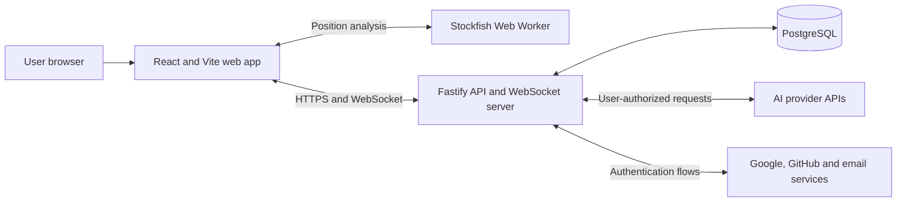

# Architecture

**Status:** Canonical MVP architecture

**Scope:** Component boundaries and technical constraints for the full MVP; implementation status belongs in the [roadmap](roadmap.md).

**Last updated:** 2026-09-08

## Architectural drivers

- A server-authoritative chess state prevents clients and models from creating illegal or conflicting moves.
- Four AI providers must behave through one normalized contract while retaining provider-specific capabilities.
- Bring-your-own-key credentials require strict storage, transport, and logging boundaries.
- Human games need realtime updates and reconnection.
- AI games deliberately stop when the controlling browser session is absent, so the MVP does not need a durable background-job platform.
- The stack should remain portable until a hosting platform is selected.

## System context



The web application never calls an AI provider directly. The API normalizes model discovery, capabilities, move requests, usage, errors, and redaction.

## Repository shape

The initial implementation is an npm workspaces monorepo:

```text
apps/
  web/          Pages, UI, client state, WebSocket client, Stockfish worker
  api/          HTTP API, WebSocket server, auth, game orchestration, providers
packages/
  chess/        Domain types and deterministic chess helpers
  contracts/    Runtime schemas and shared transport types
  database/     Drizzle schema, migrations, repositories
  config/       Shared TypeScript, lint, and test configuration
docs/           Product, architecture, roadmap, and ADRs
```

Packages expose intentional public entry points. The web application may import shared contracts and chess presentation helpers but not API repositories, provider clients, or credential code.

## Components

### Web application

Responsibilities:

- render the dark, responsive arena UI;
- collect provider/model/parameter configuration;
- hold session-only provider keys in memory;
- initiate exactly one AI turn at a time;
- maintain HTTP and WebSocket session state;
- run Stockfish analysis in a Web Worker without blocking rendering;
- send display-only evaluation results to the API for saved games;
- localize all user-facing text.

The client is not authoritative for legal moves, game results, authorization, participant identity, or room state.

The [AI setup flow](gameplay.md#ai-setup-ui) keeps each seat's non-secret draft and discovered capabilities separate from its page-memory credential. Provider and key changes cancel obsolete discovery; requests cannot replace a newer seat catalog. Shared schemas validate provider lists, discovery results, and credential-free creation. The accepted handoff starts the shared [playback controller](gameplay.md#ai-playback-ui) with separate AI-seat credentials, the versioned command session, operation gate, and paused recovery. AI-versus-AI is read-only; [AI-versus-human](gameplay.md#ai-versus-human-ui) enables the configured human seat.

### Fastify API

Recommended modules:

```text
auth          Better Auth integration and profile lifecycle
users         usernames, avatars, deletion, and history ownership
credentials   session credential handling and encrypted saved credentials
providers     OpenAI, Anthropic, Google, and OpenRouter adapters
games         game commands, reads, lifecycle, replay, and PGN
chess         server-side legality and result evaluation
rooms         invitation codes, membership, reconnection, and abort
realtime      WebSocket authentication, events, and connection registry
analysis      persisted Stockfish samples and post-game aggregates
```

Fastify route schemas validate external input and serialize explicit response shapes. Domain services do not depend on Fastify request objects.

### PostgreSQL and Drizzle

PostgreSQL is the durable system of record. Drizzle ORM defines the schema in TypeScript and Drizzle Kit produces reviewed SQL migrations. Use the latest stable release line; do not base the MVP on Drizzle v1 beta/RC relations APIs.

Core tables are expected to include:

| Table                  | Purpose                                                            |
| ---------------------- | ------------------------------------------------------------------ |
| Better Auth tables     | users, accounts, sessions, verification records                    |
| `profiles`             | unique username, avatar metadata, preferences                      |
| `provider_credentials` | encrypted key material and provider metadata                       |
| `games`                | mode, state, result, FEN, PGN, ownership, privacy, version         |
| `game_participants`    | human, guest, or AI seat configuration                             |
| `moves`                | canonical move, position, commentary, timing, evaluation           |
| `game_commands`        | accepted command identity, kind, and aggregate revision            |
| `model_invocations`    | attempts, provider/model, parameters, usage, cost estimate, errors |
| `turn_reservations`    | durable command/execution ownership, revision, lease, and outcome  |
| `rooms`                | private invitation code, owner, membership, lifecycle              |
| `guest_sessions`       | expiring identity and active-game recovery metadata                |

Stable relational fields stay in typed columns. Bounded provider-specific parameter, usage, and error metadata may use `jsonb`. Provider keys never appear in JSON metadata.

Enforce one active or paused game per user or guest session with a database constraint where practical and an application-level check with a clear conflict response. Concurrent creation requests must not bypass this limit.

### Stockfish worker

Stockfish runs inside a browser Web Worker after every accepted move. Analysis is asynchronous and must not block the next visual update. The web app may persist evaluation score, mate distance, depth, and principal variation for replay.

Stockfish data is display and analysis metadata, not authoritative chess state. It is never included in an LLM prompt. Because client-computed analysis is untrusted, it must not later be reused for ratings, prizes, or security-sensitive decisions.

## Deterministic domain and core contracts

`@neurochess/chess` wraps pinned `chess.js` 1.4.0 behind an opaque synchronous aggregate. `createGame()` creates the standard position in `configuring`; callers explicitly start it. Commands return either a defensive `ChessSnapshot` or a code-based domain failure, without transport identifiers, clocks, I/O, display text, or engine objects. Only active games expose playable moves. The internal lifecycle reducer handles start, pause, resume, abort, and completion. Trusted `resignHuman(losingColor)` and `recordTechnicalLoss(losingColor)` hooks require the caller to verify seat type, authorization, and retry policy.

`restoreGame({ moves, lifecycle })` requires the complete ordered UCI history and explicit lifecycle metadata. It replays the same internal move/adjudication path without constructing intermediate snapshots; PGN, legal-move lists, and defensive history copies are projected only when a snapshot is requested. It rejects entries after a terminal outcome and lifecycle metadata that contradicts the replay. Paused, aborted, and non-board completion states are preserved. Session recovery restores the persisted lifecycle before submitting an explicit pause command; domain restoration does not infer browser presence. FEN, SAN, legal moves, and identity/commentary-free PGN are derived, never restored from cached strings. PGN's result header and final marker always reflect the domain result. Unfinished games use `*` with a null reason; aborted games use `*` with reason `aborted`.

Repetition uses occurrence counts keyed by the first four fields of the engine's normalized FEN, including legal en passant availability and excluding move counters. Do not substitute `chess.js` 1.4.0's repetition hash: it retains an en passant target when an adjacent pawn is pinned and cannot capture. A regression fixture demonstrates the resulting missed third occurrence. The adapter counts the initial position and every accepted move, rebuilding counts on restoration. The engine's half-move counter supplies the fifty-move threshold; specific predicates are evaluated in the [product-defined order](product.md#automatic-draw-policy), not through generic `isDraw()` or `isGameOver()`.

`@neurochess/contracts` independently defines strict Zod schemas for bootstrap, creation, route parameters, snapshots, move commands, and errors. Sandbox creation accepts only `{}`; its body grants no sandbox privilege. Separate AI creation schemas accept independent White/Black configurations or a human color and one AI configuration, never client-selected authority or positions. Snapshots add a UUID `gameId` and nonnegative safe-integer `version` to domain data. Move commands contain `gameId`, canonical UCI `move`, `expectedVersion`, and UUID `commandId`; AI turn commands omit `move` because the server obtains it from the adapter. Clients reuse a command ID for retries of the same command. Version is an aggregate revision, not the number of plies: the application layer owns version advancement for persisted state changes, atomic writes, and deduplication. A `GAME_CONFLICT` error carries the current authorized snapshot for stale or duplicate commands; other errors cannot carry snapshots.

The two shared packages remain separate leaves. Their duplicated stable literals, database literals, and snapshot compatibility are checked in the API test suite. Contracts validate wire structure and lifecycle/result combinations, not chess semantics. Arbitrary-FEN fixtures are package-internal, outside production compilation and exports. HTTP orchestration and persistence are consumers of these packages, not dependencies of them.

## Game command model

All mutations use an authorized, versioned command against a fully restored chess aggregate. Short database transactions commit accepted commands and state atomically; external provider calls execute between transactions under durable reservations. Reads never mutate lifecycle. The [game protocol](game-protocol.md) defines wire contracts, conflict ordering, ownership and lease checks, retry accounting, client synchronization, private replay, and recovery.

## Local development sandbox

The explicitly labeled development sandbox lets one guest session control White and Black in turn. It uses the real API, PostgreSQL persistence, chess rules, and reusable UI components through the shared command service.

- Enable the sandbox explicitly on the server in local development or tests; keep it disabled by default. Production configuration must reject attempts to enable it. Hiding a frontend route is insufficient.
- Mark sandbox games internally when the server creates them. Only their owning guest session receives authority over both seats. Clients cannot grant themselves this capability or apply it to ordinary games, and production game access must not recognize sandbox authority.
- Preserve every lifecycle, turn, legality, version, and atomic persistence check. Both-seat control never permits moving out of turn or changing an accepted position.
- Keep sandbox records in the development/test database. The sandbox creates no room, invitation, join flow, public spectator access, or additional public game mode.
- Start each sandbox game from the standard position. Special FEN positions are allowed only as internal test fixtures, never through a game-creation API.

Apply the [guest identity and ownership rules](#authentication-and-guest-sessions). Unfinished sandbox games recover as paused on refresh/reopening and require explicit resume. Completed or aborted records remain available for private replay and PGN export at their game URL during the retained guest session, including after a new game starts. They do not become account history. The production guest retention period and automated cleanup remain follow-up decisions.

## AI provider boundary

The API routes all discovery and move requests through server-side adapters and strict shared schemas. Adapters execute one attempt; the game service owns retries, legality, and lifecycle. [Provider contracts and discovery](providers.md#ai-provider-boundary) define canonical model context, capability resolution, catalog isolation, and normalized output. Provider-specific compatibility sources and transport mappings live in that reference.

## Error taxonomy

Errors are classified before game policy is applied:

| Class                  | Examples                                      | Game effect                      |
| ---------------------- | --------------------------------------------- | -------------------------------- |
| `model_invalid`        | malformed payload, missing move, illegal move | retry twice, then technical loss |
| `provider_auth`        | rejected API key                              | pause                            |
| `provider_quota`       | quota, balance, or rate limit                 | pause                            |
| `provider_timeout`     | provider request timeout                      | pause                            |
| `provider_unavailable` | network or upstream failure                   | pause                            |
| `game_conflict`        | stale version or duplicate command            | refresh current state            |
| `authorization`        | user is not allowed to act                    | reject without changing game     |

Missing commentary is not an error.

## Authentication and guest sessions

Better Auth manages email/password, Google, GitHub, email verification, password reset, and authenticated sessions in PostgreSQL. Profiles add a unique username and avatar metadata.

Guest identity uses an opaque cookie token with only its digest stored in PostgreSQL. The [guest protocol](game-protocol.md#guest-identity-and-authorization) defines bootstrap, expiry/renewal, Origin checks, and private access. A game ID never grants access, and ownership is distinct from human-seat authority.

Guests have no durable account history; the effect of registration/sign-in is an open decision linked below. Production retention and automated cleanup must be resolved before production guest gameplay; session expiry currently removes access without deleting the record.

Account support must extend the existing authorization on snapshots, commands, replay, and PGN and the active-or-paused limit. Resolve the [account-transition and deletion decisions](product.md#before-phase-3--accounts-and-deletion) before designing the affected identity and ownership schema; do not infer transfer or deletion behavior from the current guest-only repository.

AI recovery restores a paused game and requires explicit continuation. Missing session-only keys must be re-entered; an authenticated user's explicitly saved key follows the authorized saved-credential path below. The [recovery protocol](game-protocol.md#recovery-and-runtime-continuity) defines browser presence and revision fencing.

## Credential lifecycle

### Session-only credential

1. The browser accepts the key into in-memory state.
2. It sends the key over HTTPS only to provider-related API operations that require it.
3. Discovery and AI-turn requests carry exactly one `{ provider, apiKey }` credential. The API separates it from the credential-free command, verifies the turn's persisted provider before reservation, and passes it only to that request's provider attempts. Creation, lifecycle, snapshots, and replay accept no credential. No default, environment, previously submitted, or other-seat key is used.
4. The API drops its credential references when the request completes or disconnects, including adapter input objects. A disconnected or cancelled operation cannot cache a late discovery result or persist a late move. Adapters must honor cancellation and never retain keys or raw request objects. Provider output is validated and rejected if it echoes the current key, including in otherwise permitted names, commentary, or response identifiers. No credentials enter logs, exceptions, response payloads, catalogs, or database inputs.
5. Refreshing or closing the tab removes it; a restored game remains paused until re-entry.

### Saved credential

1. Only an authenticated user may opt in to saving a key.
2. The API encrypts the key with authenticated encryption before database insertion.
3. The database stores ciphertext and required cryptographic metadata, never the plaintext key.
4. The encryption key lives in deployment secret storage, separately from PostgreSQL.
5. Reads return masked metadata only. Decryption occurs only for an authorized provider call.
6. Users can revoke individual saved keys, clear credentials, or delete the account.

All request logging and exception reporting must redact credential fields, authorization headers, cookies, URLs with tokens, and provider secrets.

## Realtime rooms

The Fastify process owns active WebSocket connections. PostgreSQL stores canonical room and game state, allowing a client to reconnect after a connection loss or process restart.

MVP assumptions:

- one API instance is sufficient;
- no Redis dependency;
- invitation codes are random, unguessable, stored safely, and revocable;
- only an authenticated room owner can abort the room;
- an aborted game is retained for registered participants;
- games and rooms are private.

If the API is scaled horizontally, add a shared pub/sub or connection-routing layer through a new ADR.

Before implementing guest membership, resolve [reconnection after guest expiry](product.md#before-phase-4--guest-reconnection). Joining must enforce the single-game limit for the participant as well as the owner; the current owner-only index is insufficient for that flow.

## Telemetry and cost

Persist normalized attempts, reported measurements, and accepted commentary without raw provider payloads or credentials. The [private telemetry projection](game-protocol.md#invocation-projection) distinguishes an accepted move from other work and defines unavailable values. Model input and canonical PGN remain free of identities, commentary, and analysis.

Cost calculation uses provider-reported token counts and versioned pricing metadata when available. Every cost is labeled as an estimate. Unknown usage or price produces unavailable, not zero. Stockfish and aggregate analysis follow the [roadmap](roadmap.md).

## API shape

The exact paths remain an implementation detail, but the API needs these capability groups:

- auth and profile management;
- provider model discovery and credential management;
- game creation, snapshot, command, pause/resume, abort, replay, deletion, and PGN;
- room creation, invitation resolution, join, reconnect, and abort;
- WebSocket snapshot/event protocol;
- history listing and account/data deletion.

Generate OpenAPI from Fastify route schemas. Version WebSocket event payloads through shared runtime schemas.

## Verification strategy

The [verification guide](testing.md) defines the required baseline, checks by change type, focused suites, and MVP acceptance coverage. Runtime behavior changes require relevant tests. Automated provider checks use mocks; live requests require the separate opt-in procedure. [Design validation](design-system/validation.md) records current coverage gaps.

## Deployment constraints

The web app can be hosted as static assets. The API hosting environment must support a long-running Node.js Fastify process and persistent WebSocket connections. PostgreSQL should be managed or backed up appropriately and reached over TLS. Both applications should be containerizable.

The exact providers, production region, email delivery service, object storage for custom avatars, observability service, and backup policy remain open decisions.
