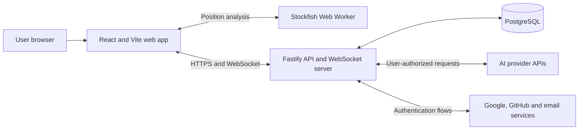

# Architecture

**Status:** Proposed baseline for MVP  
**Last updated:** 2026-08-21

## Architectural drivers

- A server-authoritative chess state prevents clients and models from creating illegal or conflicting moves.
- Four AI providers must behave through one normalized contract while retaining provider-specific capabilities.
- Bring-your-own-key credentials require strict storage, transport, and logging boundaries.
- Human games need realtime updates and reconnection.
- AI games deliberately stop when the controlling browser session is absent, so the MVP does not need a durable background-job platform.
- The stack should remain portable until a hosting platform is selected.

## System context



The web application never calls an AI provider directly. The API normalizes model discovery, capabilities, move requests, usage, errors, and redaction.

## Repository shape

The initial implementation is an npm workspaces monorepo:

```text
apps/
  web/          Pages, UI, client state, WebSocket client, Stockfish worker
  api/          HTTP API, WebSocket server, auth, game orchestration, providers
packages/
  chess/        Domain types and deterministic chess helpers
  contracts/    Runtime schemas and shared transport types
  database/     Drizzle schema, migrations, repositories
  config/       Shared TypeScript, lint, and test configuration
docs/           Product, architecture, roadmap, and ADRs
```

Packages expose intentional public entry points. The web application may import shared contracts and chess presentation helpers but not API repositories, provider clients, or credential code.

## Components

### Web application

Responsibilities:

- render the dark, responsive arena UI;
- collect provider/model/parameter configuration;
- hold session-only provider keys in memory;
- initiate exactly one AI turn at a time;
- maintain HTTP and WebSocket session state;
- run Stockfish analysis in a Web Worker without blocking rendering;
- send display-only evaluation results to the API for saved games;
- localize all user-facing text.

The client is not authoritative for legal moves, game results, authorization, participant identity, or room state.

### Fastify API

Recommended modules:

```text
auth          Better Auth integration and profile lifecycle
users         usernames, avatars, deletion, and history ownership
credentials   session credential handling and encrypted saved credentials
providers     OpenAI, Anthropic, Google, and OpenRouter adapters
games         game commands, reads, lifecycle, replay, and PGN
chess         server-side legality and result evaluation
rooms         invitation codes, membership, reconnection, and abort
realtime      WebSocket authentication, events, and connection registry
analysis      persisted Stockfish samples and post-game aggregates
```

Fastify route schemas validate external input and serialize explicit response shapes. Domain services do not depend on Fastify request objects.

### PostgreSQL and Drizzle

PostgreSQL is the durable system of record. Drizzle ORM defines the schema in TypeScript and Drizzle Kit produces reviewed SQL migrations. Use the latest stable release line; do not base the MVP on Drizzle v1 beta/RC relations APIs.

Core tables are expected to include:

| Table                  | Purpose                                                            |
| ---------------------- | ------------------------------------------------------------------ |
| Better Auth tables     | users, accounts, sessions, verification records                    |
| `profiles`             | unique username, avatar metadata, preferences                      |
| `provider_credentials` | encrypted key material and provider metadata                       |
| `games`                | mode, state, result, FEN, PGN, ownership, privacy, version         |
| `game_participants`    | human, guest, or AI seat configuration                             |
| `moves`                | canonical move, position, commentary, timing, evaluation           |
| `model_invocations`    | attempts, provider/model, parameters, usage, cost estimate, errors |
| `rooms`                | private invitation code, owner, membership, lifecycle              |
| `guest_sessions`       | expiring identity and active-game recovery metadata                |

Stable relational fields stay in typed columns. Bounded provider-specific parameter, usage, and error metadata may use `jsonb`. Provider keys never appear in JSON metadata.

Enforce one active or paused game per user or guest session with a database constraint where practical and an application-level check with a clear conflict response.

### Stockfish worker

Stockfish runs inside a browser Web Worker after every accepted move. Analysis is asynchronous and must not block the next visual update. The web app may persist evaluation score, mate distance, depth, and principal variation for replay.

Stockfish data is display and analysis metadata, not authoritative chess state. It is never included in an LLM prompt. Because client-computed analysis is untrusted, it must not later be reused for ratings, prizes, or security-sensitive decisions.

## Game command model

All game mutations are commands against a game version. The server validates:

1. requester identity and participation;
2. current game state;
3. expected side to move;
4. expected game version;
5. move legality;
6. resulting game state and termination.

The server persists the move and updated game state atomically. Duplicate or stale commands return the current state instead of appending another move.

### AI turns

The browser requests one AI turn at a time. The API:

1. authorizes the requester and reserves the expected turn/version;
2. builds the canonical model context from server state;
3. resolves a session-only key from the request or decrypts an explicitly saved credential;
4. calls the selected provider adapter outside a long-running database transaction;
5. validates and normalizes the response;
6. retries model-invalid output at most twice;
7. commits the legal move only if the game version is still current;
8. returns the new state and normalized telemetry.

The reservation must be idempotent so multiple clicks, retries, or network duplicates cannot cause multiple moves. If the controlling tab disconnects, automatic turn requests stop and the game becomes paused.

### Human turns

Human moves use the same authoritative command path without a provider call. For online games, the accepted state is broadcast to both room participants over WebSocket. Reconnecting clients fetch a full snapshot before processing later events.

## AI provider boundary

Each provider adapter implements equivalent operations conceptually:

```ts
interface AiProviderAdapter {
  listModels(input: ListModelsInput): Promise<ModelDescriptor[]>;
  requestMove(input: MoveRequest): Promise<NormalizedMoveResponse>;
}
```

`ModelDescriptor` includes capability metadata used to build a capability-aware configuration UI. The server filters unsupported parameters rather than sending speculative fields to a provider.

The normalized move response contains:

- required UCI move;
- optional viewer commentary;
- provider request identifier when safe to retain;
- latency;
- normalized token usage when available;
- raw provider usage fields in bounded, non-secret metadata;
- retry and error classification.

Model lists come from the selected provider through the API and may be cached briefly. A model being listed does not guarantee it supports the required chess response contract; adapters must surface capability or runtime errors clearly.

## Error taxonomy

Errors are classified before game policy is applied:

| Class                  | Examples                                      | Game effect                      |
| ---------------------- | --------------------------------------------- | -------------------------------- |
| `model_invalid`        | malformed payload, missing move, illegal move | retry twice, then technical loss |
| `provider_auth`        | rejected API key                              | pause                            |
| `provider_quota`       | quota, balance, or rate limit                 | pause                            |
| `provider_timeout`     | provider request timeout                      | pause                            |
| `provider_unavailable` | network or upstream failure                   | pause                            |
| `game_conflict`        | stale version or duplicate command            | refresh current state            |
| `authorization`        | user is not allowed to act                    | reject without changing game     |

Missing commentary is not an error.

## Authentication and guest sessions

Better Auth manages email/password, Google, GitHub, email verification, password reset, and authenticated sessions in PostgreSQL. Profiles add a unique username and avatar metadata.

Guests receive an opaque, expiring identifier in a Secure, HttpOnly cookie. Temporary active-game metadata may be retained long enough to recover from a refresh but does not appear in durable history and is deleted after the configured inactivity period.

After refresh, an AI game is restored as paused. Provider keys must be entered again unless the authenticated user previously opted into encrypted storage.

## Credential lifecycle

### Session-only credential

1. The browser accepts the key into in-memory state.
2. It sends the key over HTTPS only to provider-related API operations that require it.
3. The API uses it within that request and does not persist or log it.
4. Refreshing or closing the tab removes it; a restored game remains paused until re-entry.

### Saved credential

1. Only an authenticated user may opt in to saving a key.
2. The API encrypts the key with authenticated encryption before database insertion.
3. The database stores ciphertext and required cryptographic metadata, never the plaintext key.
4. The encryption key lives in deployment secret storage, separately from PostgreSQL.
5. Reads return masked metadata only. Decryption occurs only for an authorized provider call.
6. Users can revoke individual saved keys, clear credentials, or delete the account.

All request logging and exception reporting must redact credential fields, authorization headers, cookies, URLs with tokens, and provider secrets.

## Realtime rooms

The Fastify process owns active WebSocket connections. PostgreSQL stores canonical room and game state, allowing a client to reconnect after a connection loss or process restart.

MVP assumptions:

- one API instance is sufficient;
- no Redis dependency;
- invitation codes are random, unguessable, stored safely, and revocable;
- only an authenticated room owner can abort the room;
- an aborted game is retained for registered participants;
- games and rooms are private.

If the API is scaled horizontally, add a shared pub/sub or connection-routing layer through a new ADR.

## Telemetry and cost

Store operational metadata required by the product: provider/model, attempt number, duration, reported tokens, normalized errors, and estimated cost. Never store raw keys. Avoid storing complete raw provider payloads by default; retain the normalized move and user-facing commentary needed for replay.

Cost calculation uses provider-reported token counts and versioned pricing metadata when available. Every cost is labeled as an estimate. Unknown usage or price produces `unavailable`, not zero.

## API shape

The exact paths remain an implementation detail, but the API needs these capability groups:

- auth and profile management;
- provider model discovery and credential management;
- game creation, snapshot, command, pause/resume, abort, replay, deletion, and PGN;
- room creation, invitation resolution, join, reconnect, and abort;
- WebSocket snapshot/event protocol;
- history listing and account/data deletion.

Generate OpenAPI from Fastify route schemas. Version WebSocket event payloads through shared runtime schemas.

## Verification strategy

- Unit tests: chess state transitions, legal move validation, result rules, provider normalization, retry classification, cost calculation, and redaction.
- Integration tests: Fastify routes, Better Auth authorization, Drizzle repositories, migrations, credential encryption, deletion cascades, and idempotent AI turns.
- WebSocket tests: invitation join, move broadcast, disconnect/reconnect snapshot, owner abort, and unauthorized access.
- Provider contract tests: recorded or mocked responses for every adapter; no live paid calls in the default suite.
- End-to-end tests: the three game modes, guest restrictions, history/replay/PGN, responsive layouts, and key lifecycle.

## Deployment constraints

The web app can be hosted as static assets. The API hosting environment must support a long-running Node.js Fastify process and persistent WebSocket connections. PostgreSQL should be managed or backed up appropriately and reached over TLS. Both applications should be containerizable.

The exact providers, production region, email delivery service, object storage for custom avatars, observability service, and backup policy remain open decisions.
