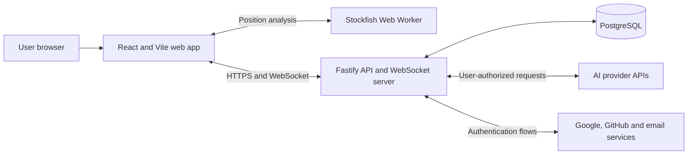
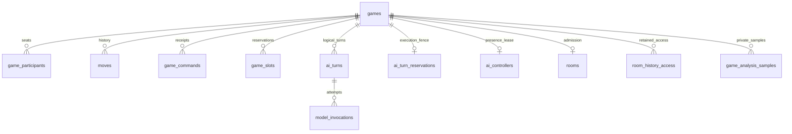
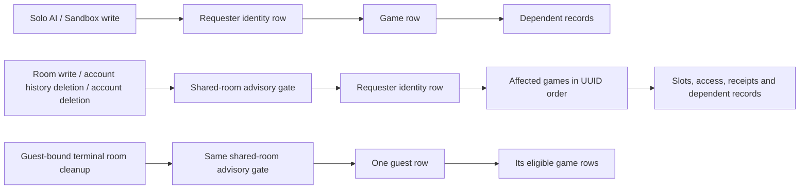

# Architecture

**Status:** Current architecture contract

**Last updated:** 2026-10-27

The production system uses a static React application, one Fastify HTTP/WebSocket process, and PostgreSQL. A deterministic chess aggregate owns every accepted position and result. AI providers choose from server-supplied legal moves; browser Stockfish analysis supplies private display data only. Implementation status belongs in the [roadmap](roadmap.md).

## Architectural drivers

- Server authority prevents clients and models from creating illegal or conflicting moves.
- Four provider adapters normalize discovery, capabilities, move requests, usage, failures, and redaction.
- Bring-your-own-key credentials require explicit storage, transport, authorization, and logging boundaries.
- Private human rooms need authoritative realtime updates and reconnect recovery.
- AI play requires a live controlling browser; durable leases fence absence without a background inference queue.
- The accepted single-host Oracle deployment keeps one socket owner; portable containers preserve a future hosting option.

## System context



The web application never calls an AI provider directly. The API normalizes model discovery, capabilities, move requests, usage, errors, and redaction.

## Repository shape

The implementation is an npm workspaces monorepo:

```text
apps/
  web/          Pages, UI, client state, WebSocket client, Stockfish worker
  api/          HTTP API, WebSocket server, auth, game orchestration, providers
packages/
  chess/        Domain types and deterministic chess helpers
  contracts/    Runtime schemas and shared transport types
  database/     Drizzle schema, migrations, repositories
  config/       Shared TypeScript, lint, and test configuration
docs/           Product, architecture, roadmap, and ADRs
```

Packages expose intentional public entry points. The web application may import shared contracts and chess presentation helpers but not API repositories, provider clients, or credential code.

## Components

| Component                                    | Responsibility                                                                                         | Detailed contract                                                    |
| -------------------------------------------- | ------------------------------------------------------------------------------------------------------ | -------------------------------------------------------------------- |
| React/Vite web app                           | Route entry, identity observation, page-memory keys, complete snapshots, accessible controls, replay   | [Browser architecture](architecture/browser.md)                      |
| Deterministic chess package and game service | Legal moves/results, versioned commands, persistence, AI reservations and controller recovery          | [Game commands and AI execution](architecture/games.md)              |
| Auth, profile, and credential services       | Server-derived principals, exact-session authorization, encrypted saved keys, private history/deletion | [Identity and credentials](architecture/identity-and-credentials.md) |
| Provider adapters and pricing                | Credential-scoped discovery/inference, normalized outcomes, invocation metadata and stored estimates   | [Providers and telemetry](architecture/providers.md)                 |
| Room service and realtime transport          | Admission, participant slots/access, HTTP commands, authorized socket snapshots/presence               | [Private rooms](architecture/rooms.md)                               |
| Stockfish worker and analysis API            | Bounded browser computation and independent account/game/ply samples                                   | [Analysis](architecture/analysis.md)                                 |

### Fastify API

Current implementation paths (relative to the repository root):

| Path                                                                           | Responsibility                                                                                                               |
| ------------------------------------------------------------------------------ | ---------------------------------------------------------------------------------------------------------------------------- |
| `apps/api/src/app.ts`, `apps/api/src/server.ts`                                | API composition, startup, and service lifetimes                                                                              |
| `apps/api/src/auth/`                                                           | Better Auth integration, email/OAuth flows, and account-deletion entry point                                                 |
| `apps/api/src/profiles/`                                                       | Usernames, avatar metadata, and profile settings                                                                             |
| `apps/api/src/identity/`, `apps/api/src/guests/`                               | Server-derived principals, validity/locking, and guest sessions                                                              |
| `apps/api/src/credentials/`                                                    | Request-scoped provider access and encrypted saved credentials                                                               |
| `apps/api/src/providers/`                                                      | Provider adapters, standalone model-discovery service/routes, normalization, and request cancellation                        |
| `apps/api/src/games/`                                                          | Game commands/reads, AI execution and controller presence, history ownership/deletion, account game cleanup, replay, and PGN |
| `apps/api/src/rooms/`                                                          | Invitations, admission, membership, and room lifecycle                                                                       |
| `apps/api/src/realtime/`                                                       | Human-room WebSocket authentication, presence, synchronization, events, and connection registry                              |
| `apps/api/src/analysis/`, `apps/api/src/pricing/`                              | Private Stockfish samples and provider cost estimates, respectively                                                          |
| `apps/api/src/limits/`, `apps/api/src/monitoring/`, `apps/api/src/operations/` | Request budgets, operational health/metrics, and reconciliation CLI                                                          |
| `packages/chess/src/`                                                          | Deterministic position, legality, and result authority used by the API                                                       |

Profile and account/game lifecycle responsibilities are split across these modules; there is no `users` or `chess` directory inside the API.

Fastify route schemas validate external input and serialize explicit response shapes. Domain services do not depend on Fastify request objects.

`providers/model-service.ts` owns standalone discovery authorization and credential resolution; `providers/routes.ts` registers `/providers/models` independently of game routes. Composition shares guest services, adapters, credential ciphers, and monitoring instances with game execution. Turn-scoped discovery and parameter selection remain in the AI executor.

The API's `identity` module defines a credential-free, server-derived `Principal` and its database validity/locking boundary. Guest token verification and cookie renewal stay in `guests`; game authorization consumes the principal rather than the guest authentication service. See [ADR-0013](decisions/0013-server-derived-principals-and-account-lifecycle.md) for the account extension and cleanup rules.

### PostgreSQL and Drizzle

PostgreSQL is the durable system of record. Drizzle ORM defines the schema in TypeScript and Drizzle Kit produces reviewed SQL migrations. Use the latest stable release line; do not base the MVP on Drizzle v1 beta/RC relations APIs.

`packages/database/src/game-repository.ts` composes identity, game-state, AI-execution, credential-access, room, and analysis repositories on the same connection or transaction. Their interfaces live in the corresponding `*-repository.ts` modules; API helpers accept only the capabilities they need. Extracted capabilities do not start independent transactions. Read transactions use read-only `REPEATABLE READ`; writes use `READ COMMITTED` and the lock order below. `schema/ai-parameters.ts` supplies the shared participant/invocation parameter predicate while nullable rules and constraint names remain in `schema/games.ts`.

The current durable records are defined in [the database schema](../packages/database/src/schema/index.ts):

| Records                                  | Responsibility and authority                                                                                                 |
| ---------------------------------------- | ---------------------------------------------------------------------------------------------------------------------------- |
| Better Auth tables; `profiles`           | Accounts, login methods, sessions, verification/rate-limit records; username/avatar preferences do not identify a game owner |
| `guest_sessions`                         | Token digest, internal guest identity, last activity and access expiry                                                       |
| `provider_credentials`                   | Owner/provider-scoped authenticated ciphertext and masked metadata; no plaintext storage                                     |
| `games`, `game_participants`             | Mode, lifecycle/result, cached FEN/PGN, version and ownership; independent human/AI seat configuration                       |
| `moves`, `game_commands`                 | Canonical ordered UCI history and projections; accepted game-scoped command IDs/revisions                                    |
| `game_slots`                             | One unfinished public game per account/guest, plus an independent guest Sandbox slot                                         |
| `ai_turns`, `model_invocations`          | Logical next-ply invalid-output budgets; numbered attempts, effective parameters, safe outcomes, usage and price provenance  |
| `ai_turn_reservations`, `ai_controllers` | One execution fence and one browser-presence lease per AI game; neither stores a credential                                  |
| `rooms`, `room_creation_operations`      | Waiting/joined admission and invitation digests; bounded account creation-retry records that survive result deletion         |
| `room_history_access`                    | Independent account entitlement to terminal shared history, separate from ownership and seats                                |
| `game_analysis_samples`                  | Private account/game/ply evaluations and verified analysis provenance; no chess authority                                    |

Selected game relationships are shown below; account/guest ownership and access rules are defined by the linked contracts, not inferred from this diagram.



Stable relational fields stay in typed columns. Bounded provider-specific parameters, usage/billing metadata, and rates may use `jsonb`; provider keys never appear in JSON metadata. Room-creation operations are outside game cascades: deletion clears their result reference while preserving consumed/unavailable status until expiry or replacement. See the [room persistence contract](architecture/rooms.md#shared-room-persistence-and-access).

Solo games have exactly one owner, `owner_guest_session_id` or `owner_user_id`; Sandbox requires a guest owner. Human seats have at most one guest/account reference, and an identity occupies at most one seat per game; AI seats have neither. Normalized slot reservations cover owners and joined participants across public modes. Retained partial owner indexes provide additional uniqueness protection; they cannot alone enforce a non-owner participant's slot. Legacy guest owners and unassigned Sandbox Black seats remain supported.

Account foreign keys do not cascade user deletion into games. The dedicated lifecycle removes solo games explicitly and aborts/anonymizes or cleans up shared rooms under their retention rules. Only terminal human-room records may become ownerless. Full-history restoration verifies cached FEN/PGN and move projections; inconsistent data is rejected rather than silently repaired.

## Authority boundaries

| Decision                     | Authority                                                                        | Boundary                                                                                  |
| ---------------------------- | -------------------------------------------------------------------------------- | ----------------------------------------------------------------------------------------- |
| Position, legal move, result | Server deterministic aggregate reconstructed from complete UCI history           | Neither LLM output nor Stockfish evaluation can authorize a move/result                   |
| Request identity             | Verified account session or guest cookie resolved by the API                     | Expected-account headers/socket fields reject mismatches; they never grant authority      |
| Human move/resignation       | Current assigned human seat plus valid version/lifecycle                         | Ownership alone does not authorize playing an AI or opponent seat                         |
| AI execution                 | Owner, current AI seat, exact session, revision, reservation and live controller | Saved credentials authorize provider access only; no automatic takeover after uncertainty |
| Room administration          | Account owner and room lifecycle                                                 | Invitations admit one participant; they grant no preview or spectator access              |
| Terminal shared reads        | Remaining account retained access or original valid guest participation          | Owner/seat references cannot restore deleted account access                               |
| Analysis                     | Authorized viewer's own sample and verified history prefix                       | Scores remain untrusted display data and never enter model context                        |

The [game command contract](architecture/games.md#game-command-model) specifies conflict-check order and atomic receipts. [Identity and credential rules](architecture/identity-and-credentials.md) define exact-session fencing, account precedence, key resolution, and deletion. [Room rules](architecture/rooms.md) distinguish current membership, room ownership, and terminal retained access.

## Transaction and lock order

Reads establish authorization in a consistent read-only snapshot. Writes follow one order on one database connection; callbacks and composed repository capabilities reuse the caller's transaction.



Auth/profile/credential-only writes lock the account before their dependent rows. Solo analysis follows requester account → game → sample; room analysis prepends the shared-room gate. Shared account deletion acquires the gate before the outer auth-user lock. Recheck exact session, profile where required, and applicable deadlines after lock waits and before committing; cleanup has its own stored-identity authority and cannot renew a session or call a provider.

Never acquire the shared-room gate after an identity/game lock or acquire a peer identity lock after the requester/game. Establish retained account access at admission so completion need not create peer identity references. Guest-bound terminal cleanup runs separately after commit and through startup/periodic sweeps, synchronizing with renewal before checking expiry. The [shared write protocol](architecture/rooms.md#shared-room-write-order) defines the complete ordering and race requirements.

External provider calls, SMTP delivery, and socket publication stay outside these write transactions. Publish only committed changes. AI outcome writes recheck all execution fences; uncertainty never expires into automatic provider redispatch. [Recovery](recovery.md) handles database restoration and post-snapshot deletion/revocation reconciliation.

## API shape

HTTP routes own validated auth/profile/credential operations, provider discovery, game creation/commands/reads, private history/deletion, analysis, and room admission/administration. WebSockets at `/rooms/realtime` deliver private human-room snapshots, committed changes, and presence; AI execution and telemetry remain HTTP. Native browser sockets authenticate with cookies plus a versioned identity-expectation subscription before private delivery.

Shared runtime schemas live in `packages/contracts`; Fastify validates requests and serializes explicit responses. The [development API reference](reference/http-api.md#sandbox-api) supplies concrete routes and usage. OpenAPI document generation from these schemas is **deferred** and tracked in [post-MVP candidates](roadmap.md#post-mvp-candidates); schema convertibility is tested, but no generated specification or documentation endpoint is currently provided. WebSocket payloads already use versioned shared runtime schemas.

## Verification strategy

- Unit tests: chess state transitions, legal move validation, result rules, provider normalization, retry classification, cost calculation, and redaction.
- Integration tests: Fastify routes, Better Auth authorization, Drizzle repositories, migrations, credential encryption, deletion cascades, and idempotent AI turns.
- WebSocket tests: invitation join, move broadcast, disconnect/reconnect snapshot, owner abort, and unauthorized access.
- Provider contract tests: recorded or mocked responses for every adapter; no live paid calls in the default suite.
- End-to-end tests: the three game modes, guest restrictions, history/replay/PGN, responsive layouts, and key lifecycle.

The foundational Sandbox regression suite must additionally verify:

- one guest completes a game through human commands, replays it, and exports PGN without loading a provider adapter; another guest cannot read or mutate any of these resources;
- sandbox creation/control paths are unavailable when disabled, production cannot enable them, and ordinary games never inherit authority over both seats;
- concurrent game creation respects the active/paused limit, completion or abortion releases the slot, and duplicate move submissions append only one move;
- refresh recovers an unfinished game paused, and resume preserves the full move history;
- repeating `g1f3 g8f6 f3g1 f6g8` twice from the initial position ends the game on the eighth half-move, including after database restoration between the cycles;
- internal fixtures verify the 99-to-100 half-move boundary, pawn/capture counter resets, repetition identity, and checkmate priority without exposing arbitrary-FEN creation;
- completed and aborted games reject new moves, and replay/PGN agree with the persisted result and termination reason.

## Deployment constraints

[ADR-0020](decisions/0020-single-host-production-deployment.md) selects Oracle Always Free in Frankfurt, Caddy for static assets/HTTPS, exactly one long-running API container/socket owner, and self-managed PostgreSQL reached over verified TLS, within a $0 hosting budget. Both applications are containerized. Horizontal socket ownership requires a new ADR and shared pub/sub or connection routing; rolling API overlap is not supported.

The [operations runbook](operations.md) owns artifacts, same-site origins, secrets, database TLS, request limits, monitoring, and stop/drain/migrate/restart rollout. Static hosting follows the [SPA fallback contract](reference/browser.md#browser-routes). The private operational collector exports only fixed aggregate counters; monitoring failure cannot affect chess state. The [recovery runbook](recovery.md) owns independent secret recovery, encrypted backups, isolated restore, reconciliation, and controlled promotion.

Live SMTP/OAuth/provider configuration, cloud monitoring/recovery, and device verification remain [release checks](operations.md#mvp-release-acceptance), with status in the [roadmap](roadmap.md#phase-5--analysis-polish-and-release-hardening). Custom avatar uploads remain deferred by the [profile policy](product.md#usernames-and-avatars).
