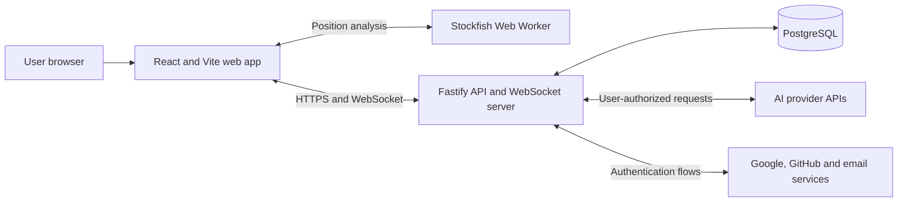

# Architecture

**Status:** Proposed baseline for MVP  
**Last updated:** 2026-10-10

## Architectural drivers

- A server-authoritative chess state prevents clients and models from creating illegal or conflicting moves.
- Four AI providers must behave through one normalized contract while retaining provider-specific capabilities.
- Bring-your-own-key credentials require strict storage, transport, and logging boundaries.
- Human games need realtime updates and reconnection.
- AI games deliberately stop when the controlling browser session is absent, so the MVP does not need a durable background-job platform.
- The stack should remain portable until a hosting platform is selected.

## System context



The web application never calls an AI provider directly. The API normalizes model discovery, capabilities, move requests, usage, errors, and redaction.

## Repository shape

The initial implementation is an npm workspaces monorepo:

```text
apps/
  web/          Pages, UI, client state, WebSocket client, Stockfish worker
  api/          HTTP API, WebSocket server, auth, game orchestration, providers
packages/
  chess/        Domain types and deterministic chess helpers
  contracts/    Runtime schemas and shared transport types
  database/     Drizzle schema, migrations, repositories
  config/       Shared TypeScript, lint, and test configuration
docs/           Product, architecture, roadmap, and ADRs
```

Packages expose intentional public entry points. The web application may import shared contracts and chess presentation helpers but not API repositories, provider clients, or credential code.

## Components

### Web application

Responsibilities:

- render the dark, responsive arena UI;
- collect provider/model/parameter configuration;
- hold session-only provider keys in memory;
- initiate exactly one AI turn at a time;
- maintain HTTP and WebSocket session state;
- run Stockfish analysis in a Web Worker without blocking rendering;
- send display-only evaluation results to the API for saved games;
- localize all user-facing text.

The client is not authoritative for legal moves, game results, authorization, participant identity, or room state.

#### Browser routing

The web source separates `app/` startup wiring, route composition, and error boundaries from `routing/` runtime services, navigation, game lifetimes, URL builders, route-data helpers, context, and effects. `shell/` owns page landmarks, navigation presentation, notices, static screens, and document metadata. Routing cannot import application composition or the shell; the shell cannot import application wiring, APIs, or features. Feature routes may use the shared `app/public-page.tsx` guard but cannot import other application wiring.

[ADR-0017](decisions/0017-data-router-and-canonical-game-paths.md) adopts one React Router Data-mode browser router, constructed before React render from explicit route objects in `app/routes.tsx`. Vite remains the bundler; there is no Framework-mode plugin or server rendering. Shared mode layouts span setup and game leaves. Route metadata drives titles and current navigation state, including Arena on `/games/:gameId` and Sandbox on `/sandbox/games/:gameId`.

Auth, Profile, Credentials, History, and Arena own their route components and route data; `app/routes.tsx` assembles them. Profile owns account settings, onboarding, and deletion presentation. The shared identity/onboarding guard is application composition in `app/public-page.tsx`, so Auth never imports other features. Dependency rules permit cross-feature imports only through the explicitly declared paths in `dependency-cruiser.config.mjs`.

Navigation reads Sandbox availability from the route context, including loading and error branches; screens do not pass the flag through their presentation props. Isolated screen fixtures provide the same context without running public loaders.

`routing/route-context.ts` owns page metadata and the `AppPage` type; `routing/route-navigation.ts` owns `GameTarget`. Auth callback parsing, scrubbing, and page-memory reset input remain in `auth/auth-entry.ts`. Router construction and identity subscriptions remain in `app/router.tsx`.

`routing/route-data.ts` shares protected-loader failure handling, duplicate-safe strict form parsing, action cancellation scopes, expected-account checks, and self-POST revalidation. Features retain their endpoint validation and error policies. `routing/fenced-results.ts` clears issued metadata/history references and fences reads begun before an acknowledged mutation; credential saves retain already-issued metadata while fencing earlier reads. Named account and credential UUID schemas in `api/identifier-schemas.ts` derive from their own transport contracts.

The root does not request identity. `routing/route-runtime.ts` owns one account service for the public branch, and `AccountApplication` provides its observed state around an outlet. Every public leaf loader resolves identity through the same deduplicated service; it cannot rely on a parent loader running first. Identity loaders return only an access code and generation. Session/profile projections and safe return destinations stay in page memory. Sandbox/reference and unavailable routes remain outside this service. Game loaders reject invalid parameters, legacy entry queries, and mixed targets before any identity request.

Identity invalidation synchronously clears the values already issued to router loader/action/fetcher caches and aborts the old authority. Generation guards hide private screens immediately, including during a pending navigation; guarded revalidation waits for identity resolution. Same-identity profile refreshes retain the generation and live controller. Email lifecycle, OAuth initiation, sign-out, and explicit guest continuation use route actions. Acknowledgements use fetchers and bounded outcome/field codes; successful destination changes replace history. Sign-out submits the displayed account expectation and rejects a replacement identity. A pending navigation cancels obsolete auth submissions without treating cancellation as proof that the server did not commit.

Arena leaf loaders in `match/route-data.ts` own unfinished-game discovery at `/` and private details at `/games/:gameId`, together with applicable masked credential metadata. Requests use the route and identity cancellation signals, and results share the runtime's generation fence. Loaders never bootstrap a guest or issue gameplay commands. The setup form consumes discovery; the match owner consumes committed details and performs one versioned recovery pause for an unfinished AI game. A creation handoff reuses the existing owner without a details read or recovery. Terminal entry reads replay and telemetry within the feature lifetime without requesting credentials or acquiring control. Human rooms use their own synchronized controller as described under [realtime rooms](#realtime-rooms).

Same-game action revalidation skips the entry read while identity changes and explicit revalidation still read. Ordinary revalidated details cannot restart recovery, replace an accepted controller snapshot, or reset keys. A fresh access denial clears the private view; an explicit retry after an entry failure or canceled departure reads again before entering. Telemetry polling, replay selection, PGN delivery, provider discovery and all gameplay writes remain controller-owned.

History uses one account/profile-gated loader for entry and cursor fetchers, with generation-scoped results. Deletion actions validate confirmation, intent, game UUID where applicable, and the displayed account expectation before calling the existing API. Confirmed deletion clears every issued History page and fences older reads; the screen resets its pagination fetcher before revalidating. Confirmation and cursor navigation remain local UI state. Failed acknowledgements require explicit retry or refresh, and cancellation never proves that a server write stopped.

Account settings project the account service's validated profile through a scoped loader. Profile changes, avatar removal and confirmed account deletion use validated fetcher actions with the displayed account expectation. Same-identity profile observation updates the projection without ending gameplay; onboarding completion replaces the page with the allowlisted return destination. Deletion retains the account transition service's immediate privacy cleanup, recent-sign-in requirement and distinct confirmed/unconfirmed outcomes, including before onboarding.

The router's pending-destination subscription ends gameplay lifetimes immediately. A short-lived memory-only handoff allows controller-accepted creation or discovered recovery to update the address without another entry read or pause; ordinary revalidation does not recreate the owner. Navigation to another game, departure, identity invalidation, and pagehide still clear requests, timers, keys, and private views. Canceled departure leaves controls stopped until explicit recovery. Route errors expose only localized bounded copy; fatal module/render failures offer reload and usable navigation. Auth fragments/callback fields are scrubbed before constructing the router, with reset tokens retained only in the bootstrap closure and destroyed on success, departure, or pagehide. Internal links use router navigation; validated OAuth departure, fatal reload, native hash focus, and file delivery remain browser operations.

Explicit page changes focus main content; creation preserves accepted-Start board focus. Initial recovery, ordinary game updates, and revalidation do not move focus or scroll. Back/Forward restores bounded in-memory scroll coordinates keyed by router entry keys, without persisting private paths.

New pages extend this route tree and its feature-owned loader/action modules; they do not add path dispatch, browser history subscriptions, or initial-fetch effects. Bootstrap invitation sanitization is a narrow exception: it captures native fragment arrivals before the router can retain a secret, preserves the router's history index, and hands the value only to bounded entry memory; it never selects a route. Route adapters require the shared runtime/navigation context and committed entry data. Gameplay controllers expose entry and lifetime cleanup, keeping only command recovery and feature reads whose lifetime requires them. Isolated presentation fixtures supply routing context without mounting public loaders. Follow the [route extension procedure](development.md#extending-routes) and track delivery in the [roadmap](roadmap.md#navigation-and-route-data-migration--before-phase-4).

### Fastify API

Recommended modules:

```text
auth          Better Auth integration and profile lifecycle
users         usernames, avatars, deletion, and history ownership
credentials   session credential handling and encrypted saved credentials
providers     OpenAI, Anthropic, Google, and OpenRouter adapters
games         game commands, reads, lifecycle, replay, and PGN
chess         server-side legality and result evaluation
rooms         invitation codes, membership, reconnection, and abort
realtime      WebSocket authentication, events, and connection registry
analysis      persisted Stockfish samples and post-game aggregates
```

Fastify route schemas validate external input and serialize explicit response shapes. Domain services do not depend on Fastify request objects.

The API's `identity` module defines a credential-free, server-derived `Principal` and its database validity/locking boundary. Guest token verification and cookie renewal stay in `guests`; game authorization consumes the principal rather than the guest authentication service. See [ADR-0013](decisions/0013-server-derived-principals-and-account-lifecycle.md) for the account extension and cleanup rules.

### PostgreSQL and Drizzle

PostgreSQL is the durable system of record. Drizzle ORM defines the schema in TypeScript and Drizzle Kit produces reviewed SQL migrations. Use the latest stable release line; do not base the MVP on Drizzle v1 beta/RC relations APIs.

Core tables are expected to include:

| Table                   | Purpose                                                            |
| ----------------------- | ------------------------------------------------------------------ |
| Better Auth tables      | users, accounts, sessions, verification records                    |
| `profiles`              | unique username, avatar metadata, preferences                      |
| `provider_credentials`  | encrypted key material and provider metadata                       |
| `games`                 | mode, state, result, FEN, PGN, ownership, privacy, version         |
| `game_participants`     | human, guest, or AI seat configuration                             |
| `moves`                 | canonical move, position, commentary, timing                       |
| `game_analysis_samples` | private account/game/ply evaluation and analysis provenance        |
| `game_commands`         | accepted command identity, kind, and aggregate revision            |
| `model_invocations`     | attempts, provider/model, parameters, usage, cost estimate, errors |
| `rooms`                 | private invitation code, owner, membership, lifecycle              |
| `guest_sessions`        | expiring identity and active-game recovery metadata                |

Stable relational fields stay in typed columns. Bounded provider-specific parameter, usage, and error metadata may use `jsonb`. Provider keys never appear in JSON metadata.

Enforce the [public-mode and independent Sandbox limits](product.md#development-sandbox) with database constraints and an application-level conflict response. Existing solo games have exactly one owner: `owner_guest_session_id` or `owner_user_id`, each with a foreign key. Sandbox requires a guest owner. The partial unique index on `(owner_guest_session_id, is_sandbox)` reserves one active/paused slot per guest group; a separate partial unique index on `owner_user_id` reserves one unfinished public game across all sessions of an account. Concurrent creation cannot bypass these limits; see [ADR-0012](decisions/0012-independent-sandbox-game-slot.md).

Human participant rows have at most one guest/account reference, and an account can occupy at most one seat per game. AI seats have neither identity. Legacy guest owners, unassigned Sandbox Black seats, histories, and execution records remain intact. Account foreign keys do not cascade user deletion into games; the dedicated account-deletion lifecycle must remove application data explicitly. Owner-only uniqueness does not cover joining a room as a non-owner: the [shared persistence contract](#shared-room-persistence-and-access) extends reservations and permits ownerless terminal room records without weakening solo-game ownership.

### Stockfish worker

The [accepted analysis decision](decisions/0019-browser-analysis-and-private-samples.md) selects browser computation and independent account samples. This section is the implementation contract; the [roadmap](roadmap.md#phase-5--analysis-polish-and-release-hardening) records delivery. Analysis covers all three public modes, including live human rooms, plus private replay. It never acquires an AI controller, requests credentials, dispatches inference, or changes chess state.

#### Engine and analysis profile

Self-host only the lite single-threaded JS/WASM pair from the exact npm package `stockfish@19.0.0`; no version range or runtime CDN resolution. Resolve assets relative to the built application base so private deep links work, keep the pair together with correct JavaScript/WASM MIME types, and lazy-load only when an authorized game view needs computation. No SharedArrayBuffer or cross-origin-isolation headers are required for this build. Do not switch engine flavor based on device speed or silently fall back to ASM.js. Distribution materials and source matching follow [ADR-0019](decisions/0019-browser-analysis-and-private-samples.md#distribution-and-licensing).

The initial immutable profile is `sf19-lite-single-v1`, rank 1. Its server-owned manifest binds engine/package version, artifact and network hashes, source/build provenance, score normalization, and all options below. A change to any of these creates a new profile ID and increasing rank; clients cannot choose the rank or arbitrary engine options.

| Resource       | Initial limit                                                                                                                                                       |
| -------------- | ------------------------------------------------------------------------------------------------------------------------------------------------------------------- |
| Concurrency    | One worker per mounted game view, one search at a time; no background/shared worker                                                                                 |
| Engine options | Single thread, `Hash=16` MiB, `MultiPV=1`, `Ponder=false`, `UCI_LimitStrength=false`, `Skill Level=20`, `UCI_Chess960=false`; no tablebase/network probing          |
| Search         | `go depth 18 nodes 1000000 movetime 1000`; stop at the first engine limit, retain actual achieved depth                                                             |
| Initialization | 15 seconds from worker creation through `uciok`, option setup and `readyok`; subsequent readiness/stop acknowledgement at most 1 second                             |
| Watchdog       | 2 seconds per search, then `stop`; terminate if no `bestmove` within 1 additional second                                                                            |
| Scheduling     | One in-flight request and at most two pending descriptors: latest displayed target and next missing historical ply; at least 250 ms idle between completed searches |
| Output         | 16 KiB per UCI line, 64 KiB partial-message buffer; discard raw lines after parsing and fail closed on overflow                                                     |

The 16 MiB hash setting is not a total memory claim. The pinned source configures 128 MiB initial and 2 GiB maximum WASM linear memory; P5-02 must verify these ceilings in the packaged module, reject a larger artifact, and record them in the profile manifest. Browser/JS overhead is additional and has no portable hard cap. Allocation failure terminates analysis; never increase Hash or start a fallback worker to recover. Measure actual device memory before release under P5-07; lowering the compiled ceiling requires a separately identified build/profile and matching source. [Pinned linker configuration](https://github.com/nmrugg/stockfish.js/blob/54fde71d90c7c403964f6cacef48f7bbec495df1/src/emscripten/wasm-makefile.mk)

Initialize with `uci`, verify the supported profile options, apply them, then await `isready`/`readyok`. Reset search state with `ucinewgame` and await readiness before each position so prior scheduling does not silently warm its search. Supply `position startpos moves ...` with the complete accepted UCI prefix (plain `position startpos` for ply 0). FEN alone loses repetition history. Pause/resume, terminal commands, and game revisions are not plies.

#### Sample identity and scores

Each request carries a browser identity/game lifetime token, game UUID, nonnegative ply, canonical FEN, complete accepted move prefix, history digest, and profile ID. Bind responses to that exact request and worker generation. The digest is lowercase SHA-256 of UTF-8 `JSON.stringify(["standard-v1", ...uciPrefix])`, with no whitespace, BOM, or trailing newline. The API recomputes it and FEN from canonical history for the submitted ply; it never accepts a client-selected starting position or digest as authority. Later accepted moves do not invalidate an earlier prefix sample.

A persisted sample contains account/game/ply identity, verified FEN/digest, profile ID, achieved integer depth, search duration in integer milliseconds, server recording time, and exactly one score:

- Centipawns: integer from -100000 through 100000, positive for White and negative for Black. Convert the UCI root side-to-move score to White's perspective once; zero is valid.
- Mate: benefiting color plus nonnegative whole moves to mate, at most 128. Normalize signed UCI mate output to that color using the root side to move. Distance zero is valid only for a checkmate independently verified from the accepted prefix; the winner is opposite the mated side. It is not zero centipawns.

For rank 1, depth is 0–18 and duration is 0–3000 ms. Require the primary (`multipv 1` or omitted) exact score, never `lowerbound`/`upperbound`, from the greatest completed depth, finalized by that search's `bestmove`. A normal time/node-limited completion may keep its last valid exact score at the achieved depth. Missing, malformed, nonfinite, out-of-range, or bound-only output yields unavailable, never an invented score. Do not persist intermediate updates, principal variations, `bestmove`, raw engine output, or arbitrary client provenance; `bestmove` only marks completion.

At board-terminal positions, permit depth-zero output and a no-move completion only when consistent with the restored position. No valid score means `no_score`; the canonical result remains separately visible. Analyze positions in resigned, technically lost, and aborted games under the same limits, including ply 0. Their result is not evidence of engine mate or centipawn advantage. Automatic draw results also remain independent of the engine evaluation. Stockfish metadata is untrusted display data, never legality, results, ratings, prizes, or model input.

#### Scheduling and lifetime

Start with the displayed live/replay ply, then scan missing or older-profile plies from 0 upward. After at most two foreground search dispatches while gaps remain (including subsequently cancelled searches), run one historical search to completion before serving the latest foreground target. Foreground changes may cancel an obsolete foreground search; they do not repeatedly preempt that reserved historical turn. Coalesce targets by game/history/ply/profile, reuse canonical history rather than copying prefixes into queued jobs, and retain at most one sample/status per accepted ply. The bounded descriptors scan the history again as slots become free, so a burst of moves cannot permanently drop plies. Eventual backfill requires a visible, authorized session with a working engine and sufficient time; completion is not promised before the next move.

On cancellation, discard that request's output, send `stop`, consume its `bestmove`, and await a fresh `isready`/`readyok` before another search. `readyok` alone does not prove a previous search ended. An acknowledgement deadline failure terminates the worker; messages from its old generation can never be attached to a new request. Cancelled work remains missing and is not an analysis error; the reserved historical turn remains owed until it completes or fails under the bounded search policy.

When the document becomes hidden, terminate the worker and suspend computation/uploads immediately; preserve already validated page-memory samples. On visibility return, revalidate private access before creating a worker or using new API results, then resume missing work. Navigation/unmount, pagehide, identity change, access loss, and acknowledged game/history/account deletion dispose the worker, cancel reads/uploads, clear private analysis state, and invalidate the lifetime token. Other tabs use existing identity/deletion notifications and authorization refresh; server checks remain authoritative. A late worker result or HTTP response cannot restore cleared state, and a late upload cannot recreate a deleted game or entitlement.

Expose `pending`, `computing`, `suspended`, `ready`, or `unavailable`. Safe unavailable reason codes are `unsupported_browser`, `engine_load_failed`, `initialization_timeout`, `engine_protocol_error`, `search_timeout`, `engine_crashed`, `resource_limit`, and `no_score`; UI copy is localized. Hidden-tab suspension and cancellation are not failures. A search failure with a responsive worker marks only that ply unavailable and continues other missing plies; worker/startup/protocol/resource failures suspend the worker queue. There is no automatic fault-restart loop: an explicit analysis Retry creates at most one replacement worker and retries the selected failed ply, or re-enables the suspended queue. Failed plies are skipped by ordinary backfill until explicitly retried; a new authorized mount may try them again. Analysis Retry is separate from provider retry and never changes game state or invalid-output budgets.

#### Private persistence and replacement

Use normalized `game_analysis_samples`, unique by `(user_id, game_id, ply)`, outside canonical move rows. Only authenticated, profile-complete accounts with current solo ownership or room participation/retained access can read/write their own samples. Derive the account from the session; reject client owner overrides. Guests, Sandbox, outsiders, expired identities, and removed room participants cannot use this persistence API. Guests and Sandbox keep samples only in the current page lifetime, with no localStorage, sessionStorage, IndexedDB, or service-worker game cache; signing in does not migrate them. Static engine assets may be cached independently of private data. Do not log raw worker output, private positions/history, or analysis request/response bodies.

Use separate validated, private no-store analysis reads/writes with existing exact-Origin, expected-identity and session/profile checks; HTTP schemas belong in `packages/contracts`. Read at most 128 samples per page in ascending ply order with an authorized cursor; write at most 32 distinct plies per request within 64 KiB, atomically. A scalar sample is at most 1 KiB and can reference only an existing accepted ply or initial position. Validate the whole batch before mutation. Bound profile IDs to 64 ASCII letters/digits/hyphens and allowlist known manifests. Never accept an uploaded history, profile definition, PV, or arbitrary JSON metadata for storage. No samples or failures are broadcast to the other participant.

For the same verified prefix, insertion/replacement serializes under the authorized write lock: a higher registered profile rank replaces a lower rank regardless of depth; within one profile only greater depth replaces. Equal-rank/depth submissions retain the first committed row, and exact repeats acknowledge idempotently. Lower-rank submissions cannot downgrade newer samples; duration, score magnitude, and client timestamps do not break ties. Writes accept only the deployment's current profile; old known profiles remain readable. Old tabs receiving `profile_obsolete` keep labelled results without retry loops and must reload to compute/upload the current profile. A response returns the retained sample so a losing tab converges. Old samples remain visible as older-profile analysis until bounded current-profile backfill replaces them; a failed replacement leaves the prior sample labelled, not erased.

Reads/writes never acquire controllers or mutate game FEN/PGN/result, aggregate versions, command receipts, terminal `updated_at`, unfinished slots, or socket revisions. Upload failure leaves a local sample explicitly unsaved; do not retry indefinitely or block play. One upload may be in flight; future batches scan unsaved samples instead of accumulating requests. Transport uncertainty permits an explicit identical retry. Authorization failure clears analysis and ends the lifetime.

Solo writes lock requester account → game → sample; room writes use shared-room gate → requester account → game → sample, following the [existing lock protocol](#shared-room-write-order). Recheck exact session deadlines and current access after waits and before commit; never lock the peer account. Account/game foreign keys cascade samples on physical deletion. Removing room retained access also deletes only that account's samples in the same gate/account/game transaction; no ownership or seat fallback can restore them. Account deletion removes all of its samples, including live/hidden rooms; last-access physical cleanup removes remaining game samples. Existing consistent reads may finish with a pre-deletion snapshot, but new requests after commit cannot see removed data. No sample write creates a game, access record, or deletion tombstone.

## Game command model

All game mutations are commands against a game version. The server validates:

1. requester identity and participation;
2. current game state;
3. expected side to move;
4. expected game version;
5. move legality;
6. resulting game state and termination.

The server persists the move and updated game state atomically. Duplicate or stale commands return the current state instead of appending another move.

For conflict handling, establish read authorization first, then check the accepted command ID and expected version before fresh-command lifecycle and current-seat checks. This lets an authorized retry return the current snapshot even when the accepted move changed the turn or completed the game.

Reconstruct the chess engine from the ordered, persisted UCI moves starting at the standard initial position. Current FEN alone cannot restore repetition history. Keep FEN, PGN, result, and termination reason consistent with this history; evaluate the [product's automatic draw policy](product.md#automatic-draw-policy) before allowing another turn.

### Deterministic domain and core contracts

`@neurochess/chess` wraps pinned `chess.js` 1.4.0 behind an opaque synchronous aggregate. `createGame()` creates the standard position in `configuring`; callers explicitly start it. Commands return either a defensive `ChessSnapshot` or a code-based domain failure, without transport identifiers, clocks, I/O, display text, or engine objects. Only active games expose playable moves. The internal lifecycle reducer handles start, pause, resume, abort, and completion. Trusted `resignHuman(losingColor)` and `recordTechnicalLoss(losingColor)` hooks require the caller to verify seat type, authorization, and retry policy.

`restoreGame({ moves, lifecycle })` requires the complete ordered UCI history and explicit lifecycle metadata. It replays the same internal move/adjudication path without constructing intermediate snapshots; PGN, legal-move lists, and defensive history copies are projected only when a snapshot is requested. It rejects entries after a terminal outcome and lifecycle metadata that contradicts the replay. Paused, aborted, and non-board completion states are preserved. AI/Sandbox session recovery restores the persisted lifecycle before submitting an explicit pause command; domain restoration does not infer browser presence. Room recovery restores and synchronizes without a pause. FEN, SAN, legal moves, and identity/commentary-free PGN are derived, never restored from cached strings. PGN's result header and final marker always reflect the domain result. Unfinished games use `*` with a null reason; aborted games use `*` with reason `aborted`.

Repetition uses occurrence counts keyed by the first four fields of the engine's normalized FEN, including legal en passant availability and excluding move counters. Do not substitute `chess.js` 1.4.0's repetition hash: it retains an en passant target when an adjacent pawn is pinned and cannot capture. A regression fixture demonstrates the resulting missed third occurrence. The adapter counts the initial position and every accepted move, rebuilding counts on restoration. The engine's half-move counter supplies the fifty-move threshold; specific predicates are evaluated in the [product-defined order](product.md#automatic-draw-policy), not through generic `isDraw()` or `isGameOver()`.

`replayPositions(moves)` is a read-only iterator over the standard initial position and accepted prefixes, using the same internal rules and automatic adjudication. It yields FEN, turn and board termination reason without intermediate PGN/history projections, and rejects malformed/illegal moves or entries after a terminal position. Browser analysis consumes it in interruptible batches; it does not expose arbitrary starting positions or replace server command authority.

`@neurochess/contracts` independently defines strict Zod schemas for bootstrap, creation, route parameters, snapshots, move commands, and errors. Sandbox HTTP creation accepts only `{}`; it grants no sandbox privilege and does not select a public mode. Snapshots add a UUID `gameId` and nonnegative safe-integer `version` to domain data. Move commands contain `gameId`, canonical UCI `move`, `expectedVersion`, and UUID `commandId`. Clients reuse a command ID for retries of the same command. Version is an aggregate revision, not the number of plies: the application layer owns version advancement for persisted state changes, atomic writes, and deduplication. A `GAME_CONFLICT` error carries the current authorized snapshot for stale or duplicate commands; other errors cannot carry snapshots.

The two shared packages remain separate leaves. Their duplicated stable literals, database literals, and snapshot compatibility are checked in the API test suite. Contracts validate wire structure and lifecycle/result combinations, not chess semantics. Arbitrary-FEN fixtures are package-internal, outside production compilation and exports. HTTP orchestration and persistence are consumers of these packages, not dependencies of them.

### Persisted guest commands

Fastify exposes guest bootstrap, sandbox creation/discovery, snapshots, moves, lifecycle commands, replay, and PGN. Routes validate strict request/response schemas and delegate to injected guest and game services. The game service composes the chess aggregate with database-owned repository interfaces; the database package does not import chess or contracts. The [development guide](development.md#sandbox-api) specifies the wire behavior.

PostgreSQL stores normalized `guest_sessions`, `games`, `game_participants`, and `moves`. The server creates an active standard-position game at revision zero, with a human White seat assigned to the owner and an unassigned human Black seat. An internal `is_sandbox` marker and enabled non-production policy are both required for the owner to control both seats. Ordinary-game ownership is not move authority; the current human seat must be assigned to the requester. No ordinary-game creation or joining route is introduced here.

Write transactions use `READ COMMITTED`, locking the guest or account user row before the game row and rechecking the requesting session after lock waits. The owner indexes enforce unfinished slots. Normalized `game_commands` receipts enforce accepted command-ID and revision uniqueness across moves, pause, resume, abort, and human resignation; the forward migration backfills old move receipts. Each successful command commits its receipt, position/result fields, and any move insert together, advancing the aggregate revision once. Lifecycle commands add no move. Completion and abortion release the slot in that transaction. No provider call occurs inside these transactions. See [ADR-0007](decisions/0007-lifecycle-recovery-and-private-replay.md).

Snapshot reads use a read-only `REPEATABLE READ` transaction so history and version come from one database view. The service restores ordered UCI history, checks persisted FEN/PGN and per-move projections, and rejects inconsistencies without repairing data or changing lifecycle. See [ADR-0006](decisions/0006-guest-owned-game-commands.md) for identity, authority, concurrency, and follow-up boundaries.

### Ordinary AI game configuration

`aiGameConfigurationSchema` describes `ai_vs_ai` and `ai_vs_human` with independent `white` and `black` seats. AI seats contain provider, model ID, and a closed parameter object; human seats contain only their type. Creation assigns the owning guest or account to the single human seat, if present. Identical providers/models are allowed. Credentials, identity IDs, Sandbox privileges, positions, and prompts are never configuration inputs.

The game service's `createAi`, `details`, and `unfinishedGame` methods create and restore games through identity locks, unfinished-owner indexes, and full-history verification. Details combine an unchanged chess snapshot with its private configuration in one read transaction. Guest unfinished-game lookups require an explicit ordinary or Sandbox scope; account lookups permit only ordinary games. Creation conflicts return only the occupied game's snapshot from that identity and scope. Ordinary AI reads are owner-only, and ownership grants no human move or resignation authority over an AI seat. Configuration restoration rejects inconsistent mode, seat, or guest/account assignment before any command is accepted.

`games.mode` stores the explicit public mode: `ai_vs_ai`, `ai_vs_human`, or `human_vs_human`. Common game details and history configuration accept all three; AI creation input remains AI-only. Legacy records retain null mode and their original `is_sandbox` value; null mode grants no additional authority. AI provider and model ID are typed participant columns, with bounded, closed parameter metadata in `jsonb`. Human seats have null AI fields. Parameter schemas supply structural bounds; provider capability validation and filtering belong at the discovery/inference boundary. See the [migration instructions](development.md#migrations) and [room persistence contract](#shared-room-persistence-and-access).

### AI failure policy and invocation records

AI execution uses the reservations in [ADR-0009](decisions/0009-ai-turn-reservations.md) and the durable failure policy in [ADR-0010](decisions/0010-ai-failure-policy-and-invocations.md). `ai_turns` identifies a logical turn by game and next ply, independent of lifecycle revisions. Its invalid-output budget survives Pause/Resume and explicit crash recovery. Each dispatch gets a numbered `model_invocations` row before calling the injected adapter outside the transaction.

The executor rechecks authority, seat configuration, revision, and reservation at each dispatch/outcome. Known invalid outputs increment the durable count; the third commits the trusted domain technical loss and an internal `technical_loss` command receipt. Provider failures commit an ordinary pause under the AI command ID and return the paused snapshot. They never consume invalid-output budget. Both outcomes, and successful moves, commit their required attempt, counter, and command records atomically. Explicit Resume or Next move and a fresh versioned command authorize another attempt on the same logical turn.

`GameService.invocations` exposes private normalized records in a read-only transaction after the same ownership and full-history checks as game reads. Records include the exact parameters supplied to the adapter, service-measured duration, independently nullable reported usage, safe enumerated failure causes, and accepted commentary. A logical turn links all its attempts to the accepted move; failures without a move remain readable. Invocation reads are separate from chess snapshots, and operational metadata may change without a game revision. Commentary never enters PGN or model context. Raw responses, prompts, exceptions, credentials, and upstream request IDs are not persisted.

Lifecycle commands interrupt unfinished attempt records while invalidating reservations. A late result may update only its own attempt as discarded, never a counter or canonical game outcome. Unresolved dispatches retain unknown duration/usage; recovery neither invents an upstream result nor silently retries it. The public controller reads these records independently of chess revisions for commentary, telemetry, Events, and safe provider-error guidance. Reads refresh during unfinished games and on explicit Refresh details, including terminal games; request lifetime, game ID, and revision fence stale responses. These reads cannot dispatch moves.

Live commentary shows each AI seat's latest accepted move. Replay selects only the chosen ply's accepted commentary, measured latency, and independently reported token counts. Human moves and the initial position have distinct empty states. Operational totals include every recorded attempt, including failures and discarded calls; a missing measurement or missing historical AI-move record makes the affected total unavailable. Events show attempt sequence, invalid-output budget, safe reasons, and the terminal result. Commentary remains plain untrusted text and never enters canonical PGN.

### Sandbox web client

The application shell separates the public AI Arena (`/`) from Sandbox (`/sandbox`). Vite exposes only the explicit `SANDBOX_ENABLED` value from the shared root environment to the web environment validator; it does not expose other server variables. The flag controls navigation, screen mounting, and a build-time import boundary: disabled builds omit the Sandbox client; enabled builds load it lazily on the Sandbox route, keeping navigation and a localized loading notice visible while it downloads. API authorization remains authoritative. Router navigation ends the Sandbox controller's lifetime before a pending destination finishes loading; returning uses the existing paused-recovery flow. Shared mode route layouts select explicit controller entries from validated route parameters and handle navigation callbacks; controllers do not read location, change history, or subscribe to navigation.

Sandbox leaf loaders in `sandbox/route-data.ts` read readiness alongside guest-authorized unfinished discovery or the validated game snapshot. They remain behind the same lazy build boundary as `sandbox/sandbox-route.tsx`, outside public account observation. An absent guest is an empty entry; only explicit Start bootstraps one. Loaders never issue lifecycle commands. After commit, `useSandbox` seeds the shared controller without repeating those reads and performs versioned paused recovery. Creation pushes the game path; discovery replaces the entry path. Both handoffs retain the owner and skip another entry read. Revalidation updates readiness and revokes denied access without replacing accepted gameplay or uncertain commands. Failed entry retries and persisted `pageshow` read through the loader before recovery.

`apps/web/src/api/sandbox-client.ts` declares Sandbox endpoints and error mapping over the shared `api/http.ts` transport. The same transport serves AI, account, and credential clients with validated JSON, credentialed/no-store requests, `referrerPolicy: "no-referrer"`, and cancellation tied to the caller and applicable identity lifetime. Clients preserve their failure types, identity checks, and deadlines: Sandbox and account requests use ten seconds, AI discovery uses 35 seconds and turns 190 seconds, and credential transport starts its ten-second budget after identity verification. Only safe error codes and validated conflict snapshots survive the boundary; server message fields and exception text never enter the UI. `api/identity.ts` owns the request identity type, and Sandbox and AI clients implement the shared `GameCommandApi`. `api/game-validation.ts` validates snapshots, replay positions, and PGN game identity; the FEN presentation parser checks display syntax without generating moves or adjudicating games.

The sandbox controller owns gameplay commands, reconciliation, replay/export, and complete accepted snapshots. `sandbox/sandbox-screen.tsx` connects it through `useSandbox`, while `sandbox/presentation.ts` and `sandbox/status-presentation.ts` project accepted state into board, participant, and status data. The `Sandbox`-prefixed adapters in `sandbox/panels` translate commands into presentation callbacks. `shell/app-shell.tsx` owns shared page landmarks; `arena` owns layout, reusable panels, and result formatting. Architecture checks prevent arena, board, and UI production components from importing sandbox state/controllers or the HTTP client. A different mode supplies its own adapter and authorized actions; a presentation callback never grants server authority.

`gameplay/` owns shared snapshot helpers, failure classification, `OperationGate`, and PGN delivery. Sandbox and Arena both use its `ArchiveController`, which depends on the replay/PGN API and a small typed store interface. Replay and export have independent request slots, tied to the loaded terminal game and revision; replay compares the full accepted snapshot, and PGN checks game ID, revision, and canonical text before delivery. Mode owners cancel archive requests on lifetime or revision changes and clear private state on access loss. Dependency rules keep feature owners out of `gameplay/`; production bundles retain the shared core while excluding disabled `sandbox/` and `api/sandbox-client.ts` code. `GameSession` remains Sandbox-owned.

`arena/arena-details.tsx` accepts Moves plus optional commentary, telemetry, Analysis, and Events content. It renders only supplied extensions; Sandbox supplies Moves and its own guidance/recovery actions. Additional detail panels use keyboard-operated tabs that preserve local state. The development-only `/dev/arena` reference adapter exercises the same shell, layout, board, participants, lifecycle controls, and replay with fictional human/AI scenarios. It uses legal fixture history from the chess package without importing Sandbox or HTTP modules. Its lazy entry is excluded from production builds and also requires the Sandbox flag; these fixtures do not implement or authorize any public game mode.

React subscribes through `useSyncExternalStore`; square selection, focus, orientation, and promotion remain separate component state. Presentation projections do not cache private snapshots or merge partial revisions. Only `legalMoves` supplies selectable sources, destinations, and promotion suffixes. A synchronous guard serializes creation, moves, and lifecycle commands before React can render pending feedback. Commands use the actual snapshot revision and a fresh UUID, and responses must belong to the current game/request generation without regressing the accepted revision.

Client flow, replay, and export state use discriminated unions. The store accepts complete typed substates instead of partial field patches, publishing phase, snapshot, and pending-command changes atomically. Changing the accepted game or revision, or clearing access, clears its private replay and export state in the same notification.

- Mounting checks readiness and reads the URL's game or discovers the existing guest's unfinished sandbox. Anonymous discovery returns to entry; only explicit Start bootstraps a guest before creation. Readiness does not imply sandbox availability.
- Creation conflicts recover the authorized game paused. Command conflicts replace the complete snapshot and invalidate stale selection/promotion without automatically repeating a user command.
- Rejected moves synchronize with an authorized GET before permitting another move. A failed synchronization keeps the board inspectable and movement blocked.
- Network, timeout, server, or malformed-response failures retain the original command and fetch the authorized snapshot. An unchanged revision cannot prove that the original request will not commit; new moves remain blocked. Explicit retry reuses the identical UUID, revision, and UCI. A newer revision makes that old command unable to commit, so the returned position can be adopted safely.
- Access failures on loaded games clear the snapshot and require explicit action before another guest bootstrap. No game state is persisted in browser storage.

The web localization layer uses bundled, typed i18next/react-i18next English resources with English fallback. Metadata, configuration errors, the failure screen that an error boundary shows when rendering throws, controls, board descriptions, and one polite atomic live region use the catalog; a caught exception is reported to React but never rendered. There is no language selector or browser-language detection. The [design guide](design-system.md#keyboard-and-chess-interaction) defines grid/dialog semantics and focus behavior; the [browser tests](development.md#browser-tests) exercise the real guest-command flow.

Recovery sends the same versioned pause command as the Pause control. It reconciles active conflict snapshots with at most three automatic attempts, then requires Retry recovery. An uncertain pause keeps its original command for explicit retry. No recovered active snapshot enables play; an already-paused game needs no write, and Resume is always explicit. Snapshot/discovery GETs never change game lifecycle. URL navigation cancels obsolete requests, clears private view state, and resolves the target through guest authorization.

Terminal replay and PGN use the same authorized full-history verification as snapshots. Replay returns the terminal snapshot and initial FEN; a separate client cursor selects the displayed verified FEN/SAN/UCI without modifying the accepted snapshot. Export returns the verified canonical PGN in JSON. Copy and UTF-8 file download use identical text, with a selectable-text clipboard fallback. These endpoints reject unfinished games; access loss clears loaded private data. There are no provider adapters, rooms, or WebSockets in this flow.

### AI turns

The browser requests one AI turn at a time. The API:

1. authorizes the requester and reserves the expected turn/version;
2. builds the canonical model context from server state;
3. resolves a session-only key from the request or decrypts an explicitly saved credential;
4. calls the selected provider adapter outside a long-running database transaction;
5. validates and normalizes the response;
6. retries model-invalid output at most twice;
7. commits the legal move only if the game version is still current;
8. returns the new state and normalized telemetry.

The reservation must be idempotent so multiple clicks, retries, or network duplicates cannot cause multiple moves. If the controlling tab disconnects, automatic turn requests stop and the game becomes paused.

The game service's `aiTurn` accepts a game ID, expected revision, command ID, controller UUID, optional paused-step flag, and request-scoped adapter access. It builds the standard response instruction and chess context from verified server history. A separate `ai_turn_reservations` row fences execution; `game_commands` records only accepted moves/lifecycle changes. Discovery and inference hold no database transaction. After reservation, live discovery validates the current model and resolves effective parameters before an invocation is recorded. Authority, seat/configuration, reservation identity, and revision are rechecked before inference and before acceptance, which uses the same deterministic move and atomic persistence path as human commands.

AI HTTP requests cancel provider work when the response connection closes. Discovery has a 30-second operational deadline; a turn, including discovery and automatic invalid-output retries, has a 180-second deadline. A dispatched turn's cancellation or timeout follows the provider-pause policy, never a chess loss. The AI client allows 35/190 seconds respectively so the API can persist and acknowledge an operational failure, propagates its owner's cancellation, and never retries transport failures automatically. An uncertain response still requires authorized synchronization and explicit recovery; a lost response cannot prove that no move committed. These deadlines are transport safeguards, not chess clocks.

Failed or interrupted executions retain a blocked reservation. A process crash can leave an apparently in-flight reservation; it never expires into automatic redispatch. Explicit owner-authorized Pause advances the revision and invalidates the reservation before Resume and another turn can authorize a new call. Accepted ordinary-game commands clear reservations atomically; reads do not. Expired controller presence also authorizes a server pause, never another provider call. See [ADR-0009](decisions/0009-ai-turn-reservations.md) for receipt identity, cancellation, rollback, crash recovery, and the limits of provider billing guarantees. Failure-policy and public-flow implementation status remains in the [roadmap](roadmap.md#phase-2--ai-arena-core).

### AI controller presence and recovery

The public `match` controller holds complete accepted snapshots, page-memory credentials, and one unresolved inference identity at a time. It never advances the board speculatively. Pause, Stop, and human resignation use a separate lifecycle request lane; accepted controls invalidate pending inference. The speed setting delays the next AI request after the previous complete response. A lost acknowledgement blocks dispatch until synchronization and a versioned pause establish a safe revision. AI seats remain read-only to human commands.

`match/controller.ts` is the facade over `MatchSession`, `MatchStore`, `ControllerLease`, `AiTurnRunner`, `MatchCommands`, `InvocationFeed`, `SeatCredentials`, and the shared archive controller. The session coordinates entry, lifetime cleanup, accepted snapshots, and access loss. The store accepts complete typed game-flow, seat-key, invocation, and archive substates; its stable snapshot preserves the facade's view fields and publishes `canMove`, `pendingMove`, and `pendingControl` for React. Raw credentials remain outside published state. Revision changes clear archive state atomically while retaining received telemetry and its move count until the next read; lifetime cleanup clears all private slices together. Collaborators run without a DOM through injected credential ownership and PGN delivery.

`match/presentation.ts` projects subscribed state and the display name into localized status, announcements, players, results, board data, and control/recovery availability without a DOM or side effects. `MatchScreen` owns the subscription, credential reconciliation, orientation, focus, and route/setup composition; `match/panels` adapts the header, board controls, and details rail to shared presentation components. The match-only `AiControls` lives with those adapters. Shared play-area, game-details, and player-activity labels use neutral `arena.*` and `players.*` localization keys.

Arena setup and gameplay treat `PROFILE_REQUIRED` as access loss. Pending work is canceled, page-owned credentials and private data are cleared, and late responses cannot restore them. Entry loaders classify this response as denied access; account identity resolution still owns the onboarding flow.

As specified in [ADR-0011](decisions/0011-ai-controller-presence-and-step.md), an authenticated owner claims a database controller lease with a page-memory UUID. Three-second heartbeats renew a 15-second lease; expired or replaced controllers cannot dispatch or accept provider outcomes. Every API instance sweeps expired presence at startup and every two seconds, committing an authoritative pause under the existing lock/receipt machinery. Initial unclaimed games also expire. During total API/database downtime the pause is deferred until service returns, while the persisted expiry still fences acceptance.

Opening an unfinished game at `/games/<uuid>` performs authorized reads followed by an explicit versioned pause without a controller UUID. This revokes any competing tab and outstanding execution, including a paused step. No GET changes lifecycle. The recovered tab needs missing keys and explicit Resume or Next move before claiming control. Navigation, close, refresh, and bfcache entry stop automatic requests and clear keys; unload delivery is not needed for server enforcement. Provider errors show only localized safe causes and require user-directed continuation.

`step: true` authorizes one AI move while the stored game is paused. The executor resumes only its reconstructed in-memory aggregate to build legal context and apply the deterministic move. It persists the move and final paused or terminal position at one revision, without an intermediate active record or playable paused snapshot. Its reservations, failure budgets, and technical-loss policy are identical to ordinary AI turns.

### Human turns

AI-versus-human setup assigns the owner only to the selected human color and requires a credential only for the opponent. Switching a seat to human cancels its discovery and clears its key and AI selections. The public match controller uses the shared HTTP move command, board, promotion, and private replay path. It waits on human turns and dispatches one AI turn after an accepted human move; AI White opens when the human chooses Black. The initial board orientation follows the human color. A paused step is available only on an AI turn.

Unacknowledged human moves follow the [Sandbox web client's uncertain-command policy](#sandbox-web-client). Recovery fences unresolved work with a versioned pause before explicit continuation. Only the human seat has a confirmed resignation action, including paused and off-turn positions; a conflicting revision requires a new decision instead of automatically resubmitting resignation. No room transport is used for this mode.

Human moves use the same authoritative command path without a provider call. For online games, the accepted state is broadcast to both room participants over WebSocket. Reconnecting clients fetch a full snapshot before processing later events.

### Local development sandbox

Phase 1 provides an explicitly labeled development screen where one guest session controls White and Black in turn. It uses the real API, PostgreSQL persistence, chess rules, and reusable UI components through the shared command service.

- Enable the sandbox explicitly on the server in local development or tests; keep it disabled by default. Production configuration must reject attempts to enable it. Hiding a frontend route is insufficient.
- Mark sandbox games internally when the server creates them. Only their owning guest session receives authority over both seats. Clients cannot grant themselves this capability or apply it to ordinary games, and production game access must not recognize sandbox authority.
- Preserve every lifecycle, turn, legality, version, and atomic persistence check. Both-seat control never permits moving out of turn or changing an accepted position.
- Keep sandbox records in the development/test database. The sandbox creates no room, invitation, join flow, public spectator access, or additional public game mode.
- Start each sandbox game from the standard position. Special FEN positions are allowed only as internal test fixtures, never through a game-creation API.

Apply the [guest identity and ownership rules](#authentication-and-guest-sessions). Unfinished sandbox games recover as paused on refresh/reopening and require explicit resume. Completed or aborted records remain available for private replay and PGN export at their game URL during the retained guest session, including after a new game starts. They do not become account history. The production guest retention period and automated cleanup remain follow-up decisions.

## AI provider boundary

Each provider adapter implements equivalent operations conceptually:

```ts
interface AiProviderAdapter {
  readonly provider: AiProvider;
  listModels(input: ListModelsInput): Promise<ModelDiscoveryResult>;
  requestMove(input: MoveRequest): Promise<NormalizedMoveResponse>;
}
```

`ModelDescriptor` includes capability metadata used to build a capability-aware configuration UI. The server filters unsupported parameters rather than sending speculative fields to a provider.

Shared schemas distinguish supported, unsupported, and unknown move-generation capability; null parameter capability never enables a speculative control. Normalized operations return discriminated success/failure results with enumerated diagnostics, excluding upstream exception text. Usage may be entirely null or contain independently nullable reported counts; absent totals are never synthesized. Adapter inputs carry cancellation and a request-scoped key, which must not be retained on the adapter. The reusable scripted adapter lives only in API test fixtures, with an architecture guard excluding it from production imports.

The normalized move response contains:

- required UCI move;
- optional viewer commentary;
- provider request identifier when safe to retain;
- latency;
- normalized token usage when available;
- retry and error classification.

Model lists come from the selected provider through the API. Discovery is currently uncached and scoped to the supplied request credential; another account's catalog is never reused. Malformed, mismatched-provider, or credential-echoing descriptors become safe provider failures. A missing or explicitly unsupported selected model pauses a turn without inference. Unknown move-generation capability permits a runtime attempt with no optional parameters. For supported models, unknown/unsupported parameter fields are omitted; values outside an advertised range or enumeration pause the game and return `AI_PARAMETERS_INVALID` before inference, without consuming an invalid-output attempt. Seat configuration is immutable, so a changed range that invalidates a selection requires a new configuration/game. Invocation records contain the parameters actually supplied to inference. Discovery failures retain a safe failure attempt with no effective parameters or token usage.

A model being listed does not guarantee it supports the required chess response contract; adapters must surface capability or runtime errors clearly. Registration is explicit through `aiAdapters`; production has no fixture adapter or fallback.

The [OpenAI adapter](development.md#openai-adapter) uses stateless Responses API requests and annotates live model discovery with conservative documented capabilities. The [Anthropic adapter](development.md#anthropic-adapter) uses Messages and paginated discovery with advertised output/effort capabilities. The [Google adapter](development.md#google-adapter) uses GenerateContent and paginated discovery with advertised generation methods, temperature ranges, and output limits. The [OpenRouter adapter](development.md#openrouter-adapter) uses Chat Completions and account-filtered discovery, preserving routed identifiers and advertised capabilities while disabling fallback requests and context compression. An optional pure adapter parameter resolver supplies required wire defaults before invocation persistence; discovered capabilities are passed within the request, never retained on the adapter. These adapters discard raw usage metadata after extracting reported counts and perform no implicit transport retries. The common executor retains all legality, retry-budget, lifecycle, and persistence authority.

## Error taxonomy

Errors are classified before game policy is applied:

| Class                  | Examples                                      | Game effect                      |
| ---------------------- | --------------------------------------------- | -------------------------------- |
| `model_invalid`        | malformed payload, missing move, illegal move | retry twice, then technical loss |
| `provider_auth`        | rejected API key                              | pause                            |
| `provider_quota`       | quota, balance, or rate limit                 | pause                            |
| `provider_timeout`     | provider request timeout                      | pause                            |
| `provider_unavailable` | network or upstream failure                   | pause                            |
| `game_conflict`        | stale version or duplicate command            | refresh current state            |
| `authorization`        | user is not allowed to act                    | reject without changing game     |

Missing commentary is not an error.

## Authentication and guest sessions

The account architecture uses Better Auth for email/password, Google, GitHub, email verification, password reset, and authenticated sessions in PostgreSQL. Profiles add the display/normalized username and avatar metadata defined by the [product policies](product.md#usernames-and-avatars). Implementation milestones are tracked only in the [roadmap](roadmap.md#phase-3--accounts-encrypted-credentials-and-history).

The API's `auth` service uses the stable Better Auth Drizzle adapter from the server-only database package. Generated user/account/session/verification and rate-limit tables share the existing migration history. The Fastify bridge explicitly allows session lookup, sign-out and application-owned account deletion, email lifecycle endpoints when a sender is configured, and Google/GitHub sign-in and callbacks when each provider is configured. Strict shared request schemas reject client identity, profile fields, callback destinations, scopes, direct ID tokens, and linking data. Better Auth's profile mutation, token/account enumeration, explicit linking, and built-in account deletion remain closed. Implicit account linking is explicitly disabled.

The separate private [profile API](development.md#profile-api) derives its owner from the account session and exposes only a chosen username, completion flag, and safe avatar metadata. A sparse `profiles` row holds the display/normalized username and sticky avatar-removal preference; an absent row or null username requires onboarding for password, Google, and GitHub alike. PostgreSQL checks ASCII syntax, reserved names and lowercase correspondence, and uniquely indexes the normalized name. Atomic updates lock the auth user row and recheck the exact unexpired session after waiting, sharing the auth/game lock order. Failed claims leave the prior name and avatar unchanged. Profiles cascade with auth-user deletion; they never identify a game owner or human seat.

The existing auth-user image remains the initial provider URL source. The profile projection revalidates its HTTPS host against a linked Google/GitHub method on every read and supplies username-derived initials (or `?` before onboarding). Invalid/missing metadata uses initials; the API never fetches images. Removal sets the profile preference and clears the image atomically, and returning sign-ins cannot restore it. Requests cannot supply URLs or provider identities. Initials are also available when a permitted image fails to load in the profile UI. Profile responses contain neither emails nor raw provider names, account IDs, or tokens.

All account game/provider reads and commands require a valid session and completed username, returning `PROFILE_REQUIRED` otherwise. This includes pre-existing account games after migration. Command checks run under the account lock and at AI retry/outcome boundaries. Guest play and guest-only Sandbox keep their existing rules. Server controller cleanup uses stored ownership independently of profile completion, so an abandoned pre-onboarding game can still pause safely.

Better Auth owns OAuth authorization URLs, PKCE, signed state cookies, state expiry/consumption, provider exchanges, and session creation. An API plugin records the selected provider in server-controlled OAuth state and checks that binding before code exchange; an optional callback issuer must also match. State uses PostgreSQL and a host-only cookie, with the library's state-cookie check enabled. Only GET callbacks for configured providers are admitted, and they retain the state cookie. Ordinary POSTs still require the exact web Origin. Authorization-code requests accept only a provider selector; the API fixes all onward destinations and maps callback errors to bounded application codes, discarding raw provider descriptions/URLs. Callback responses redirect to a token-free web URL with no-store/no-referrer headers.

OAuth profiles pass runtime validation before identity creation. The [provider-email policy](product.md#google-and-github-sign-in) binds accounts to immutable provider subjects; a unique `(provider_id, account_id)` index prevents duplicate ownership during concurrent sign-ins. The API retains only that binding, the required local email/verification state, and a validated initial HTTPS provider avatar. Names start empty and returning sign-ins never overwrite profile/email fields. Google requests `openid email profile` with online access and no incremental grant expansion; GitHub requests only `user:email`, using public profile fields for its subject/avatar. Access, refresh, and ID tokens, scopes, and token expiry metadata are removed by account-write hooks; provider account cookies and token refresh/read endpoints are disabled. Token encryption remains enabled as defense in depth, but no OAuth token is intentionally retained. Recovery hooks prevent Better Auth from adding a password method to an OAuth-only account; the generic reset acknowledgement remains unchanged.

Better Auth owns password hashing, verification, reset tokens, and session revocation under the [email lifecycle policy](product.md#emailpassword-lifecycle). The API injects an email sender and provides a configurable SMTP adapter. English mail and response copy lives in the API localization catalog. Request-local mail callbacks collect messages and dispatch only after the auth transaction commits successfully, outside database locks and outside the library's callback-error suppression. Registration, verification resend, and reset initiation return the same receipt acknowledgement without awaiting SMTP or exposing recipient-specific failures. Failed deliveries produce only the fixed internal `auth_email_delivery_failed` log event; neither mail nor transport exceptions are passed to telemetry, and observer errors cannot affect responses. Graceful API shutdown drains in-flight deliveries. Dispatch is not a durable queue: abrupt process loss may require explicit resend. This removes SMTP-dependent response status and delay, without claiming constant-time database or password processing. Runtime configuration has no test-mailbox mode; tests inject isolated mailboxes. Production requires SMTP configuration and TLS, while unconfigured development instances keep email routes closed.

Email sign-in, password-reset initiation/completion, email verification, account deletion and sign-out resolve the account through Better Auth, then lock its user row and execute the auth handler on that same transaction's adapter. This serializes password verification/session creation with password replacement/session revocation and account game commands across API instances: a sign-in checking the old password cannot escape a completed reset, and a revoked session cannot authorize a later command. Reset token consumption, password replacement, and session deletion commit together; library server-error responses cause rollback. The database package owns the lock and transaction; the API owns request validation and response handling.

The API constructs email links from validated origins, never request callback URLs or library redirect defaults. Verification links address the API and successful verification redirects only to the token-free `${WEB_ORIGIN}/?auth=email-verified`. Reset links address `${WEB_ORIGIN}/auth/reset-password#token=…`; the web entrypoint immediately removes the fragment from browser history, retains it only in page memory, and submits it in the reset POST body. No auth link or token belongs in logs, analytics, persisted client state, or referrers. Library reset-token redirect routes are closed. Email initiation and completion never inherit another account's cookie or create a session; only explicit sign-in does.

Account session lookup returns only user ID/email/verification state and session expiry, or `null`; tokens, provider accounts, raw names/avatars, IPs, and user agents never enter application JSON. A separate account resolver verifies the signed cookie against PostgreSQL on every call and returns an internal principal with user and session IDs, never its token. It neither refreshes sessions nor falls back to a guest. Game ownership uses the immutable user ID; validity requires that exact session to still belong to the user and remain unexpired. Another valid session cannot preserve a revoked device's authority.

Auth configuration requires a secret and explicit API/browser origins. Account cookies are host-only, Secure, HttpOnly, and SameSite=Lax to support top-level OAuth callbacks; cookie session caching is disabled. Sessions last seven days and renew after one day through session lookup. Fastify preserves every Set-Cookie header, requires the exact web Origin for every auth POST, and retains Better Auth CSRF/origin checks. Database-backed limits apply per socket IP and endpoint: registration, verification resend, reset requests and account deletion allow three per 60 seconds; email/OAuth sign-in and reset completion allow ten; OAuth callbacks allow 30; other endpoints allow 100. Session lookup instead allows 60 requests per one-second burst window so ongoing observation does not exhaust a minute-long inactivity window; sign-in, email delivery and reset limits remain unchanged. Untrusted forwarding headers cannot choose the IP or auth base URL. Same-site HTTPS origins are required for browser deployment; HTTP localhost is the development exception. Proxy trust must be configured deliberately when deployment is selected.

Auth responses are uncached and use a no-referrer policy. Errors use localized application codes/messages, library console logging and telemetry are disabled, and unknown auth request paths are masked because protocol tokens can appear in path segments. Sign-out verifies that the session is no longer valid before acknowledging success, including when the library catches a database deletion error.

Guests explicitly bootstrap an opaque 256-bit token in a host-only Secure, HttpOnly, SameSite=Strict cookie before creating a game. Only its SHA-256 digest is stored with an internal guest UUID. Bootstrap reuses valid identities; other endpoints reject missing or expired identities rather than creating replacements. Valid activity renews the configured inactivity expiry without rotating the token (24 hours by default). Exact-Origin POST enforcement and credentialed CORS complement the cookie policy. See [ADR-0006](decisions/0006-guest-owned-game-commands.md).

`guests/http.ts` handles guest cookie authentication/renewal and returns only the guest principal to game services. Both identity kinds require database validity for reads. Commands lock the identity before the game and recheck validity after both lock waits. AI reservation, dispatch/retry, and outcome checks use the same command preparation. The absence sweeper derives the guest/account owner from persisted metadata; server cleanup takes that identity lock but may discard an attempt or pause an abandoned AI game after every session expires. It cannot renew a session or dispatch inference. Account AI recovery uses the same explicit Pause, controller replacement, full-history restoration, and explicit continuation as guest AI recovery.

Public game and provider routes resolve a valid account first and never combine its authority with a guest cookie. Account clients send `X-Neurochess-Identity: account` on every operation, so even a browser-expired cookie cannot silently select guest play. Invalid/expired account cookies also fail closed when that header is absent. An explicit `guest` intent permits returning to guest play only when no valid account session exists; it does not override account precedence. Neither header supplies an identity or bootstraps a guest. Sandbox remains guest-only: shared game-resource routes select guest authority only from the immutable stored Sandbox marker, then perform normal session/ownership checks. No position or metadata is returned by this scope lookup. HTTP game/provider bodies cannot claim identity IDs or kinds. The [WebSocket expectation](#room-transport-and-browser-entry) is a mismatch check, never authority. Follow the [guest separation and transition policy](product.md#identity-changes-and-account-linking).

Temporary guest records do not appear in account history. Solo guest cleanup and the production inactivity duration remain follow-up decisions. Shared-room terminal cleanup has a separate [shared-room eligibility rule](product.md#shared-room-retention); neither policy extends an expired guest's authority.

Guest identity, ownership checks on snapshots/commands/replay/PGN, and the active-or-paused game limit are required from Phase 1. A game ID alone never grants access. Phase 3 extends these foundations to authenticated users and durable private history.

After refresh, an AI game is restored as paused and requires explicit resume. Session-only key loss and mandatory re-entry are required when AI games arrive in Phase 2; an authenticated user's explicitly saved credential may be resolved through the saved-credential path introduced in Phase 3.

The public web boundary resolves session and profile before mounting game controllers. It observes identity through a payload-free BroadcastChannel, focus/pageshow, and 15-second checks, with deduplicated checks at operation boundaries when the last observation is stale. Public game/provider requests send explicit `x-neurochess-identity` and `x-neurochess-expected-account` (the observed account UUID, or `guest`); profile and sign-out requests carry the latter. The expectation only rejects a mismatch with the cookie-derived principal and cannot grant authority. Sandbox keeps its guest-only server marker and ignores public expectations. Revoked/mismatched account operations clear the page before re-resolution. Session/profile-read races trigger an immediate bounded identity recheck. Profile-change notifications and periodic/focus checks refresh onboarding, usernames and avatars without ending the game lifetime of an unchanged identity.

Identity changes cancel the old request lifetime, dispose controllers and keys, clear private profile/game/replay/telemetry/history state, and fence responses even if transport cancellation arrives late. Only the non-secret `neurochess.account-intent=account` marker survives in sessionStorage, so reload after cookie loss still requires sign-in or an explicit return to guest play. No account IDs, profiles, return targets, reset tokens, passwords or provider keys are persisted by the client. Account navigation ends the match lifetime; returning to an unfinished AI game uses paused recovery. OAuth currently returns to Arena; email/profile navigation accepts only Arena, private History, or a single validated private-game UUID. Room entry adds only token-free room return destinations.

## Credential lifecycle

### Session-only credential

1. The browser accepts the key into in-memory state.
2. It sends the key over HTTPS only to provider-related API operations that require it.
3. The API uses it within that request and does not persist or log it.
4. Refreshing or closing the tab removes it; a restored game remains paused until re-entry.

The AI client's credential store is a page-owned closure with independent color/provider entries, each holding exactly one session-only key or explicitly selected saved reference. Replacement, explicit clearing, owner cancellation, and `pagehide` remove entries; even a page restored from the browser's back/forward cache requires fresh credential choices. It exposes no serializable credential state and uses no browser persistence. Configuration and command receipts never contain credentials; discovery and turn bodies add the selected source only for that operation. Client destinations require HTTPS except for local development on `localhost`. Loading or constructing the client never bootstraps a guest.

The independent setup adapter in `apps/web/src/setup` consumes that client, committed discovery data, and a page-owned credential store. It does not repeat the entry read on mount; only explicit Load models or Start actions may bootstrap a guest. Each seat cancels and discards obsolete discovery on key/provider changes, clears model/parameter selections before refreshing capabilities, and submits only supported, valid parameters. Reusable `arena/setup` controls receive data and callbacks, without importing API clients or mode controllers. Creation hands private game details to the page owner, which retains the credential lifetime; Return to game hands over only the authorized game ID. Setup itself neither dispatches turns nor performs recovery; its page owner handles those operations. An uncertain creation response requires explicit unfinished-game discovery before another creation attempt. The page-owned `match` controller connects this handoff to the public Arena and owns recovery, controller heartbeats, and serialized turns.

### Saved credential

1. Only an authenticated user may opt in to saving a key.
2. The API encrypts the key with authenticated encryption before database insertion.
3. The database stores ciphertext and required cryptographic metadata, never the plaintext key.
4. The encryption key lives in deployment secret storage, separately from PostgreSQL.
5. Reads return masked metadata only. Decryption occurs only for an authorized provider call.
6. Users can revoke individual saved keys, clear credentials, or delete the account.

The [credential envelope ADR](decisions/0014-encrypted-provider-credentials.md) defines AES-256-GCM, versioned key identification and owner/provider/record authentication. The database repository accepts encrypted fields only, and metadata queries never select ciphertext. Every management transaction locks the auth user before credential rows and checks the exact session both after the lock and after the operation; expiry during a row/index wait rolls back changes. This shares the auth/game revocation lock. Profile onboarding is not required to manage or delete saved keys.

The [credential API](development.md#saved-credential-api) requires explicit saving, bounds each account to 100 records and returns only ID, provider, label, masked suffix and creation time. Credential IDs are unique within an account, enforced by the composite `(user_id, id)` primary key. Reusing an ID within the same account conflicts without overwriting; another account may use the same ID independently, so saving cannot reveal whether a foreign record exists. Every credential lookup or mutation must include the authenticated owner. Distinct IDs may store the same key independently. Revoke and clear physically delete scoped rows. Missing or foreign revoke IDs acknowledge the same result, without revealing existence. Saves and clear serialize on the owner lock: clear removes the rows present at its turn, while later saves survive. Management never decrypts; missing encryption configuration disables saves while listing/deletion remain available. Provider operations accept exactly one session-only key or saved reference under [ADR-0015](decisions/0015-saved-credential-dispatch-and-revocation.md). The shared API resolver reads an owner/provider/ID-scoped envelope only after account/profile and relevant game/seat/controller authorization, rechecks session validity, and decrypts inside that short authorization transaction. Plaintext is scoped to discovery or one inference attempt, with no cache. Each subsequent upstream request, including discovery pagination, rechecks authorization and envelope availability before dispatch outside the transaction. Unavailable credentials use the safe provider-auth pause path without consuming the invalid-output budget. Already-dispatched outcomes retain the ordinary identity/revision/reservation/controller fences and follow the [accepted revocation policy](product.md#saved-credential-use-and-revocation).

All request logging and exception reporting must redact credential fields, authorization headers, cookies, URLs with tokens, and provider secrets.

The account credential route owns masked metadata reads and explicit save/revoke/clear actions through the validated management client, with expected-account assertions and identity cancellation fences. A small notification bridge drives scoped metadata fetchers after mutations, on focus/pageshow, every 15 seconds and on payload-free cross-tab notifications; it owns no HTTP reads or catalog cache. Arena entry seeds its metadata once, and subsequent metadata fetches do not re-enter gameplay. Confirmed revocation/clearing invalidates issued catalogs and fences older reads. Uncertain saves reconcile through fresh metadata while explicit retries retain the same credential UUID; an absent row cannot disprove a late commit. Reads return no plaintext and never select a credential. Setup and paused recovery share provider-filtered presentation controls; removed selections invalidate setup capabilities or require a new paused choice. Active provider operations retain the API's dispatch/revocation policy. See the [credential UI walkthrough](development.md#credential-ui).

## Realtime rooms

The Fastify process owns active WebSocket connections. PostgreSQL stores canonical room and game state, allowing a client to reconnect after a connection loss or process restart.

Use one API instance for socket ownership, without Redis. Rooms and games remain private. The following contract implements the [product lifecycle and retention rules](product.md#human-versus-human) under [ADR-0018](decisions/0018-private-room-lifecycle-and-shared-retention.md). See the [roadmap](roadmap.md#phase-4--private-online-human-games) for implementation status.

If the API is scaled horizontally, add a shared pub/sub or connection-routing layer through a new ADR.

### Shared-room persistence and access

Represent `human_vs_human` explicitly, with one canonical game, normalized room/admission metadata, two human colors, and separate participant access. Do not overload AI configuration or legacy `mode: null`. Waiting creation persists `paused`; joining atomically assigns the second seat and activates. Both colors use the existing deterministic command service, full move-history restoration, accepted-command receipts, and aggregate revision checks. User-initiated closure remains owner-only; deletion of either participant's account is a system abort of unfinished play.

Replace owner-only public-slot enforcement with normalized reservations uniquely constrained by identity and scope. Reserve the owner at creation, including seatless AI-versus-AI owners, and the second participant at join. Slot reservation, admission consumption, seat assignment, and activation commit together. Release every game's slots on any terminal transition or physical deletion. Backfill existing reservations and keep the old uniqueness protection until the replacement is effective. Sandbox retains its independent guest scope; lookups recover a non-owner's room as well as owned games.

Create each account's retained-access record when they are seated; terminal history queries filter those records by game state. Current membership authorizes unfinished reads and commands; terminal reads, direct details, replay, and PGN require remaining retained access or the original valid guest participation. Owner/seat references alone cannot restore deleted terminal access. Project the correct current username for each living account, a guest label, or a localized deleted-player code; do not copy emails, avatars, or usernames into permanent game/PGN data.

Unfinished rooms require an account owner. Only terminal `human_vs_human` records may lack an owner after account deletion; solo games keep their existing owner constraints. Account deletion finds all associated rooms, including previously hidden history, aborts unfinished ones, clears invitations and the deleted identity's bindings, and preserves only records still entitled to retention. Remove identifiers from receipts/recovery metadata as well as seats/access/ownership; no deleted-account tombstone is required. Keep moves, colors, and canonical identity-free PGN. The [product cleanup rule](product.md#shared-room-retention) governs last-access deletion, including a periodic/startup sweep for terminal rooms retained solely by an expiring guest. Cleanup must be restart-safe, recheck eligibility under locks, and never auto-abort an active room just because the guest expired.

Room creation needs a bounded operation record independent of game cascades: at most one pending/consumed operation per account, expiring ten minutes after server issuance. Issue/replace it only through an explicit authenticated action under the room gate/account lock. The creation command requires that known, unexpired operation and binds its first accepted payload; commit consumption and the resulting game reference atomically. A changed payload is a conflict. Unknown, replaced, or expired operation IDs are rejected, never interpreted as fresh creation. Retrying a consumed operation rechecks current access; physical game deletion clears its result reference but preserves its consumed/unavailable state until expiry or explicit replacement. This record can then be discarded without making old IDs valid again. Account deletion removes it in the same cleanup transaction. Issuance never creates a game, and a lost issuance response can be replaced explicitly. Wire fields belong to the room command contract; no creation token is an authentication credential or invitation.

### Shared-room write order

Use one database-wide, transaction-scoped advisory lock for shared-room writes. This deliberately serializes short room mutations for the single-instance MVP; it is not an in-memory mutex or a substitute for slot uniqueness. Apply this order on one database connection:

1. Acquire the shared-room gate before any identity or game write lock. Every room creation, invitation mutation, join, move, lifecycle change, all account history deletion/clearing, account deletion, and physical room cleanup follows this rule.
2. For a user operation, lock the requesting account or guest through the existing identity helper, then revalidate the exact session, profile where required, and deletion freshness. In account deletion, acquire the gate in the outer transaction **before** `withAuthUserLock` locks the auth user, not inside its already-locked deletion callback. Keep Better Auth checks, application cleanup, and the final auth cascade on that transaction/connection.
3. Discover the affected room/game set under the gate and lock games in ascending UUID order; recheck membership, retained access, lifecycle, admission, and revision after waiting. A read-only mode lookup may select this protocol, but cannot grant access or return private data. Guest-aware cleanup uses a separate transaction with the gate, one guest row, then its games; it rechecks current expiry after waiting and cannot renew that identity.
4. Mutate slots, seats, admission, access, receipts, and canonical state atomically; recheck requesting identity/deletion deadlines after waits and before commit. Only committed changes may be published to authorized sockets. Rollback releases the gate and leaves all reservations/access intact.

Never acquire an opponent's auth-user/guest write lock after the requester or game lock. Create identity-referencing rows only for the locked requester at creation/join; in particular, establish retained access on admission rather than inserting both users' history rows when a game ends. Terminal transitions release existing peer slots without creating/updating peer identity references. Deletion removes the requester's bindings and conditionally purges the game without locking the opponent. The shared gate serializes opposing account deletions and shared completion/history mutations; these rules also avoid foreign-key waits forming a cycle with a solo-game creation holding the opponent's identity lock.

Account/history deletion never decides physical guest-bound cleanup from an unlocked expiry read. After removing the final account entitlement, leave that terminal record for the guest-aware cleanup transaction, triggered after commit and by periodic/startup sweeps. Its guest-before-game lock synchronizes with existing guest renewal: a valid renewal that committed first preserves access; an expired guest cannot be revived after cleanup. Rooms with no guest binding can be purged inside the account transaction. Cleanup and account deletion cannot deadlock over these locks because both acquire the shared gate first.

Solo AI/Sandbox commands, provider execution fences, and auth/profile/credential-only writes keep their existing identity-before-game order and must never acquire the shared gate afterward. A history clear takes the gate and requester lock before selecting terminal records: shared completions serialize at the gate, solo completions at the account lock. A pending operation cannot hold an identity lock while waiting to enter the room protocol. Provider calls, network I/O, and socket sends stay outside these transactions. A future optimization to finer-grained locks requires a new concurrency review.

Before joins are enabled, exercise independent database connections for simultaneous participant account deletion, deletion versus move/join/completion/history clear, both participants clearing/deleting terminal history, AI creation versus room admission or slot release, and guest cleanup versus renewal. Verify rollback, no deadlocks or foreign-key failures, no lost opponent access, no orphan slots, and no late write or retry restoring deleted data. Room creation tests must also cover a lost acknowledgement followed by closure/deletion, receipt expiry/replacement, and delayed retry. Stop old writers before deploying the new protocol and slot/retention schema together.

### Room transport and browser entry

Keep creation, invitation resolution/rotation/revocation, join, moves, resignation, and closure on validated HTTP commands. WebSockets deliver authorized full snapshots, committed game updates, and participant presence; they do not create a second move/lifecycle implementation. Scope the AI absence sweeper, controller leases, and credential paths explicitly to AI games. Human rooms never use recovery Pause/Resume, including on refresh, navigation return, disconnect, or process restart.

Authenticate a browser socket with the existing HttpOnly cookies and an exact allowed `Origin`. Native browser WebSockets cannot carry the application's custom HTTP identity headers. Before sending private data, require a strict, versioned subscription containing a game UUID and the browser's observed identity expectation (account UUID or `guest`). Derive authority only from the verified cookie session, apply account precedence, and reject a mismatch, invalid account cookie, incomplete profile, or missing membership/access. The expectation cannot select an arbitrary user, combine cookies, bootstrap a guest, or transfer a seat. Invitations/session tokens never belong in socket URLs or subprotocols.

Bind each connection to that exact server-derived session. Recheck continuing validity/access before protected delivery and through bounded idle checks; revocation, password reset, account deletion, retained-access removal, or guest expiry ends delivery. Identity transitions clear browser snapshots, pending invitations, and handlers and fence late HTTP/socket results. Reconnection establishes fresh authority; a connection never silently changes principal. Heartbeats provide presence/liveness, not a gameplay deadline or permission to revive an expired identity.

Install subscriptions and deliver snapshots with buffering/revision reconciliation so a move committing during subscription cannot be lost. Use canonical aggregate revisions, not ply counts; derive capabilities separately for each recipient. Publish only after commit. A reconnect or detected revision gap restores a full authorized snapshot before interaction, and periodic reconciliation must discover a commit whose publication was lost even without a later move. Presence counts all live connections for a participant without changing game revisions. Bound messages, connections, buffers, and retries; slow clients close and resynchronize. No in-memory event log is required to survive a restart.

Use feature-owned `/rooms` and `/rooms/join` setup/join leaves; `/games/:gameId` dispatches waiting, live, and terminal views by the authorized server-reported mode. Room controllers reuse board/replay/routing lifetimes without entering the AI controller. Loaders remain read-only. Preserve a memory-only successful create/join handoff and synchronize on ordinary re-entry. Scrub invitation fragments before router construction, following the [invitation lifetime and auth-return policy](product.md#invitations-and-entry). Generate 32 random bytes, store only a digest, compare without exposing values, and return raw secrets only at issuance. Resolve only bounded joinable/unavailable status through an exact-Origin, rate-limited POST. Resolution can precede authentication/guest bootstrap and reveals no private data; no preview projection or spectator access is permitted. Mutation endpoints retain exact-Origin, cookie authority, and idempotency checks; raw invitations must be excluded from diagnostics and errors.

## Telemetry and cost

Store operational metadata required by the product: provider/model, attempt number, duration, reported tokens, normalized errors, and estimated cost. Never store raw keys. Avoid storing complete raw provider payloads by default; retain the normalized move and user-facing commentary needed for replay.

Cost calculation uses provider-reported token counts and versioned pricing metadata when available. Every cost is labeled as an estimate. Unknown usage or price produces `unavailable`, not zero.

## API shape

Private account history uses `GET /games/history` with bounded keyset pagination over terminal public games. A read-only repeatable-read transaction checks the account session/profile, selects at most one page plus a lookahead row, and batches the corresponding participant read. The summary validates lifecycle and configuration without loading PGN, moves, or invocations; opening its existing private game URL still performs full-history restoration. Ordering uses immutable terminal `updated_at` plus UUID, preserving PostgreSQL microseconds in the cursor. A partial index supports the existing solo owner-scoped query; the shared query uses each participant's retained access without duplicate rows or changing the terminal ordering during anonymization. Cursor contents never choose an owner or grant read authority. The web clears list state on identity changes and fetches credentials only for setup/unfinished AI play, keeping terminal replay read-only.

Existing solo terminal history deletion uses the account-before-game write lock order. The SQL DELETE repeats the account, public-mode and terminal-state predicates; existing foreign-key cascades remove participants, moves, receipts, logical turns, invocation attempts, reservations and controllers in the same transaction. Individual deletion locks only an owned public game and rejects active/paused state. Clear takes the account lock before selecting its deletion set, ordering the boundary with creation, lifecycle completion and provider outcomes across API instances. Session/profile checks run after lock waits and after deletion so expiry or failure rolls back all cascades. No retained deletion receipts or tombstones are needed under the [repeat-request policy](product.md#private-history-and-deletion). The room extension removes only the requester's retained access unless physical cleanup is eligible, and adds the [shared write gate](#shared-room-write-order) before the account lock.

A repeatable-read history/replay request already in progress may complete with its consistent pre-deletion view; reads begun after deletion commits return no deleted records. A late provider result can update only its surviving invocation/reservation under the existing fences and cannot recreate a deleted game. The web invalidates old pages before refreshing after a successful deletion, resets cursor navigation and clears confirmations/requests on identity changes or pagehide. For rooms, loss of retained access also fences later socket delivery and direct private reads.

Account deletion uses the single [application-owned auth endpoint](development.md#account-deletion), while Better Auth's built-in deletion endpoints remain disabled. The [deletion ADR](decisions/0016-atomic-account-deletion.md) defines its existing solo transaction boundary: lock the auth user, use Better Auth's authoritative session middleware without renewal, check exact session expiry and five-minute creation age, remove owned games and account-bound recovery records, then delete the user. Existing foreign keys cascade through profiles, credentials, sessions and login methods. A final deadline check after every cascade prevents lock waits from carrying deletion past authorization. A deletion savepoint rolls back all data removal on failure while preserving the outer authentication rate-limit counter for rejected identity checks; cookies are cleared only after commit. The same lock orders game commands, controller renewals, inference retries/results, credential writes, password sign-in/reset and reset initiation. No upstream request runs inside this deletion transaction. The shared extension acquires the gate before this auth-user lock and aborts/anonymizes or purges owned **and joined** rooms in the same atomic cleanup instead of unconditionally deleting owned shared records.

Verification email JWTs carry a signed account UUID and must match the current email owner; they cannot authorize a replacement account after deletion. Verification executes under the same account lock. Password recovery records explicitly deleted by user ID have no foreign key. Unassociated OAuth state and IP/endpoint rate-limit records are not account data; they contain no account reference under the disabled-linking policy. Client identity transitions cancel controllers, clear keys/private caches and notify other tabs; polling/focus and server authorization cover other devices. An uncertain HTTP acknowledgement remains visibly unconfirmed, even if session lookup returns null.

The exact paths remain an implementation detail, but the API needs these capability groups:

- auth and profile management;
- provider model discovery and credential management;
- game creation, snapshot, command, pause/resume, abort, replay, deletion, and PGN;
- room creation, invitation resolution, join, reconnect, and abort;
- WebSocket snapshot/event protocol;
- history listing and account/data deletion.

Generate OpenAPI from Fastify route schemas. Version WebSocket event payloads through shared runtime schemas.

## Verification strategy

- Unit tests: chess state transitions, legal move validation, result rules, provider normalization, retry classification, cost calculation, and redaction.
- Integration tests: Fastify routes, Better Auth authorization, Drizzle repositories, migrations, credential encryption, deletion cascades, and idempotent AI turns.
- WebSocket tests: invitation join, move broadcast, disconnect/reconnect snapshot, owner abort, and unauthorized access.
- Provider contract tests: recorded or mocked responses for every adapter; no live paid calls in the default suite.
- End-to-end tests: the three game modes, guest restrictions, history/replay/PGN, responsive layouts, and key lifecycle.

Phase 1 acceptance must additionally verify:

- one guest completes a game through human commands, replays it, and exports PGN without loading a provider adapter; another guest cannot read or mutate any of these resources;
- sandbox creation/control paths are unavailable when disabled, production cannot enable them, and ordinary games never inherit authority over both seats;
- concurrent game creation respects the active/paused limit, completion or abortion releases the slot, and duplicate move submissions append only one move;
- refresh recovers an unfinished game paused, and resume preserves the full move history;
- repeating `g1f3 g8f6 f3g1 f6g8` twice from the initial position ends the game on the eighth half-move, including after database restoration between the cycles;
- internal fixtures verify the 99-to-100 half-move boundary, pawn/capture counter resets, repetition identity, and checkmate priority without exposing arbitrary-FEN creation;
- completed and aborted games reject new moves, and replay/PGN agree with the persisted result and termination reason.

## Deployment constraints

The web app can be hosted as static assets. The API hosting environment must support a long-running Node.js Fastify process and persistent WebSocket connections. PostgreSQL should be managed or backed up appropriately and reached over TLS. Both applications should be containerizable.

Static hosting must support the [browser route and SPA-fallback contract](development.md#browser-routes), including verification on the selected deployment host.

The exact hosting providers, production region, email delivery service, observability service, and backup policy remain open decisions. Custom avatar uploads and their storage are deferred by the [profile policy](product.md#usernames-and-avatars).
