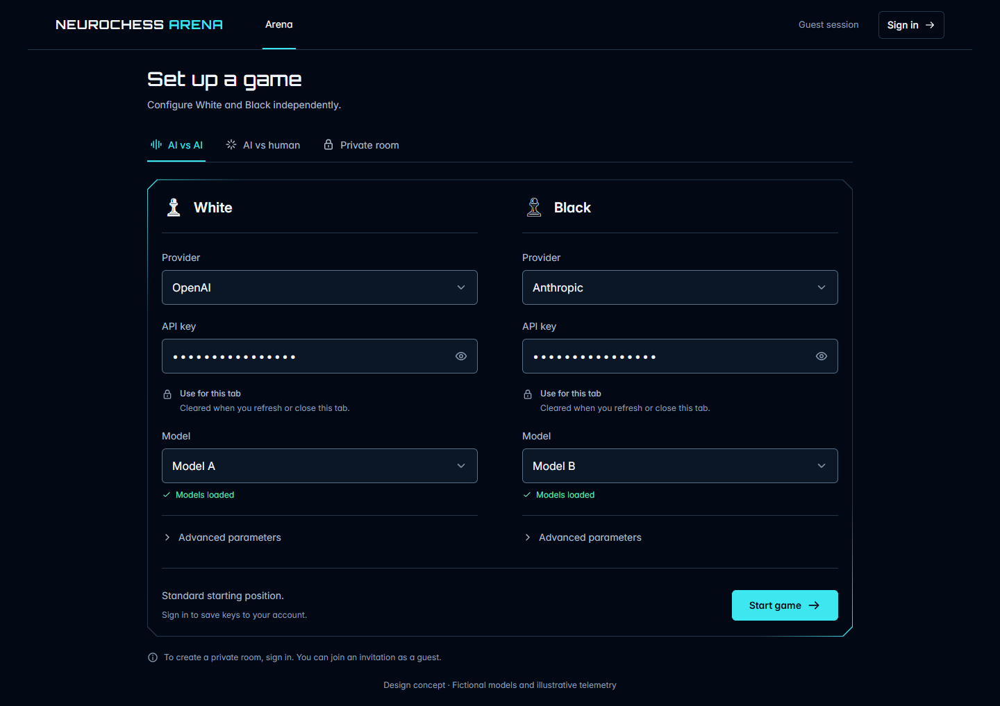
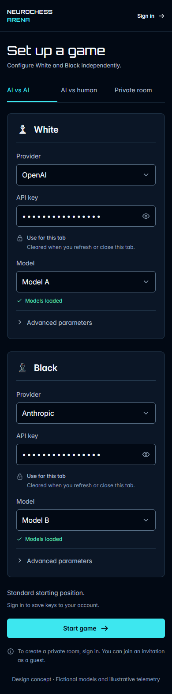
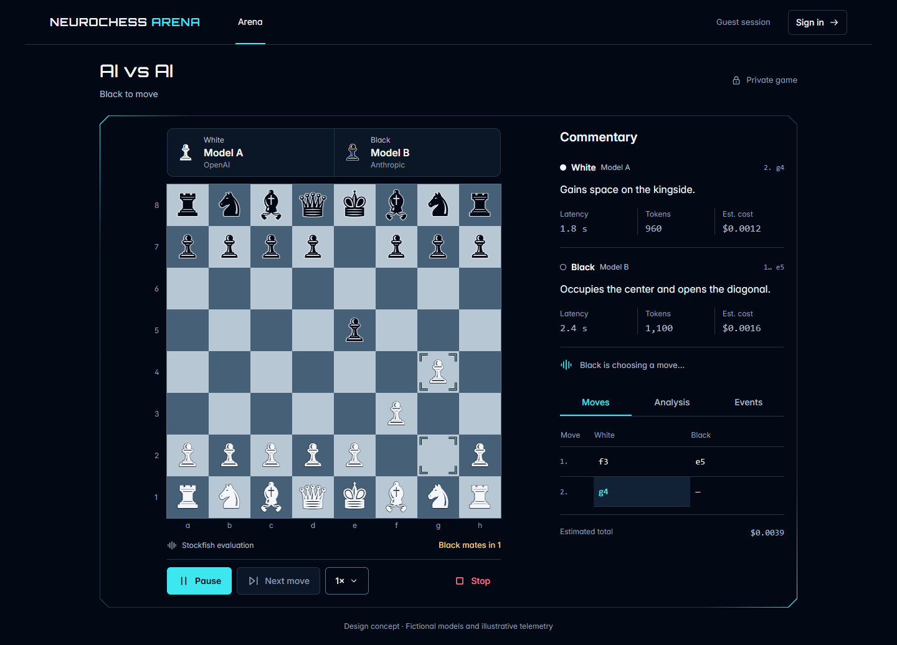
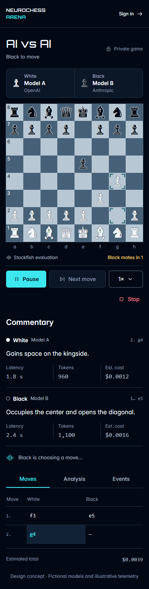
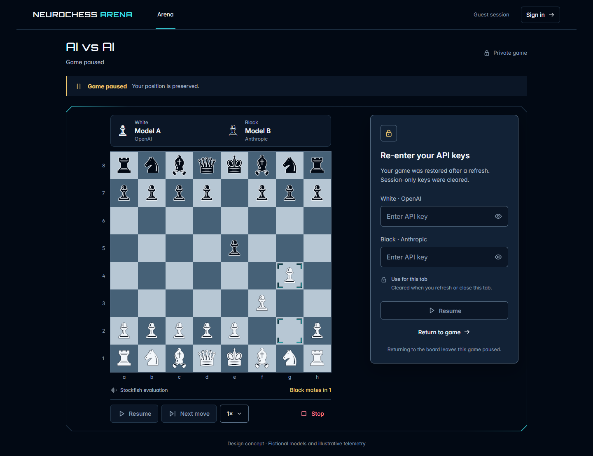
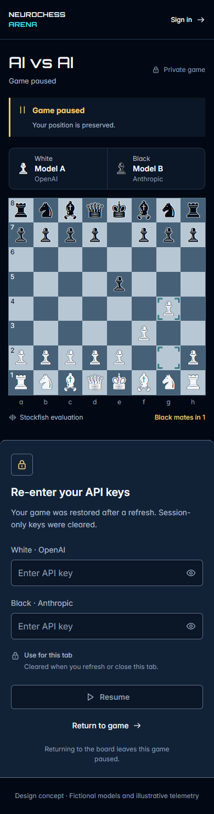
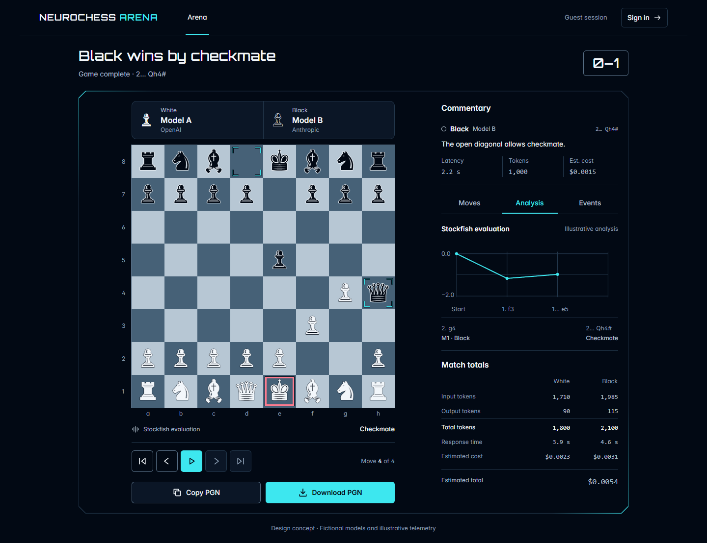
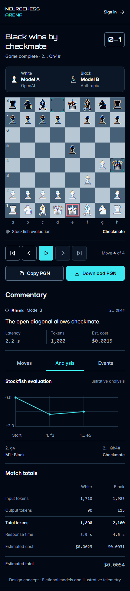

# Core journey concepts

Eight coordinated references for the [Neurochess Arena design system](../../design-system.md). Desktop layouts establish the board/information-rail composition; mobile layouts preserve the same content and actions in a single column.

These are static design references. The [guide](../../design-system.md) defines exact implementation tokens and interactions. [Fixtures](../fixtures.md) define the legal positions, fictional models, exact labels, and illustrative telemetry. [Validation limits](../validation.md) track current coverage gaps and reference limitations.

| Journey  | Desktop                                            | Mobile                                           | Review focus                                                                   |
| -------- | -------------------------------------------------- | ------------------------------------------------ | ------------------------------------------------------------------------------ |
| Setup    | [01-setup-desktop.png](01-setup-desktop.png)       | [02-setup-mobile.png](02-setup-mobile.png)       | Independent seats, session-only credentials, model fields, start action        |
| Live     | [03-live-desktop.png](03-live-desktop.png)         | [04-live-mobile.png](04-live-mobile.png)         | Dominant board, equal player identities, commentary, compact metrics, controls |
| Recovery | [05-recovery-desktop.png](05-recovery-desktop.png) | [06-recovery-mobile.png](06-recovery-mobile.png) | Preserved position, paused state, both missing keys, gated resume              |
| Replay   | [07-replay-desktop.png](07-replay-desktop.png)     | [08-replay-mobile.png](08-replay-mobile.png)     | Checkmate reason, selected move, analysis, totals, PGN actions                 |

Mobile references target a 390px CSS viewport; their raster pixel dimensions are independent of CSS viewport dimensions. Content may continue below the first viewport. The implementation must also work at 320px and with enlarged text.

The [Sandbox adaptation v1](sandbox-v1/README.md) is a separate draft for visual review, with entry, live, recovery, and replay references for desktop and mobile. It derives from these core journeys without replacing them.

## Setup

## Live arena

## Paused recovery

## Result and replay

